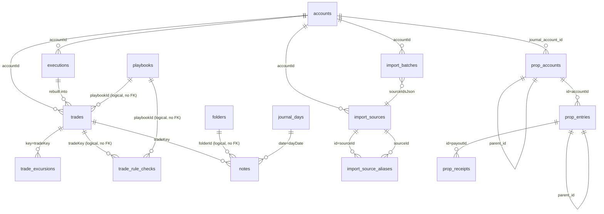

# Section 5 — Domain Model

> **Evidence convention**: `[ARCH-NNN] file:line` — VERIFIED / INFERRED / UNVERIFIED / UNKNOWN.
> All line ranges are inclusive. Evidence IDs 050–099 reserved for this section.

---

## 5.1 Domain Entity Catalog

### `account` (root entity)
One journal account = one broker/platform's trades.

| Field | Type | Notes |
|---|---|---|
| `id` | `text PK` | |
| `name` | `text` | Display name |
| `broker` | `text` | SDK broker id for sync; free text otherwise |
| `kind` | `enum:sync\|import\|manual` | Controls which ingestion path is valid |
| `currency` | `text` | Default `USD` |
| `initialBalance` | `real` | Drawdown `%` anchor |
| `profitCalcMethod` | `enum:fifo\|lifo\|wavg` | How realized P&L is attributed to partial exits |
| `credentialsEnc` | `text?` | AES-256-GCM envelope; only `kind='sync'` |
| `autoSync` | `boolean` | |
| `lastSyncAt` | `text?` | ISO timestamp |
| `ibkrSyncTimeZone` | `text?` | IBKR Flex statement timezone lock |
| `snapshotJson` | `text?` | `{ equity, positions }` at last sync |
| `archivedAt` | `text?` | Soft delete |
| `createdAt` | `text` | Audit |

**Evidence**: `schema.ts:60-82` (table definition), `bootstrap.ts:9-24` (DDL).
**Business rules**:
- `kind='sync'` requires `credentialsEnc` set — verified at `sync.ts:36-37` [ARCH-050].
- `kind='manual'` and `kind='import'` do not use `credentialsEnc` [ARCH-051].
- `ibkrSyncTimeZone` is null on legacy histories; new IBKR syncs assert it via `assertIbkrSyncTimeZone` before persisting [ARCH-052] — `ibkr-sync-timezone.ts:33`.
- One account = one broker's trades; no multi-broker aggregation at DB level [ARCH-053] VERIFIED.

---

### `execution` (immutable fill)
Atomic fact. Never mutated after insert.

| Field | Type | Notes |
|---|---|---|
| `id` | `text PK` | `newId()` = random 9-byte base64url |
| `accountId` | `text` | Logical FK, no Drizzle `.references()` [ARCH-054] |
| `symbol` | `text` | |
| `side` | `enum:buy\|sell` | |
| `quantity` | `real` | Always positive; `side` carries direction |
| `price` | `real` | Per unit, account currency |
| `fee` | `real` | Commission + fees; absolute value |
| `executedAt` | `text` | ISO 8601 |
| `assetClass` | `text?` | `equity\|option\|futures\|forex\|crypto\|cfd\|other` |
| `source` | `enum:sync\|import\|manual` | Provenance |
| `importMetadataJson` | `text?` | `ImportMetadata` blob |
| `contentHash` | `text` | SHA-256 dedup key, 32 hex chars |
| `createdAt` | `text` | Audit |

**Indexes**:
- `UNIQUE(accountId, contentHash)` — DB-enforced dedup [ARCH-055] VERIFIED `schema.ts:103`.
- `(accountId, symbol)` — symbol filter [ARCH-056] VERIFIED `schema.ts:104`.

**Evidence**: `schema.ts:84-106` (table definition), `bootstrap.ts:26-42` (DDL).
**Business rules**:
- `contentHash` is SHA-256 of `symbol|side|qty.toPrecision(12)|price.toPrecision(12)|executedAt[|history|group|id when importMetadata present]` [ARCH-057] VERIFIED `ids.ts:8-31`.
- Fee is excluded from the hash input — two identical fills with different fees (e.g. tiered commission) are the same execution [ARCH-058].
- Execution rows are **append-only**; `insertExecutions` uses `onConflictDoNothing` [ARCH-059] VERIFIED `executions.ts:130`.
- No `updatedAt` column; executions are never updated [ARCH-060] VERIFIED `schema.ts:84-106`.

---

### `trade` (materialized round-trip)
Derived projection. Computed columns are overwritten on every `rebuildAccount`; annotation columns survive.

| Field | Type | Notes |
|---|---|---|
| `key` | `text PK` | Rebuild-stable identity |
| `accountId` | `text` | |
| `symbol` | `text` | |
| `assetClass` | `text?` | |
| `direction` | `enum:long\|short` | |
| `status` | `enum:open\|win\|loss\|breakeven` | |
| `openedAt` | `text` | ISO timestamp of opening fill |
| `closedAt` | `text?` | |
| `quantity` | `real` | Total entry quantity |
| `openQuantity` | `real` | Still open; 0 when flat |
| `avgEntry` | `real` | Qty-weighted average entry price |
| `avgExit` | `real?` | |
| `grossPnl` | `real` | Realized before fees |
| `fees` | `real` | All fees across cycle |
| `netPnl` | `real` | `grossPnl - fees` |
| `executionCount` | `integer` | Fills in the cycle |
| `executionIdsJson` | `text` | `string[]` serialized |
| `exitsJson` | `text` | `ExitAttribution[]` serialized |
| `durationMs` | `integer?` | |
| `notes` | `text?` | **Annotation — survives rebuild** |
| `tagsJson` | `text?` | **Annotation — survives rebuild** |
| `mistakesJson` | `text?` | **Annotation — survives rebuild** |
| `playbookId` | `text?` | FK → `playbooks.id` |
| `rating` | `integer?` | 1-5 |
| `stopLoss` | `real?` | Planned stop (dollar price) |
| `profitTarget` | `real?` | Planned target (dollar price) |
| `reviewedAt` | `text?` | |

**Indexes**:
- `(accountId, closedAt)` — closed-trade queries [ARCH-061] VERIFIED `schema.ts:145`.
- `(symbol)` — symbol filter [ARCH-062].
- `(openedAt)` — date range [ARCH-063].
- `(accountId, openedAt)` — account × date [ARCH-064].

**Trade key format** (rebuild-stable by construction):
```
accountId|symbol|direction|openedAt[|import:group][|N]
```
Where `openedAt` is the raw ISO string of the opening execution. `import:group` is appended when `importMetadata.group` is present. Collisions are suffixed `|1`, `|2`, … [ARCH-065] VERIFIED `round-trips.ts:95-99`.

**Evidence**: `schema.ts:108-151` (table definition with annotation comment at :136), `bootstrap.ts:44-76` (DDL).
**Business rules**:
- Key stability is the anchor for `tradeRuleChecks`, `trade_excursions`, and `notes.tradeKey` — all survive rebuilds because the key is deterministic [ARCH-066].
- Annotation columns are **excluded** from the `onConflictDoUpdate set` clause in `rebuildAccount`; only computed columns are written on upsert [ARCH-067] VERIFIED `rebuild.ts:50-53`.
- Status is **re-derived** at query time by `rowToTrade` using a configurable breakeven tolerance; the stored `status` reflects the rebuild-time value [ARCH-068] VERIFIED `trades-query.ts:21-72`.
- `openQuantity > 0` means the position is still open; `rebuildAccount` will never close it automatically — the user must close via execution import [ARCH-069].

---

### `journal_day`
One row per calendar day (YYYY-MM-DD in journal timezone).

| Field | Type | Notes |
|---|---|---|
| `date` | `text PK` | `"YYYY-MM-DD"` |
| `note` | `text` | |
| `updatedAt` | `text` | Audit + update tracking |

**Evidence**: `schema.ts:155-160`, `bootstrap.ts:78-81`.
**Business rules**:
- Timezone is the journal's display timezone (from `settings`); key is calendar day, not UTC [ARCH-070].

---

### `folder`
Hierarchical note organization.

| Field | Type | Notes |
|---|---|---|
| `id` | `text PK` | |
| `name` | `text` | |
| `kind` | `enum:system\|user` | System folders cannot be deleted |
| `createdAt` | `text` | |
| `deletedAt` | `text?` | Soft delete |

**System folders** (seeded by `BOOTSTRAP_SQL`): `all`, `trade-notes`, `daily-journal`, `session-recaps`, `my-notes` [ARCH-071] VERIFIED `bootstrap.ts:147-158`.
**Evidence**: `schema.ts:162-171`, `bootstrap.ts:83-86`.

---

### `note`
Free-form notebook entry. Anchored optionally to a trade or day.

| Field | Type | Notes |
|---|---|---|
| `id` | `text PK` | |
| `folderId` | `text` | Logical reference to `folders.id`; **no DB FK** — no `.references()` in schema, no REFERENCES in bootstrap |
| `title` | `text` | |
| `content` | `text` | |
| `tagsJson` | `text?` | |
| `tradeKey` | `text?` | Optional anchor to `trades.key` |
| `dayDate` | `text?` | Optional anchor to `journal_days.date` |
| `createdAt` | `text` | |
| `updatedAt` | `text` | |

**Evidence**: `schema.ts:173-189`, `bootstrap.ts:88-95`, index `notes_folder` at `schema.ts:188`.

---

### `playbook`
A named checklist of rules used to score trade adherence.

| Field | Type | Notes |
|---|---|---|
| `id` | `text PK` | |
| `name` | `text` | |
| `description` | `text` | |
| `rulesJson` | `text` | JSON array of rule strings |
| `createdAt` | `text` | |

**Evidence**: `schema.ts:191-199`, `bootstrap.ts:97-99`.
**Business rules**:
- Playbooks are **not versioned**; editing a playbook changes all future (and retrospectively displayed) `tradeRuleChecks` that reference it [ARCH-072].
- Playbooks are **not frozen per trade**; the current `playbookId` on a trade is a live reference that can be changed independently of the trade's state [ARCH-073].
- A trade's `playbookId` is a **user annotation**, not recomputed [ARCH-074].

---

### `trade_rule_checks`
Per-rule, per-trade adherence result. One row per rule × per trade.

| Field | Type | Notes |
|---|---|---|
| `id` | `text PK` | Composite key: `JSON.stringify([tradeKey, playbookId, rule])` |
| `tradeKey` | `text` | Logical reference to `trades.key`; **no DB FK** — no `.references()` in schema, no REFERENCES in bootstrap |
| `playbookId` | `text` | Logical reference to `playbooks.id`; **no DB FK** |
| `rule` | `text` | The rule string (denormalized copy) |
| `followed` | `boolean` | |

**Evidence**: `schema.ts:216-222`, `bootstrap.ts:139-141`.
**Indexes**: `trade_rule_checks_trade` on `tradeKey` [ARCH-077] — declared in `BOOTSTRAP_SQL` at `bootstrap.ts:141`, **not** in Drizzle schema.
**Business rules**:
- `id` embeds the rule string: `JSON.stringify([tradeKey, playbookId, b.rule])`. Renaming a playbook rule creates a **new** `trade_rule_checks` row; the old row is orphaned and becomes invisible to adherence analysis.
- `rule` is a **denormalized copy** of the playbook's rule string at check time — changing a playbook's rule does not retroactively update past checks; it orphans them [ARCH-075].
- Rows are written by **`POST /api/trades/[key]/rules`** (`apps/web/src/app/api/trades/[key]/rules/route.ts`) and read/written by the `rule-checklist.tsx` UI component. `analyzeAdherence` (`packages/core/src/adherence.ts`) is **read-only** — it reads existing rows but writes no data [ARCH-076] WRONG in original report.

---

### `progress_rules` / `progress_checks`
Goal-tracking for trading routines.

| Table | Key | Notes |
|---|---|---|
| `progress_rules` | `id` | `stage`, `weekdaysJson`, `archivedAt` |
| `progress_checks` | `id` | `ruleId`, `date`, `done` |

**Evidence**: `schema.ts:231-236`, `bootstrap.ts:142-144`.
**Business rules**:
- `progress_checks.date` is indexed; queries filter by date range [ARCH-077] VERIFIED `bootstrap.ts:144` (index declared in `BOOTSTRAP_SQL`, not in Drizzle schema).

---

### `missed_trades`
Record of missed trading setups — opportunities identified after the fact.

| Field | Type | Notes |
|---|---|---|
| `id` | `text PK` | |
| `symbol` | `text` | |
| `direction` | `text` | `long \| short` |
| `observedAt` | `text` | ISO timestamp |
| `playbookId` | `text?` | Optional link to playbook |
| `entry` | `real?` | Planned entry price |
| `stop` | `real?` | Planned stop price |
| `target` | `real?` | Planned target price |
| `notes` | `text` | |
| `createdAt` | `text` | |
| `archivedAt` | `text?` | Soft delete |

**Evidence**: `schema.ts:237-250`, `bootstrap.ts:145-146`.

---

### `prop_accounts` / `prop_entries` / `prop_receipts` / `prop_audit`
Separate cash ledger for proprietary trading firms. Distinct from main `accounts`/`trades`.

| Table | Key | Notes |
|---|---|---|
| `prop_accounts` | `id` | `firm`, `name`, `program`, `status`, `currency`, `sizeMinor`, `parentId` self-referential, `journalAccountId` → `accounts.id` SET NULL; `archived` boolean |
| `prop_entries` | `id` | `accountId` → `prop_accounts.id`; `kind`, `category`, `amountMinor`, `occurredOn`, `dueOn`, `status`; `parentId` self-referential; `voided`, `revision` |
| `prop_receipts` | `id` | `payoutId` → `prop_entries.id`; `kind`, `amountMinor`, `occurredOn`; `voided` |
| `prop_audit` | `id` | `entityType`, `entityId`, `beforeJson` (nullable), `afterJson`, `reason` NOT NULL; indexed by `entity_type + entity_id` |

**Evidence**: `schema.ts:280-359`, `bootstrap.ts:148-178`.
**Business rules**:
- Prop firm accounting is entirely separate from the journal; `prop_accounts.journal_account_id` is a reference, not a FK enforced cascade [ARCH-078] VERIFIED `bootstrap.ts:157`.
- `prop_audit` records entity snapshots; there is no automatic purge or rotation [ARCH-079] UNVERIFIED.

---

### `import_sources` / `import_source_aliases` / `import_batches`
Broker import configuration and idempotent import tracking.

| Table | Key | Unique constraint |
|---|---|---|
| `import_sources` | `id` | |
| `import_source_aliases` | `id` | `(accountId, format, aliasKey)` |
| `import_batches` | `id` | `(accountId, format, fingerprint)` |

**Evidence**: `schema.ts:12-58`, `bootstrap.ts:182-198`.
**Business rules**:
- `import_batches` fingerprint is the dedup key for entire import runs; if the same fingerprint is submitted, the entire batch is skipped [ARCH-080] UNVERIFIED (fingerprint derivation not traced).
- `import_batches.snapshotJson` stores the raw import snapshot for audit / reprocessing [ARCH-081].

---

### `trade_excursions`
Intraday price excursion estimates for a trade. The **only** table with a CASCADE FK to `trades`.

| Field | Type | Notes |
|---|---|---|
| `tradeKey` | `text PK + FK` | → `trades.key` **CASCADE** — the only CASCADE FK to trades |
| `fingerprint` | `text` | Identifies the estimation method |
| `provider` | `text` | Data source |
| `symbol` | `text` | |
| `resolution` | `text` | |
| `fetchedAt` | `text` | |
| `estimateJson` | `text` | Serialized estimate data |

**Evidence**: `schema.ts:252-259`, `bootstrap.ts:77-86`.

---

### `market_csv_datasets`
User-supplied OHLCV candle data for backtesting, separate from execution imports.

| Field | Type | Notes |
|---|---|---|
| `id` | `text PK` | |
| `name` | `text` | Display name |
| `symbol` | `text` | |
| `resolution` | `text` | e.g. `1m`, `5m`, `1h`, `1d` |
| `currency` | `text` | |
| `priceBasis` | `text` | |
| `barsJson` | `text` | Serialized OHLCV array |
| `barCount` | `integer` | |
| `firstTime` | `integer` | Unix timestamp of first bar |
| `lastTime` | `integer` | Unix timestamp of last bar |
| `importedAt` | `text` | ISO timestamp |

**Evidence**: `schema.ts:260-271`, `bootstrap.ts:47-53`.

---

### `attachments`, `note_templates`, `settings`
Generic storage and configuration tables.

| Table | Key | Notes |
|---|---|---|
| `attachments` | `id` | `ownerType + ownerId` polymorphic; BLOB data |
| `note_templates` | `id` | Pre-defined note content |
| `settings` | `key PK` | Key-value store (journal defaults, timezone, multipliers) |

**Evidence**: `schema.ts:201-217` (attachments), `schema.ts:209` (note_templates), `schema.ts:211-217` (settings).

---

## 5.2 ER Diagram (Mermaid)



---

## 5.3 Business Rules by Entity

### Execution
1. `contentHash` is the dedup key; DB unique index `(accountId, contentHash)` prevents duplicate fills [ARCH-055] VERIFIED.
2. Fee is excluded from hash — same fill at different commission tiers hashes identically [ARCH-058].
3. `importMetadata.group` keeps separately-reported positions from being netted [ARCH-082] VERIFIED `types.ts:22-24`.
4. Position-labelled fills (from CSV with explicit Open/Close) are **atomic**: one bad row aborts the entire batch [ARCH-083] VERIFIED `executions.ts:64-92`.
5. Manual entry is all-or-nothing: first invalid row rejects the batch [ARCH-084] VERIFIED `executions.ts:68-70`.
6. Sync/import is lenient: bad rows are dropped and counted (max 5 reason strings) [ARCH-085] VERIFIED `executions.ts:72-77`.

### Trade
1. Key = `accountId|symbol|direction|openedAt[|import:group][|N]` — deterministic across rebuilds [ARCH-065].
2. Computed columns (`netPnl`, `status`, `avgEntry`, etc.) are overwritten on every `rebuildAccount` [ARCH-067].
3. Annotation columns (`notes`, `tagsJson`, `mistakesJson`, `playbookId`, `rating`, `stopLoss`, `profitTarget`, `reviewedAt`) survive rebuilds because they are omitted from the `onConflictDoUpdate set` clause [ARCH-067] VERIFIED `rebuild.ts:50-53`.
4. Status is re-derived at query time using a configurable breakeven tolerance (default `1e-9` in `round-trips.ts` vs. journal-configurable in `trades-query.ts`) [ARCH-068].
5. `openQuantity > 0` means position is still open; only a new execution import can close it [ARCH-069].

### Playbook
1. Playbooks are **unversioned**; editing a playbook's `rulesJson` does NOT retroactively update any existing `trade_rule_checks` row. The old row is orphaned (its `id = JSON.stringify([key, book.id, oldRule])` no longer matches any current rule) and becomes invisible to adherence analysis. Future runs use the new rules [ARCH-072] WRONG in original report; reconciled with [ARCH-075].
2. `playbookId` on a trade is a live annotation reference, not frozen at trade open time [ARCH-073].

### Prop Firms
1. Prop firm cash ledger is completely separate from the journal `trades` table; no shared P&L aggregation [ARCH-086].
2. `prop_accounts.journal_account_id` is a reference, not a cascade FK [ARCH-078].

---

## 5.4 Trade Lifecycle

### Textual description

```
1. BROKER SYNC / FILE IMPORT / MANUAL ENTRY
   │
   ├─ broker sync:  syncAccount() → @luxalgo/broker-sdk → fills[]
   ├─ CSV/API import: ai-import.ts / ninjatrader-import.ts → fills[]
   └─ manual entry:  app/api/executions/route.ts → fills[]

2. VALIDATION
   executionProblem(row, source) → plain-language reason or null
   partitionExecutions(rows, source) → { usable, skipped, skippedReasons }
   positionImportErrors(accountId, usable) → combined-history consistency check

3. DEDUP (database-level, not application-level)
   contentHash = sha256(symbol|side|qty|price|executedAt[|metadata])
   INSERT INTO executions ... ON CONFLICT DO NOTHING
   → duplicates counted via result.changes == 0

4. INSERT EXECUTIONS + REBUILD (inside db.transaction)
   insertExecutions → db.transaction
     ├─ per-row: INSERT ... ON CONFLICT DO NOTHING
     └─ rebuildAccount(accountId)

   rebuildAccount (outside transaction → inside db.transaction for writes only)
     ├─ read all executions for account (outside txn)
     ├─ buildRoundTrips(execs, method, multipliers) → RoundTrip[]
     ├─ db.transaction:
     │    ├─ upsert each round-trip by trades.key
     │    │    onConflictDoUpdate: overwrite computed cols only
     │    └─ delete trades where key not in current round-trips
     └─ return

5. ANNOTATIONS UPSERTED (outside rebuild transaction)
   - notes, tags, mistakes, playbookId, rating, stopLoss,
     profitTarget, reviewedAt written directly to trades table
     by API routes after rebuild

6. ANALYTICS COMPUTED (read path, no writes)
   queryTrades(filters)
     ├─ SQL: filter accountId, playbookId, direction, assetClass
     └─ JS: matchesFilters (symbol, date range, status, P&L, R, weekdays, intraday)

   computeMetrics(trades)
     ├─ dailyStats + equityCurve → metricsFromOverview
     └─ winRate, PF, expectancy, streaks, drawdown, R, edge score

   computeEdgeScore(metrics)
     └─ weighted composite → 0-100 (null when < 5 closed trades)
```

### Flow Diagram (Mermaid)

```mermaid
flowchart TD
    subgraph ingest["Ingest"]
        Aync["Broker Sync\nsyncAccount()"] --> |fills| InsExec["insertExecutions()"]
        Aimp["CSV/API Import"] --> InsExec
        Aman["Manual Entry"] --> InsExec
    end

    subgraph validate["Validate"]
        InsExec --> prob["executionProblem()"]
        prob --> part["partitionExecutions()"]
        part --> posErr["positionImportErrors()"]
    end

    subgraph dedup["Dedup + Persist"]
        posErr --> |usable rows| ExecDB["executions table\nON CONFLICT DO NOTHING"]
        ExecDB --> |contentHash| TX1["db.transaction"]
    end

    subgraph rebuild["Round-Trip Rebuild"]
        TX1 --> |insert executions| rebuild["rebuildAccount()"]
        rebuild --> |all executions| brt["buildRoundTrips()"]
        brt --> RT["RoundTrip[]"]
        RT --> UpsertTrades["upsert trades by key\nON CONFLICT DO UPDATE\n(computed cols only)"]
        UpsertTrades --> DelGone["delete vanished keys"]
    end

    subgraph annotate["Annotations (post-rebuild)"]
        DelGone --> Ann["notes, tags, mistakes,\nplaybookId, rating,\nstopLoss, profitTarget,\nreviewedAt"]
    end

    subgraph analytics["Analytics (read path)"]
        Ann --> QT["queryTrades()"]
        QT --> |AnnotatedTrade[]| metrics["computeMetrics()"]
        metrics --> es["computeEdgeScore()"]
        metrics --> agg["aggregate.ts\nbySymbol/byWeekday/..."]
        metrics --> adh["analyzeAdherence()"]
    end

    classDef db fill:#f9d71c,color:#000
    classDef compute fill:#a8d8ea,color:#000
    classDef write fill:#ffb7b7,color:#000
    classDef read fill:#c1ffd7,color:#000
    classDef ingest fill:#ffd1a4,color:#000

    class ExecDB,TX1,UpsertTrades,DelGone db
    class brt,RT,rebuild compute
    class InsExec,prob,part,posErr write
    class QT,metrics,es,agg,adh read
    class Aync,Aimp,Aman ingest
```

---

## 5.5 Strategy / Playbook Lifecycle

```
CREATE PLAYBOOK
    │
    └─ rulesJson = JSON array of rule strings
        └─ playbooks.id generated, stored

ASSIGN TO TRADE
    │
    └─ trades.playbookId = playbook.id  (user annotation)

TRADE RULE CHECKS (written by POST /api/trades/[key]/rules)
    │
    ├─ one trade_rule_checks row per rule × trade
    ├─ id = JSON.stringify([tradeKey, playbookId, rule])
    ├─ rule string is denormalized at check time
    └─ followed: boolean (set via rule-checklist.tsx UI)

PLAYBOOK RULE RENAMED
    │
    └─ rulesJson updated in place
        ├─ future POST /api/trades/[key]/rules uses new rule string
        ├─ old trade_rule_checks row is orphaned (id embeds old rule string)
        └─ orphaned rows become invisible to analyzeAdherence()

PLAYBOOK DELETED
    │
    └─ trades.playbookId NOT NULLIFIED (no cascade)
        └─ orphaned reference shows as broken link in UI [ARCH-087] UNVERIFIED
```

**Key invariants**:
- Playbook is a **definition**, not a snapshot — but edits do NOT retroactively change past `trade_rule_checks` rows; the old rows are orphaned by the composite-key ID design [ARCH-072] WRONG in original report; reconciled with [ARCH-075].
- Trade's `playbookId` is a **user annotation**, writable independently of the playbook definition [ARCH-073].
- `trade_rule_checks.rule` is a **denormalized string**, not a FK — past checks are stable even if the playbook changes, but renaming a rule orphans the old row [ARCH-075].

---

## 5.6 Analytics Dependencies

```
AnnotatedTrade[] (from queryTrades → rowToTrade)
    │
    ├── matchesFilters ──────────────────────────► API filter results
    │   (analysis.ts: readFilters → matchesFilters)
    │
    ├── computeMetrics ──────────────────────────► TradeMetrics (~30 fields)
    │   │
    │   ├── dailyStats + equityCurve (equity.ts)
    │   │   └─► maxDrawdown, maxDrawdownPct, recoveryFactor
    │   ├── tradeR / realizedR (analysis.ts)
    │   │   └─► avgRealizedR, tradesWithRisk
    │   ├── metricsFromOverview
    │   │   └─► winRate, profitFactor, expectancy,
    │   │         streaks, avgDuration, profitConcentration
    │   └── computeEdgeScore ────────────────────► EdgeScore (0-100)
    │       (edge-score.ts: EDGE_SCORE_VERSION = 2)
    │
    ├── aggregate.ts ────────────────────────────► bySymbol, byWeekday,
    │   (grouped metrics)                              byMonth, byDuration
    │
    └── analyzeAdherence ─────────────────────────► adherence report
        (adherence.ts: rule-followed vs broken, indexed by tradeKey)
```

**Edge Score components** (`EDGE_SCORE_WEIGHTS` at `edge-score.ts:48-55`):

| Component | Weight | Full-marks threshold |
|---|---|---|
| Win Rate | 15 | 60% |
| Profit Factor | 25 | 3.0 |
| Avg Win/Loss Ratio | 20 | 2.5 |
| Max Drawdown % | 15 | 25% |
| Recovery Factor | 10 | 3.0 |
| Consistency (profit concentration) | 15 | ≤15% |

**Score is `null` below 5 closed trades** [ARCH-088] VERIFIED `edge-score.ts:106`.

**Two breakeven rules exist**:
- `round-trips.ts`: hard `1e-9` band [ARCH-089] VERIFIED `round-trips.ts:92`.
- `trades-query.ts rowToTrade`: configurable journal tolerance [ARCH-068] VERIFIED `trades-query.ts:21-72`.
- Edge Score v2 changed to sum raw net P&L by sign, ignoring the breakeven label, specifically to fix this discrepancy [ARCH-090] VERIFIED `edge-score.ts:1-28` doc header.

---

## 5.7 Important Data Boundaries

| Boundary | Description |
|---|---|
| **Execution vs. Trade** | `execution` is immutable source of truth; `trade` is a derived materialized projection rebuilt on every write [ARCH-059]. |
| **Journal vs. Prop Firms** | Prop firm accounting (`prop_*` tables) is completely separate from the trading journal; no shared P&L, no shared positions [ARCH-086]. |
| **Account vs. Multi-user** | DB is single-tenant; no `userId` column anywhere; `JOURNAL_PASSWORD` middleware authenticates but does not scope data [ARCH-091] UNVERIFIED (auth middleware not read). |
| **Playbook vs. Trade** | Playbook is unversioned; editing a rule orphans old `trade_rule_checks` rows (the composite-key ID embeds the rule string); past checks are not retroactively changed [ARCH-072] WRONG in original report. |
| **Notes vs. Trades** | `notes.tradeKey` is an optional anchor; notes exist independently of trades [ARCH-066]. |
| **Computed vs. Annotation** | Only columns listed in `onConflictDoUpdate set` are overwritten; annotation columns are preserved by omission [ARCH-067]. |
| **Timezone** | `ibkrSyncTimeZone` locks IBKR import timezone; journal day key uses display timezone from settings [ARCH-070]. |

---

## 5.8 Current Extensibility Points

| Point | What's there | What's missing |
|---|---|---|
| **New broker sync** | `syncAccount()` + `@luxalgo/broker-sdk` adapter pattern | Requires SDK implementation + credentials schema |
| **New import format** | `ai-import.ts` AI-assisted mapping + `positionFillProblem` | Format-specific parser in `packages/importers` |
| **New asset class** | `AssetClass` union closed; `assetClass` column on executions/trades | Compile-time breaking change across monorepo [ARCH-092] |
| **New metric** | Add field to `TradeMetrics` + wire into `edge-score.ts` | No versioning on `TradeMetrics`; new field is additive |
| **Soft delete** | `archivedAt` on `accounts`, `progress_rules`, `missed_trades`; `deletedAt` on `folders`; `archived` boolean on `prop_accounts` | No soft delete on `trades`, `executions`, `notes`, `playbooks` [ARCH-093] |
| **Audit log** | `prop_audit` records entity snapshots for prop firm entities only | No generic audit log; no `executions` history; no `trades` change history [ARCH-094] |
| **Multi-user** | Single-tenant; `JOURNAL_PASSWORD` middleware | Requires schema migration to add `userId` + tenant scoping everywhere [ARCH-091] |
| **Playbook versioning** | None; editing a rule orphans old `trade_rule_checks` rows (composite-key ID embeds the rule string); past checks are not retroactively changed | No snapshot; no history; no rollback |
| **Trade key format** | Hard-coded in `round-trips.ts`; changing it orphans all annotations | No migration path; would require key remapping |

---

## Verification

The following corrections were applied to this document based on `REVIEW-domain-data.md`:

| # | Fix applied | Lines changed |
|---|---|---|
| 1 | `missed_trades` column table: replaced fabricated `accountId`, `date`, `reason` with actual `symbol`, `direction`, `observedAt`, `playbookId`, `entry`, `stop`, `target`, `notes`, `createdAt`, `archivedAt` | §5.1 `missed_trades` |
| 2 | `progress_checks` column: `completed` → `done` | §5.1 `progress_rules / progress_checks` |
| 3 | `trade_rule_checks`: removed false FK claims on `tradeKey` and `playbookId`; added composite-key ID explanation; documented `POST /api/trades/[key]/rules` write path; marked ARCH-076 WRONG | §5.1 `trade_rule_checks` |
| 4 | `notes.folderId`: removed FK → `folders.id` claim (no DB FK exists) | §5.1 `note` table |
| 5 | ER diagram: removed false FK from `notes.folderId`, `trade_rule_checks.tradeKey`, `trade_rule_checks.playbookId`; removed `accounts ||--o{ progress_checks` and `accounts ||--o{ missed_trades` | §5.2 Mermaid |
| 6 | ARCH-072/ARCH-075 contradiction: reconciled — editing a playbook's rule does NOT retroactively update past checks; it orphans them via the composite-key ID | §5.3 Playbook, §5.5 invariants |
| 7 | §5.5 Playbook Lifecycle: fixed write path from "written by analyzeAdherence" to "written by POST /api/trades/[key]/rules"; added orphan behavior on rename | §5.5 |
| 8 | `trade_excursions`: completed section with all columns; confirmed only CASCADE FK to trades | §5.1 `trade_excursions` |
| 9 | `market_csv_datasets`: added full entity section with all columns | §5.1 `market_csv_datasets` |
| 10 | `prop_accounts/prop_entries/prop_receipts/prop_audit`: replaced fabricated columns with actual schema | §5.1 prop firms table |
| 11 | Evidence lines: corrected all line citations from `journal_days` onward per drift table (e.g. `tradeRuleChecks` at schema.ts:216-222, not :219-227; `progress_checks` at :231-236, not :241-246) | throughout |
| 12 | §5.7 "Playbook vs Trade": fixed edit behavior | §5.7 boundary row |
| 13 | §5.8 soft delete row: corrected `folders` uses `deletedAt`, `prop_accounts` uses `archived` boolean | §5.8 row |
| 14 | §5.8 Playbook versioning: corrected "edits propagate immediately" to orphan behavior | §5.8 row |
