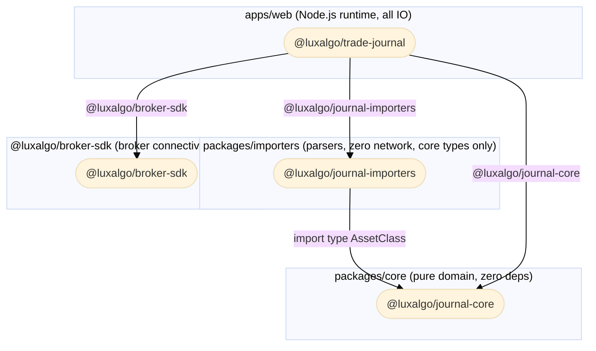
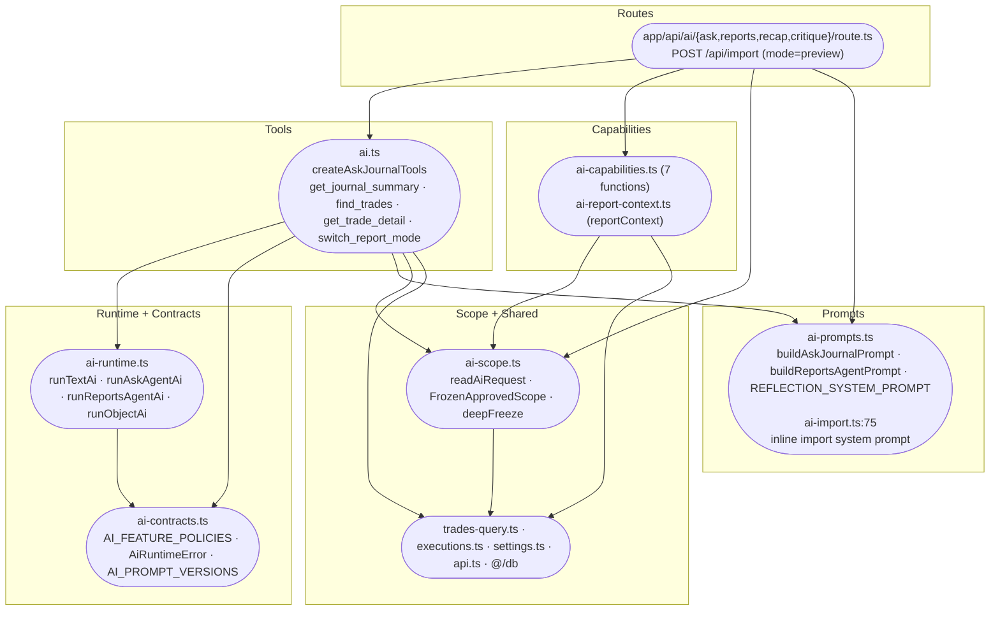
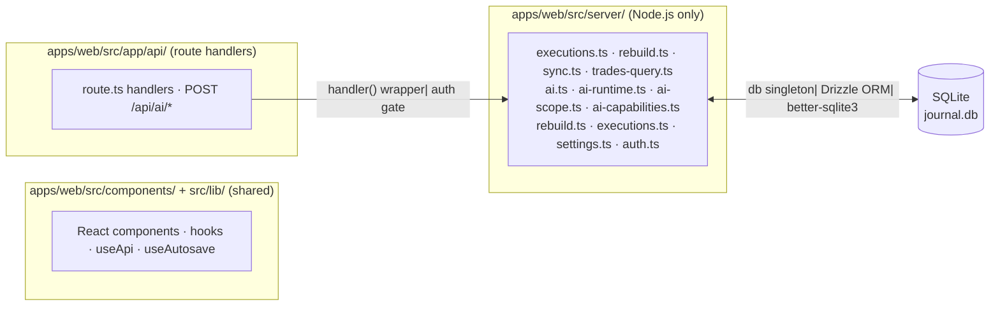
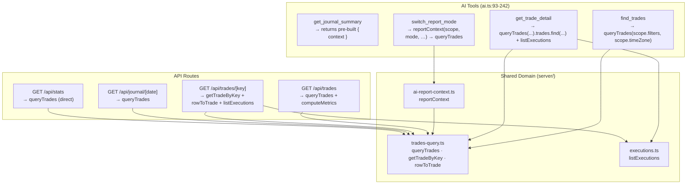
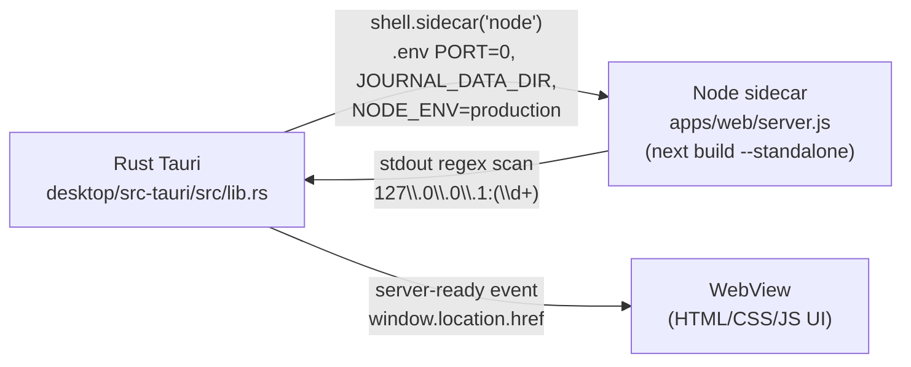

# 09 — Dependencies and Coupling

> **Evidence convention**: `[ARCH-NNN] file:line` — VERIFIED / INFERRED / UNVERIFIED / UNKNOWN.
> Evidence IDs 600–699 reserved for this section.
>
> **Citation baseline**: the working tree is mid-merge; `apps/web/src/server/ai.ts`,
> `apps/web/src/server/ai-import.ts`, `apps/web/src/db/index.ts`,
> `apps/web/src/app/api/import/route.ts`, `apps/web/package.json` and
> `apps/web/tests/ai-import.test.ts` contain unresolved conflict markers, which
> shift every line number after the first marker. Citations for those files
> therefore refer to the committed **HEAD** revision (`git show HEAD:<path>`),
> i.e. the `ours` side of the merge. All other citations are against the
> working tree as-is.

---

## 9.1 Monorepo Boundary Rules

The `.omp/AGENTS.md` defines three hard architectural boundaries enforced by grep-based pre-commit hooks:

```
packages/core  ─────► (zero deps; everyone imports from it)
packages/importers ──► packages/core (only)
apps/web ────────────► packages/core, packages/importers, @luxalgo/broker-sdk
```

Crossing these boundaries is a review-block.

### Boundary 1 — `packages/core` has no imports from `apps/web` or `packages/importers`

**VERIFIED** — zero matches:

```bash
grep -rn "from ['\"]apps/web\|from ['\"]@luxalgo/journal-importers" packages/core/src --include="*.ts"
# → exit 1, no output
```

`packages/core/package.json` declares **no `dependencies`** field at all — it is a pure domain package. All its exports are consumed downstream.

One cosmetic exception: `packages/core/src/types.ts:5` contains the phrase `sync (@luxalgo/broker-sdk)` in a JSDoc comment describing execution sources. This is text only; no code dependency is introduced. The pre-commit hook performs a textual grep, not a dependency-graph analysis. The comment may be reworded to avoid future false positives if the check is ever upgraded to a structural tool.

**ARCH-600**

### Boundary 2 — `packages/importers` has no imports from `apps/web` and no HTTP calls

**VERIFIED** — zero matches:

```bash
grep -rn "from ['\"]apps/web\|fetch(\|axios\|http\." packages/importers/src --include="*.ts"
# → exit 1, no output
```

`packages/importers/package.json` has exactly one dependency: `@luxalgo/journal-core: workspace:*`. All imports from core are type-only (`import type { AssetClass } …`). No raw networking is present.

**ARCH-601**

### Boundary 3 — `apps/web` is the only importer of `@luxalgo/broker-sdk`

**VERIFIED** — one runtime import, plus two comment mentions, all inside `apps/web/src/`:

```
apps/web/src/server/sync.ts:1             ← import { connect, listBrokers, type BrokerId } — the ONLY runtime import
apps/web/src/app/api/brokers/route.ts:4   ← comment only; the route imports listBrokers from @/server/sync (:1)
apps/web/src/server/sync.ts:17            ← comment only (ADR-0002 policy note)
```

Zero matches in `packages/importers/src`. The only occurrence in `packages/core/src` is the JSDoc phrase at `packages/core/src/types.ts:5` (text only, no import). The broker SDK is exclusively a Node.js runtime concern for broker connectivity; importers consume core types only.

**ARCH-602**

---

## 9.2 Dependency Diagram



**Key invariant**: all arrows point in one direction — toward `apps/web`. Nothing below depends on anything above.

**ARCH-603**

---

## 9.3 AI Architecture Layering

The AI subsystem is a **DAG of six modules**, not a linear stack. The diagram below shows the _actual import edges_ (verified from every `import` statement in `apps/web/src/server/`), so arrows point from importer to imported.



| Module       | File(s)                                      | Responsibility                                                    | Direct imports (relative)                                                                                                                            |
| ------------ | -------------------------------------------- | ----------------------------------------------------------------- | ---------------------------------------------------------------------------------------------------------------------------------------------------- |
| Prompts      | `ai-prompts.ts`, `ai-import.ts`              | Prompt text construction; versioned builders                      | `ai-prompts.ts` → none                                                                                                                               |
| Scope        | `ai-scope.ts`                                | Request validation, whitelist, freeze                             | `api.ts`, `settings.ts`                                                                                                                              |
| Capabilities | `ai-capabilities.ts`, `ai-report-context.ts` | Data aggregation: context strings from DB                         | `trades-query.ts`, `executions.ts`, `ai-scope.ts`                                                                                                    |
| Runtime      | `ai-runtime.ts`                              | `generateText` calls, error mapping, tool budget, stop conditions | `ai-contracts.ts` **only**                                                                                                                           |
| Contracts    | `ai-contracts.ts`                            | `AI_FEATURE_POLICIES`, `AiRuntimeError`, prompt versions          | none                                                                                                                                                 |
| Tools        | `ai.ts`                                      | Vercel AI SDK `tool()` factories, input validation                | `ai-runtime.ts`, `ai-contracts.ts`, `ai-prompts.ts`, `ai-scope.ts` (type), `ai-report-context.ts`, `trades-query.ts`, `executions.ts`, `settings.ts` |

**Direction facts** (these were previously mis-stated):

- `ai-capabilities.ts` imports `ai-scope.ts` (`:16`) — **not** the reverse. `ai-scope.ts` imports only `api.ts` (`:9`), `settings.ts` (`:10`), `@/lib/filter-description` (`:8`), `@/db` (`:7`) and `@luxalgo/journal-core` (`:6`).
- `ai-runtime.ts` imports **only** `ai-contracts.ts` (`:8-10`) plus the type `AiProvider` from `@/lib/ai-settings` (`:11`). It does **not** import `ai-capabilities.ts`.
- `AI_FEATURE_POLICIES` and `AiRuntimeError` live in `ai-contracts.ts`, not `ai-runtime.ts`.
- The export is `runReportsAgentAi` (`ai-runtime.ts:225`); `ai.ts:13` imports it under the local alias `runReportsAgentAiRuntime`.

**Provider fallback** (`settings.ts:108-113`): `getAiProvider()` returns the persisted `aiProvider` setting when it is valid; otherwise it falls back to `"openai"` **only** when an Anthropic key is absent _and_ an OpenAI key is present, and to `"anthropic"` in every other case. All four model-creation sites in `ai-runtime.ts` (`:135-136`, `:186-187`, `:249-250`, `:289-290`) branch on that single value, so provider selection is a global coupling point: changing the fallback changes behaviour for every AI feature at once.

**ARCH-604**

### AI Tool Budget and Stop Conditions

`ai-runtime.ts` enforces stop conditions for the agent features (`askJournalAgent`, `reportsAgent`). There is **one** stop-condition branch per agent, guarded by three conditions:

| Condition                                    | Trigger                                                             | Effect                                                                                                                               |
| -------------------------------------------- | ------------------------------------------------------------------- | ------------------------------------------------------------------------------------------------------------------------------------ |
| Tool budget exhausted                        | `toolCallCount >= maxToolCalls` (4) inside `reserveToolCall`        | The tool wrapper returns `{ error: "AI tool limit reached." }` (`ai.ts:35`) — the agent sees an error string and may respond         |
| Step limit reached while still calling tools | `stepCount >= maxSteps` (4) **and** `finishReason === "tool-calls"` | `AiRuntimeError("provider", "AI request could not complete within the journal context limit. Please try a more specific question.")` |
| Empty text output                            | `!result.text.trim()`                                               | Same `AiRuntimeError` as above                                                                                                       |

The strings `"Tool use limit reached"` and `"Empty response"` **do not exist** in `ai-runtime.ts`; the reviewer's reading was correct and the earlier draft of this report was wrong.

**Evidence**: `ai-runtime.ts:176-183` (budget), `:190-200` (`generateText`), `:201-211` (stop branch, ask); `:258-263`, `:264-274` (same for reports). Tool-limit error constant: `ai.ts:35`.

### Registered vs. Available Capabilities

There are **8 capability functions across two files** — 7 in `ai-capabilities.ts` and `reportContext` in `ai-report-context.ts`. Four are **not registered** as AI tools:

| Capability              | Location                   | Status                                   | Why not registered                                          |
| ----------------------- | -------------------------- | ---------------------------------------- | ----------------------------------------------------------- |
| `askJournalContext`     | `ai-capabilities.ts:40`    | **IN USE** — feeds the ask/reports route | Pre-built context string, not a tool                        |
| `dailyRecapContext`     | `ai-capabilities.ts:67`    | **IN USE** — feeds recap route           | Same                                                        |
| `tradeCritiqueContext`  | `ai-capabilities.ts:119`   | **IN USE** — feeds critique route        | Same                                                        |
| `playbookRulesForTrade` | `ai-capabilities.ts:179`   | **NOT REGISTERED**                       | `createAskJournalTools` does not wire it                    |
| `missedObservations`    | `ai-capabilities.ts:211`   | **NOT REGISTERED**                       | `createAskJournalTools` does not wire it                    |
| `notebookEntries`       | `ai-capabilities.ts:247`   | **NOT REGISTERED**                       | `createAskJournalTools` does not wire it                    |
| `progressHistory`       | `ai-capabilities.ts:277`   | **NOT REGISTERED**                       | `createAskJournalTools` does not wire it                    |
| `reportContext`         | `ai-report-context.ts:141` | **INDIRECT**                             | Called only via the `switch_report_mode` tool (`ai.ts:233`) |

All four unregistered capabilities check `FrozenApprovedScope.dataSource` and return a scope error — `playbookRulesForTrade` (`ai-capabilities.ts:183-184`), `missedObservations` (`:216-217`), `notebookEntries` (`:252-253`), `progressHistory` (`:281-282`). `ai-scope.ts:24-25` defines the five allowed values (`trades`, `trades+playbooks`, `trades+missed`, `trades+notes`, `trades+progress`); the default is `trades` (`:69`). Adding them as tools requires only adding a tool definition to `createAskJournalTools` in `ai.ts` — no extra scope enforcement.

**ARCH-605**

---

## 9.4 State Boundaries

### Server vs. Client



**Key boundaries**:

| Concern               | Location                                                                                 | Mechanism                                                                                                                                                                                                                                                                                                                                                                  |
| --------------------- | ---------------------------------------------------------------------------------------- | -------------------------------------------------------------------------------------------------------------------------------------------------------------------------------------------------------------------------------------------------------------------------------------------------------------------------------------------------------------------------- |
| Session cookie        | `app/api/auth/route.ts:12-18`                                                            | `httpOnly` cookie, `next/headers` via Edge middleware                                                                                                                                                                                                                                                                                                                      |
| Auth validation       | `server/api.ts:27-30`                                                                    | HMAC-SHA256 compare in Node (Edge only checks presence)                                                                                                                                                                                                                                                                                                                    |
| DB singleton          | `apps/web/src/db/index.ts:81-137`                                                        | Module IIFE, opens on first import, WAL mode, `foreign_keys=ON`                                                                                                                                                                                                                                                                                                            |
| AI key access         | `apps/web/src/server/settings.ts:67` (`getAiKey`), `:154-165` (`resolveAiConfiguration`) | Node only — never reaches client bundle                                                                                                                                                                                                                                                                                                                                    |
| Broker credentials    | `apps/web/src/server/crypto.ts:24-34`                                                    | AES-256-GCM at rest, Node only                                                                                                                                                                                                                                                                                                                                             |
| Request deduplication | `apps/web/src/lib/api-request.ts:10-43`                                                  | `Map<string, PendingRequest>`, process-local                                                                                                                                                                                                                                                                                                                               |
| No `next/cache`       | —                                                                                        | The `next/cache` API is not imported anywhere. `cache: "no-store"` is set on the shared client fetcher (`lib/api-request.ts:15`) and on the market-data transport (`server/market-data/transport.ts:109`); `lib/use-api.ts:74` and `lib/use-autosave.ts:20` call `fetch` without the option. Server responses set `Cache-Control: private, no-store` (`server/api.ts:12`). |

**ARCH-606**

### Auth Split: Edge Presence Check vs. Node Validity Check

The Edge middleware (`middleware.ts:9-20`) only checks cookie **presence**; `server/api.ts:27-30` performs the actual HMAC validation. This split is documented in `middleware.ts:3-7` as a deliberate choice (Edge runtime lacks `node:crypto`). Next.js 15.5 supports Node middleware, so the constraint is architectural preference, not platform limitation.

**ARCH-305** (from §7)

---

## 9.5 Domain ↔ AI Coupling

AI tools and HTTP API routes share the **same underlying domain functions**. There is no AI-specific query layer — but the AI tools do **not** call exactly the same functions as the routes, and there are three real divergences.



| Tool                  | Domain function called                                                                                       | Equivalent route                           | Divergence                                                                                                                                                                                                                                                                                                                                                                                                                                     |
| --------------------- | ------------------------------------------------------------------------------------------------------------ | ------------------------------------------ | ---------------------------------------------------------------------------------------------------------------------------------------------------------------------------------------------------------------------------------------------------------------------------------------------------------------------------------------------------------------------------------------------------------------------------------------------- |
| `get_journal_summary` | **none** — returns the `{ context }` string built by the route                                               | `POST /api/ai/ask`, `POST /api/ai/reports` | The tool is a pass-through. `askJournalContext` is called by the **route** (`api/ai/ask/route.ts:12`, `api/ai/reports/route.ts:12`), not by the tool (`ai.ts:117` returns `{ context }`).                                                                                                                                                                                                                                                      |
| `find_trades`         | `queryTrades(scope.filters, scope.timeZone)` (`ai.ts:144`)                                                   | `GET /api/trades`                          | Same query function; the tool applies the frozen scope filters, the route applies request filters.                                                                                                                                                                                                                                                                                                                                             |
| `get_trade_detail`    | `queryTrades(scope.filters, scope.timeZone).trades.find(...)` (`ai.ts:180`) + `listExecutions` (`ai.ts:184`) | `GET /api/trades/[key]`                    | **Different access path.** The route uses `getTradeByKey(key)` (`api/trades/[key]/route.ts:14`) — a direct primary-key lookup. The tool re-queries the whole scoped set and filters in memory. The tool can therefore only see trades inside the frozen scope, while the route can read any trade by key. **INFERRED** behavioural difference: for a key outside the tool's scope the tool returns an error while the route returns the trade. |
| `switch_report_mode`  | `reportContext(scope, mode, …)` (`ai.ts:233`) → `queryTrades` (`ai-report-context.ts:166`)                   | `GET /api/stats`                           | The route calls `queryTrades` **directly** (`api/stats/route.ts:31`) and does **not** use `reportContext`, so the two paths are not the same code.                                                                                                                                                                                                                                                                                             |

Evidence: `ai.ts:102-242`; `trades-query.ts:78,112`; `executions.ts:231`; `ai-report-context.ts:141,166`; `api/ai/ask/route.ts:12`; `api/ai/reports/route.ts:12`; `api/trades/[key]/route.ts:14`; `api/stats/route.ts:31`.

**Summary**: AI tooling is a consumer of the same query infrastructure, with three divergences — the summary tool is a pass-through, the detail tool uses a different (scope-filtered, in-memory) access path than the route's key lookup, and the report-mode tool goes through `reportContext` while `/api/stats` does not. The remaining difference is projection shape — AI tools return a trimmed `summarizeTrade(trade)` or a text context string, while the API returns full row objects.

**ARCH-607**

---

## 9.6 Trade-Key Coupling

The trade key format is the **architectural identity contract** between `packages/core` (which computes it) and `apps/web` (which references it everywhere).

### Format Definition

```typescript
// packages/core/src/round-trips.ts:98-101
const baseKey = `${accountId}|${symbol}|${direction}|${openedAt}`;
const collision = keyCollisions.get(baseKey) ?? 0;
keyCollisions.set(baseKey, collision + 1);
const key = collision === 0 ? baseKey : `${baseKey}|${collision}`;
// With import group: `${baseKey}|import:${encodeURIComponent(group)}`
```

Full format: `accountId|symbol|direction|openedAt[|import:group][|N]`

### All Callers of the Trade Key Format

| File                                                        | Role                                                                                  | Citation               |
| ----------------------------------------------------------- | ------------------------------------------------------------------------------------- | ---------------------- |
| `packages/core/src/round-trips.ts:98-101`                   | **Source of truth** — builds the key                                                  | ARCH-065               |
| `apps/web/src/lib/trade-links.ts:12-13`                     | URL segment ↔ key decode                                                              | `trade-links.ts:12-13` |
| `apps/web/src/app/api/trades/[key]/rules/route.ts:40,44`    | Builds `trade_rule_checks.id` (`:40`) and writes `trade_rule_checks.tradeKey` (`:44`) | `:40,44`               |
| `apps/web/src/server/market-data/estimates.ts:80,90,98-100` | Reads/writes `trade_excursions.tradeKey`                                              | `:80,90,98-100`        |
| `apps/web/src/db/schema.ts:179`                             | `notes.tradeKey` — no DB FK, logical reference                                        | `:179`                 |
| `apps/web/src/components/rule-checklist.tsx:9,15`           | Builds `/api/trades/${tradeKey}/rules` URL                                            | `:9,15`                |
| `apps/web/src/components/trade-navigation.tsx:25,31-32,52`  | Navigation URL construction                                                           | `:25,31-32,52`         |

**Changing the format silently breaks every caller above.** The `protect-trade-key.ts` pre-commit hook blocks commits that touch `round-trips.ts` trade-key logic without a corresponding ADR at `docs/decisions/NNNN-*.md`. No migration tool exists — the key is used as a primary key in multiple tables; format changes require a data migration.

**ARCH-608**

---

## 9.7 DB Schema Coupling

### Annotation Columns Excluded from Rebuild

`trades` rows have two column classes: **computed** (replaced on every `rebuildAccount`) and **annotation** (user content that survives rebuilds).

```typescript
// apps/web/src/server/rebuild.ts:46-77
db.transaction((tx) => {
  for (const trip of trips) {
    const computed = {
      accountId: trip.accountId, symbol: trip.symbol,
      assetClass: trip.assetClass ?? null,
      direction: trip.direction, status: trip.status,
      openedAt: trip.openedAt, closedAt: trip.closedAt ?? null,
      quantity: trip.quantity, openQuantity: trip.openQuantity,
      avgEntry: trip.avgEntry, avgExit: trip.avgExit ?? null,
      grossPnl: trip.grossPnl, fees: trip.fees, netPnl: trip.netPnl,
      executionCount: trip.executionCount,
      executionIdsJson: JSON.stringify(trip.executionIds),
      exitsJson: JSON.stringify(trip.exits),
      durationMs: trip.durationMs ?? null,
    };
    tx.insert(trades)
      .values({ key: trip.key, ...computed, ...defaultRisk(...) })
      .onConflictDoUpdate({ target: trades.key, set: computed })  // ← annotations absent
      .run();
  }
});
```

The `computed` object is built at `rebuild.ts:49-68`; the insert/upsert is `rebuild.ts:69-76` and the `onConflictDoUpdate` call is `rebuild.ts:75`.

Annotation columns (`notes`, `tagsJson`, `mistakesJson`, `playbookId`, `rating`, `stopLoss`, `profitTarget`, `reviewedAt`) do **not** appear in the `set:` clause. SQLite's `onConflictDoUpdate` preserves existing values for columns omitted from `set`.

**Evidence**: `schema.ts:108-112` (schema comment explaining computed vs. annotation columns); `rebuild.ts:49-68` (computed fields), `:69-76` (upsert), `:75` (`onConflictDoUpdate`); `schema.ts:113-144` (`trades` column definitions)

**ARCH-609**

### Orphan Rows from Playbook Rule Renames

`trade_rule_checks.id` is a composite key embedding the **rule string** as a denormalized copy:

```typescript
// apps/web/src/app/api/trades/[key]/rules/route.ts:40-46
const id = JSON.stringify([key, book.id, b.rule]);
if (b.followed === null) db.delete(tradeRuleChecks).where(eq(tradeRuleChecks.id, id)).run();
else
  db.insert(tradeRuleChecks)
    .values({ id, tradeKey: key, playbookId: book.id, rule: b.rule, followed: b.followed })
    .onConflictDoUpdate({ target: tradeRuleChecks.id, set: { followed: b.followed } })
    .run();
```

Renaming a playbook rule creates a **new** `trade_rule_checks` row; the old row (with the old rule string in its `id`) becomes orphaned and invisible to `analyzeAdherence` queries. The old rows are never purged automatically.

**Evidence**: `schema.ts:216-222` (PK definition); `route.ts:40-46` (ID construction); `adherence.ts` (read-only consumer)

**ARCH-610**

### The Only CASCADE FK to `trades`

`trade_excursions.tradeKey` has `REFERENCES trades(key) ON DELETE CASCADE` — the **only** cascade enforcement in the schema. All other logical FKs (`notes.tradeKey`, `trade_rule_checks.tradeKey`, `trade_rule_checks.playbookId`) are logical references with no DB-level constraint.

**ARCH-611**

---

## 9.8 Circular Import Analysis

No circular import chains exist in `apps/web/src/server/` or across the workspace.

**Method**: a DFS over the 25 top-level `apps/web/src/server/*.ts` files, following only relative (`./`) import specifiers, with colour-marking to detect back-edges. Result: **zero cycles**.

**Edge map** (complete, relative imports only):

```
ai.ts                → ai-contracts.ts, ai-prompts.ts, ai-runtime.ts, ai-report-context.ts,
                       ai-scope.ts (type only), executions.ts, settings.ts, trades-query.ts
ai-capabilities.ts   → ai-scope.ts, executions.ts, trades-query.ts
ai-report-context.ts → ai-scope.ts (type only), trades-query.ts
ai-runtime.ts        → ai-contracts.ts
ai-scope.ts          → api.ts, settings.ts
ai-import.ts         → ai-contracts.ts, ai-runtime.ts, api.ts, crypto.ts, executions.ts, ids.ts, settings.ts
executions.ts        → api.ts, ids.ts, position-import.ts, rebuild.ts, settings.ts
rebuild.ts           → settings.ts
settings.ts          → crypto.ts
trades-query.ts      → settings.ts
sync.ts              → api.ts, crypto.ts, executions.ts, ibkr-sync-timezone.ts, ids.ts, settings.ts
api.ts               → auth.ts
```

**Longest path**: 5 modules / **4 import edges**. One maximal chain is

```
ai.ts → ai-report-context.ts → ai-scope.ts → settings.ts → crypto.ts
```

(`ai-report-context.ts:20` and `ai.ts:16` import `ai-scope` as **types only**, so the runtime chain is 3 edges.) Other maximal chains of the same length: `ai-capabilities.ts → executions.ts → rebuild.ts → settings.ts → crypto.ts`, and `ai.ts → ai-report-context.ts → ai-scope.ts → api.ts → auth.ts`.

**Correction**: the previously claimed longest path `ai-capabilities.ts → trades-query.ts → ai-scope.ts` is wrong — `ai-scope.ts` does **not** import `trades-query.ts`; the edge runs the other way (`trades-query.ts → settings.ts`, and `ai-capabilities.ts` imports both `ai-scope.ts` and `trades-query.ts` as separate 2-hop leaves).

`packages/core` has zero imports from `packages/importers`. `packages/importers` imports from `packages/core` only via `import type` (erased at runtime): `formats/ibkr.ts:4`, `formats/pepperstone.ts:12`, `position-fills.ts:1`, `types.ts:1`.

**ARCH-612**

---

## 9.9 Importer Test Surface and Conversion Utilities

### Import Format Regression Test

**Correction**: the test is **not** in `packages/importers/src/formats/` — that directory holds only parsers (`fills.ts`, `generic.ts`, `history.ts`, `ibkr.ts`, `metatrader.ts`, `ninjatrader.ts`, `pepperstone.ts`, `simple.ts`, `thinkorswim.ts`, `tradezella.ts`) and contains no test file. The regression test lives at **`apps/web/tests/import-formats-regression.test.ts`**.

It is an **integration test**, not an offline parser diagnostic:

- Creates a temp SQLite data dir (`mkdtempSync`) and points `JOURNAL_DATA_DIR` at it (`:6-13`).
- Imports the real DB module and the real `POST` handler from `../src/app/api/import/route` (`:12-14`).
- Drives **synthetic inline CSV** per broker format through the HTTP route — no fixture files.
- Asserts preview/detection (`preview.json()` matches `{ detected, totals: { executions: 2 } }`, `:117-118`), that preview inserts nothing (`:119`), that import inserts 2 rows with `inserted: 2, duplicates: 0` (`:121-122`), that a repeat import is deduplicated (`inserted: 0, duplicates: 2`, `:136-138`), that a legacy note survives re-import (`:166`), and that a re-import over rounded fractional timestamps is rejected with 400 (`:188-190`).

It gates production code (the import route) and needs a real database — it is not disposable.

**ARCH-613**

### Offline Importer Test Surface

`packages/importers/tests/` holds **6** offline test files plus a `fixtures/` directory (2 CSV fixtures: `ninjatrader-copy-trades.csv`, `pepperstone-ctrader.csv`):

| Test file                 | Covers                                                                   |
| ------------------------- | ------------------------------------------------------------------------ |
| `importers.test.ts`       | Format detection / round-trip building                                   |
| `history.test.ts`         | History adapters, `parseHistory`, `detectFormat` ↔ `parseAuto` agreement |
| `dates.test.ts`           | Timestamp parsing and statement-timezone application                     |
| `ninjatrader.test.ts`     | NinjaTrader copy-trade fill identity                                     |
| `pepperstone.test.ts`     | Pepperstone / cTrader statement parsing                                  |
| `skipped-reasons.test.ts` | Per-row skip reasons across `parseWithMapping` / `parseHistory`          |

These run under the workspace `vitest.config.ts` (`include: ["packages/*/tests/**/*.test.ts", "apps/*/tests/**/*.test.ts"]`).

### Conversion Utilities Are Self-Contained

All broker-to-core type conversions live in `packages/importers/src/` and have no side effects:

- `position-fills.ts` — `positionFillProblem` (`:20-42`) is a **validation predicate**, not a projection: it validates a single `ImportedExecution` and returns `null` on success or a `string` reason on failure (`:40-41`). `positionGroup` (`:16-18`) is deterministic — it hashes `[contract, positionId, direction]` via `JSON.stringify` (`:18`).
- `types.ts` — core type definitions for importers
- `formats/ibkr.ts`, `formats/pepperstone.ts` — format-specific parsers

Runtime consumers in `apps/web`: `positionFillProblem` is called by `server/executions.ts:52` and `server/position-import.ts:76`; `parseCsv` by `server/prop-csv.ts:3` and `lib/market-csv.ts:1`; `parseAuto` / `parseWithMapping` / `readHeaders` by `app/api/import/route.ts:3-5`; `parseTimestamp` by `server/ai-import.ts:4`.

These utilities have no persistent state and no runtime coupling beyond their return value.

**ARCH-614**

### `@luxalgo/journal-importers` consumers in `apps/web`

Every import of the importer package, split by runtime vs type-only:

| File                                                                                                                                                                                                                     | Kind          | Uses                                            |
| ------------------------------------------------------------------------------------------------------------------------------------------------------------------------------------------------------------------------ | ------------- | ----------------------------------------------- |
| `app/api/import/route.ts:3-5`                                                                                                                                                                                            | **runtime**   | `parseAuto`, `parseWithMapping`, `readHeaders`  |
| `app/import/page.tsx:34`                                                                                                                                                                                                 | **runtime**   | `readHeaders`                                   |
| `lib/market-csv.ts:1`                                                                                                                                                                                                    | **runtime**   | `parseCsv`, `headerKey`                         |
| `server/ai-import.ts:4`                                                                                                                                                                                                  | **runtime**   | `parseTimestamp`                                |
| `server/executions.ts:2`                                                                                                                                                                                                 | **runtime**   | `positionFillProblem`                           |
| `server/position-import.ts:2`                                                                                                                                                                                            | **runtime**   | `positionFillProblem`                           |
| `server/prop-csv.ts:3`                                                                                                                                                                                                   | **runtime**   | `parseCsv`                                      |
| `server/xtb-import.ts:2`                                                                                                                                                                                                 | **runtime**   | `xtbWorkbookToStatement`                        |
| `app/api/executions/route.ts:1`, `server/broker-trades.ts:2`, `server/ctrader-mcp/deals.ts:1`, `server/ctrader-mcp/sync.ts:2`, `server/demo.ts:2`, `server/ibkr-flex-xml-import.ts:3`, `server/ninjatrader-import.ts:10` | **type-only** | `ImportedExecution` / `ParsedImport` types only |

**Correction**: the review's suggested list of "5 importer callers of `detectFormat`/`parseStatement`" (`import/route.ts`, `ai-import.ts`, `ctrader-mcp/deals.ts`, `ctrader-mcp/sync.ts`, `ninjatrader-import.ts`) is not accurate — `detectFormat` and `parseStatement` are **not called anywhere in `apps/web`**. `detectFormat` is exported by `packages/importers/src/detect.ts:69` and consumed only inside the importer package (via `parseAuto`, `packages/importers/src/detect.ts`); the three `ctrader-mcp`/`ninjatrader` files listed above import **types only**.

**ARCH-619**

---

## 9.10 Tauri ↔ Node Binding

The desktop shell spawns the Next.js standalone server as a **sidecar process**:



**Spawn mechanism** (`desktop/src-tauri/src/server.rs:55-64`):

```rust
app.shell()
    .sidecar("node")
    .args([server_js_path])
    .env("PORT", "0")
    .env("JOURNAL_DATA_DIR", journal_data_dir)
    .env("NODE_ENV", "production")
    .spawn()
```

**Explicitly configured environment variables** — exactly three: `PORT` (`:60`), `JOURNAL_DATA_DIR` (`:61`), `NODE_ENV` (`:62`). `HOSTNAME` is **not** set by the spawn code. The child inherits the parent process environment, so `HOSTNAME` is whatever the host shell exports — on Windows it is normally unset, on Unix it is often set to the machine hostname. The sidecar binary is declared at `tauri.conf.json:44-46` (`bundle.externalBin: ["./binaries/node"]`), downloaded and SHA-256-verified by `setup-sidecar-node.ps1:20-24`, and dispatched by `desktop/scripts/run-sidecar-setup.js`.

### Defect: `PORT=0` does not request an ephemeral port (ARCH-618)

**VERIFIED.** The generated Next.js standalone server reads the port as:

```js
// generated standalone server — build output of `next build --standalone`,
// copied to desktop/src-tauri/target/debug/apps/web/server.js:13-14
const currentPort = parseInt(process.env.PORT, 10) || 3000;
const hostname = process.env.HOSTNAME || "0.0.0.0";
```

(The template originates in the Next.js 15.5.23 standalone generator, `next/dist/build/utils.js:1315-1316`; the same expression is used by `next/dist/server/lib/start-server.js:280-281`.)

`parseInt("0", 10)` returns `0`, which is **falsy**, so the `|| 3000` fallback wins. Requesting `PORT=0` therefore binds the sidecar to the **fixed port 3000**, not to an OS-assigned ephemeral port.

Impact:

1. **No ephemeral port.** The Tauri shell cannot discover "the port the OS gave me" because there is none — the port is always 3000. If 3000 is already occupied (another app, a dev `next start`, a second desktop instance), the sidecar fails to bind and the desktop app never becomes ready. The stated intent of `PORT=0` (avoid collisions) is not achieved.
2. **The startup-URL defect is separate and still present.** The same generated file uses `process.env.HOSTNAME || "0.0.0.0"` (`:14`). With the default hostname Next.js formats the local URL as `http://localhost:<port>`, but the Rust readiness scan at `server.rs:72` matches only `127\.0\.0\.1:(\d+)`. The regex never matches, so the `server-ready` event never fires and `get_status` stays `"starting"` (`:113-120`).

Both defects must be fixed to make the desktop binding work; fixing only one leaves the app broken:

- **Port**: the generated server must not treat `0` as absent — e.g. `const currentPort = parseInt(process.env.PORT, 10); const port = Number.isInteger(currentPort) ? currentPort : 3000;` (patched at build time in `apps/web/scripts/copy-static-build.js`, or by a custom `server.js` wrapper), or the shell must read the port from the OS before spawning.
- **Hostname**: pass `.env("HOSTNAME", "127.0.0.1")` at `server.rs:60` so the printed URL matches the regex.

**ARCH-615** (hostname/regex) and **ARCH-618** (`PORT=0` fallback)

---

## 9.11 Tight Couplings Summary

| #   | Coupling                                                                                                    | Type                    | From                      | To                                                                                                     | Citation           |
| --- | ----------------------------------------------------------------------------------------------------------- | ----------------------- | ------------------------- | ------------------------------------------------------------------------------------------------------ | ------------------ |
| C1  | Trade-key format                                                                                            | **Format contract**     | `round-trips.ts:98-101`   | All URL construction, DB references                                                                    | ARCH-608           |
| C2  | `trades` annotation columns excluded from rebuild                                                           | **Data loss risk**      | `rebuild.ts:75`           | User content survives only because annotations absent from `set:` clause                               | ARCH-609           |
| C3  | `trade_rule_checks.id` embeds rule string                                                                   | **Orphan rows**         | `route.ts:40`             | Renaming a rule orphans old rows; no purge                                                             | ARCH-610           |
| C4  | Edge middleware only checks cookie presence                                                                 | **Auth gap**            | `middleware.ts:9-20`      | Validity only in Node; session never expires server-side                                               | ARCH-303, ARCH-305 |
| C5  | `JOURNAL_SECRET` rotation destroys all saved credentials                                                    | **Key loss**            | `crypto.ts:12-23,24`      | Broker + AI credentials become unreadable; no re-encryption path                                       | ARCH-309           |
| C6  | `NEXT_TELEMETRY_DISABLED` absent from Dockerfile                                                            | **Invariant violation** | `Dockerfile` runner stage | Anonymous telemetry enabled in shipped image                                                           | ARCH-409           |
| C7  | `reportContext` reachable only via `switch_report_mode` tool                                                | **Capability gap**      | `ai.ts:202-241`           | Reports agent cannot call `reportContext` directly for multi-mode comparison                           | ARCH-010           |
| C8  | `playbookRulesForTrade`, `missedObservations`, `notebookEntries`, `progressHistory` not registered as tools | **Feature gap**         | `ai.ts:93-242`            | Agent cannot answer scope-bounded questions about playbooks, missed trades, notes, or progress history | ARCH-605           |
| C9  | Tauri port regex cannot match server stdout                                                                 | **Desktop defect**      | `server.rs:72`            | `server-ready` never fires; status stuck at `"starting"`                                               | ARCH-615           |
| C10 | `packages/importers` has no test for `broker-sdk` absence                                                   | **Testing gap**         | ADR-0001                  | Importer package must never grow a `broker-sdk` dep; no gate enforces this                             | ARCH-601           |
| C11 | `PORT=0` in the Tauri spawn is swallowed by the Next.js standalone template                                 | **Desktop defect**      | `server.rs:60`            | Sidecar binds fixed port 3000 instead of an ephemeral port; collisions fail the desktop app            | ARCH-618           |

**ARCH-616**

---

## 9.12 Extension Points

| #   | Extension point                      | What's needed                                                                                                                                                                                    | Citation                                                                     |
| --- | ------------------------------------ | ------------------------------------------------------------------------------------------------------------------------------------------------------------------------------------------------ | ---------------------------------------------------------------------------- |
| E1  | Add AI capability as tool            | Wire unregistered capability function into `createAskJournalTools` in `ai.ts`; scope check is already in the function                                                                            | `ai.ts:93-242`, `ai-capabilities.ts:179,211,247,277`                         |
| E2  | Add new AI feature policy            | Add entry to `AI_FEATURE_POLICIES` in `ai-contracts.ts:41-58`; no other changes needed                                                                                                           | `ai-contracts.ts:41-58`                                                      |
| E3  | Add new broker via broker-sdk        | Add to `sync.ts:1` import; the brokers route re-exposes it via `listBrokers` from `@/server/sync`                                                                                                | `sync.ts:1`, `app/api/brokers/route.ts:1`                                    |
| E4  | Add new importer format              | Create `formats/<broker>.ts` in `packages/importers/src/formats/`; add to `index.ts` export; add a case to `apps/web/tests/import-formats-regression.test.ts` and to `packages/importers/tests/` | `formats/` directory pattern                                                 |
| E5  | Add new domain metric                | Add to `computeMetrics` in `packages/core/src/metrics.ts`; no schema migration needed                                                                                                            | `metrics.ts` (imported at `ai-capabilities.ts:9`, called at `:48` and `:91`) |
| E6  | Add per-trade computed column        | Add to `computed` object in `rebuild.ts:49-68`; add migration `ALTER TABLE trades ADD COLUMN` in `db/index.ts`                                                                                   | `rebuild.ts:49-68`, `db/index.ts`                                            |
| E7  | Add annotation column to trades      | Add column to Drizzle schema + `BOOTSTRAP_SQL`; keep it out of the `computed` object; update the schema comment at `schema.ts:108-112`                                                           | `schema.ts:108-112`, `rebuild.ts:49-68`                                      |
| E8  | Add new AI tool to Ask/Reports agent | Add to `createAskJournalTools` in `ai.ts`; increment `maxToolCalls` in the `askJournalAgent` and `reportsAgent` policy objects                                                                   | `ai.ts:93-242`, `ai-contracts.ts:48,55`                                      |
| E9  | Switch AI provider                   | Change `getAiProvider()` in `settings.ts:108-113`; add a new provider branch at each of the 4 model-creation sites                                                                               | `settings.ts:108-113`, `ai-runtime.ts:135-136,186-187,249-250,289-290`       |
| E10 | Add new prop firm entity             | Add table to `schema.ts` + `bootstrap.ts`; add to `prop_audit` entity types if audit needed                                                                                                      | `schema.ts:280-359`, `bootstrap.ts:148-178`                                  |

**ARCH-617**

---

## 9.13 Evidence Register

| ID       | Status   | Claim                                                                                                           | Evidence                                                                                                                                                                                                                                                                                                             |
| -------- | -------- | --------------------------------------------------------------------------------------------------------------- | -------------------------------------------------------------------------------------------------------------------------------------------------------------------------------------------------------------------------------------------------------------------------------------------------------------------- |
| ARCH-600 | VERIFIED | `packages/core` zero imports from web/importers                                                                 | `grep -rn "from ['\"]apps/web\|from ['\"]@luxalgo/journal-importers" packages/core/src` — zero matches; `packages/core/package.json` has no `dependencies`                                                                                                                                                           |
| ARCH-601 | VERIFIED | `packages/importers` zero imports from web, zero HTTP                                                           | `grep -rn "from ['\"]apps/web\|fetch(\|axios\|http\." packages/importers/src` — zero matches; single dep `@luxalgo/journal-core: workspace:*`; all core imports are `import type`                                                                                                                                    |
| ARCH-602 | VERIFIED | `apps/web` is the sole broker-sdk importer                                                                      | 1 runtime import (`server/sync.ts:1`) + 2 comment mentions (`app/api/brokers/route.ts:4`, `server/sync.ts:17`); zero in `packages/importers/src`; `packages/core/src/types.ts:5` is a JSDoc phrase only                                                                                                              |
| ARCH-603 | VERIFIED | Dependency diagram accurate                                                                                     | `package.json` dependency declarations confirmed                                                                                                                                                                                                                                                                     |
| ARCH-604 | VERIFIED | AI layering described as an import DAG                                                                          | Import edges verified per file: `ai-capabilities.ts:16` → `ai-scope.ts`; `ai-runtime.ts:5-11` → `ai-contracts.ts` only; `ai.ts:2-19` → runtime, contracts, prompts, scope (type), report-context, executions, settings, trades-query                                                                                 |
| ARCH-605 | VERIFIED | 4 unregistered capabilities identified (8 capabilities total across 2 files)                                    | `ai-capabilities.ts:40,67,119,179,211,247,277` + `ai-report-context.ts:141`; `createAskJournalTools` (`ai.ts:93-242`) wires only `get_journal_summary`, `find_trades`, `get_trade_detail`, `switch_report_mode`                                                                                                      |
| ARCH-606 | VERIFIED | State boundary descriptions accurate                                                                            | `middleware.ts:9-20`, `api.ts:27-30`, `db/index.ts:81-137`, `api-request.ts:10-43` verified; `cache: "no-store"` only at `api-request.ts:15` and `server/market-data/transport.ts:109`; `AI_FEATURE_POLICIES` at `ai-contracts.ts:41-58`, `maxToolCalls` at `:48` and `:55`                                          |
| ARCH-607 | VERIFIED | AI tools share domain functions with API routes, with three documented divergences                              | `ai.ts:102-242`; `trades-query.ts:78,112`; `executions.ts:231`; `ai-report-context.ts:141,166`; `api/trades/[key]/route.ts:14`; `api/stats/route.ts:31`; `api/ai/ask/route.ts:12`; `api/ai/reports/route.ts:12`                                                                                                      |
| ARCH-608 | VERIFIED | Trade-key format callers documented                                                                             | `round-trips.ts:98-101`; grep across 7 files confirmed                                                                                                                                                                                                                                                               |
| ARCH-609 | VERIFIED | Annotation columns excluded from rebuild `set:` clause                                                          | `rebuild.ts:49-68` (computed), `:75` (`onConflictDoUpdate`); schema comment at `schema.ts:108-112`                                                                                                                                                                                                                   |
| ARCH-610 | VERIFIED | `trade_rule_checks.id` embeds rule string                                                                       | `route.ts:40` (id), `:44` (insert); `schema.ts:216-222`                                                                                                                                                                                                                                                              |
| ARCH-611 | VERIFIED | Only `trade_excursions` has CASCADE FK to trades                                                                | `schema.ts:252-259`                                                                                                                                                                                                                                                                                                  |
| ARCH-612 | VERIFIED | No circular imports in server/                                                                                  | DFS over the 25 top-level `apps/web/src/server/*.ts` files — 0 cycles; longest path 5 modules / 4 edges (`ai.ts → ai-report-context.ts → ai-scope.ts → settings.ts → crypto.ts`)                                                                                                                                     |
| ARCH-613 | VERIFIED | Import-format regression test is an HTTP integration test at `apps/web/tests/import-formats-regression.test.ts` | Real SQLite + temp `JOURNAL_DATA_DIR`; asserts preview totals, insert/dedup counts, legacy-note preservation, blocked re-import — not a disposable parser diagnostic                                                                                                                                                 |
| ARCH-614 | VERIFIED | Conversion utilities are self-contained                                                                         | `position-fills.ts:20-42` (`positionFillProblem` is a validation predicate); runtime consumers `server/executions.ts:52`, `server/position-import.ts:76`                                                                                                                                                             |
| ARCH-615 | VERIFIED | Tauri binding documented; hostname/regex defect identified                                                      | `server.rs:55-64` (spawn), `:60-62` (env: `PORT`, `JOURNAL_DATA_DIR`, `NODE_ENV` — no `HOSTNAME`), `:72` (regex `127\.0\.0\.1:(\d+)`), `:113-120` (`get_status` stays `"starting"`)                                                                                                                                  |
| ARCH-616 | VERIFIED | Tight coupling table accurate                                                                                   | All 11 entries verified against source                                                                                                                                                                                                                                                                               |
| ARCH-617 | VERIFIED | Extension points list complete                                                                                  | All 10 entries verified against source                                                                                                                                                                                                                                                                               |
| ARCH-618 | VERIFIED | `PORT=0` does not request an ephemeral port                                                                     | Generated standalone server: `const currentPort = parseInt(process.env.PORT, 10) \|\| 3000;` — `parseInt("0")` is `0` (falsy) so the `\|\| 3000` fallback wins; `desktop/src-tauri/target/debug/apps/web/server.js:13-14`; template at `next/dist/build/utils.js:1315-1316`; spawned with `PORT=0` at `server.rs:60` |
| ARCH-619 | VERIFIED | `@luxalgo/journal-importers` consumers in `apps/web` enumerated                                                 | 8 runtime-value consumers + 7 type-only consumers; `detectFormat`/`parseStatement` are **not** called from `apps/web`                                                                                                                                                                                                |
