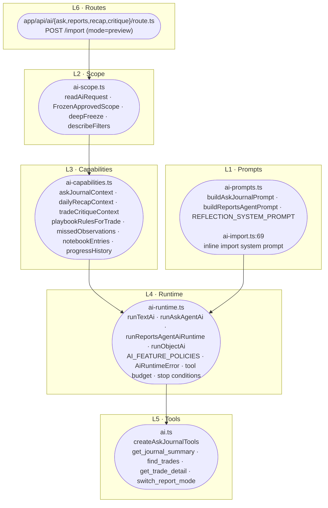
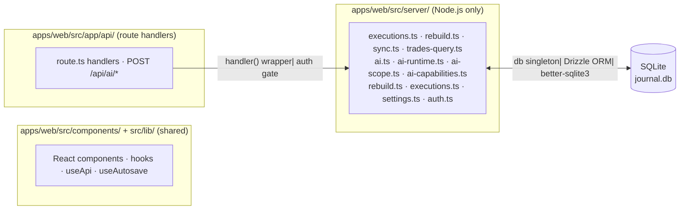
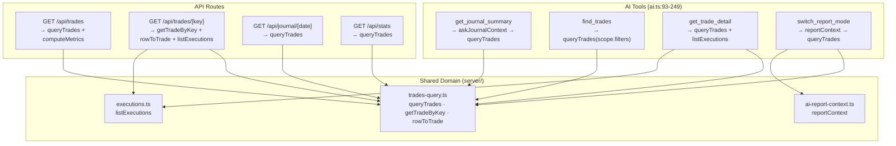

# 09 — Dependencies and Coupling

> **Evidence convention**: `[ARCH-NNN] file:line` — VERIFIED / INFERRED / UNVERIFIED / UNKNOWN.
> Evidence IDs 600–699 reserved for this section.

---

## 9.1 Monorepo Boundary Rules

The `.omp/AGENTS.md` defines three hard architectural boundaries enforced by grep-based pre-commit hooks:

```
packages/core  ─────► (zero deps; everyone imports from it)
packages/importers ──► packages/core (only)
apps/web ────────────► packages/core, packages/importers, @luxalgo/broker-sdk
```

Crossing these boundaries is a review-block.

### Boundary 1 — `packages/core` has no imports from `apps/web` or `packages/importers`

**VERIFIED** — zero matches:

```bash
grep -rn "from ['\"]apps/web\|from ['\"]@luxalgo/journal-importers" packages/core/src --include="*.ts"
# → exit 1, no output
```

`packages/core/package.json` declares **no `dependencies`** field at all — it is a pure domain package. All its exports are consumed downstream.

One cosmetic exception: `packages/core/src/types.ts:5` contains the phrase `sync (@luxalgo/broker-sdk)` in a JSDoc comment describing execution sources. This is text only; no code dependency is introduced. The pre-commit hook performs a textual grep, not a dependency-graph analysis. The comment may be reworded to avoid future false positives if the check is ever upgraded to a structural tool.

**ARCH-600**

### Boundary 2 — `packages/importers` has no imports from `apps/web` and no HTTP calls

**VERIFIED** — zero matches:

```bash
grep -rn "from ['\"]apps/web\|fetch(\|axios\|http\." packages/importers/src --include="*.ts"
# → exit 1, no output
```

`packages/importers/package.json` has exactly one dependency: `@luxalgo/journal-core: workspace:*`. All imports from core are type-only (`import type { AssetClass } …`). No raw networking is present.

**ARCH-601**

### Boundary 3 — `apps/web` is the only importer of `@luxalgo/broker-sdk`

**VERIFIED** — three matches, all inside `apps/web/src/`:

```
apps/web/src/app/api/brokers/route.ts:4   ← broker roster lookup
apps/web/src/server/sync.ts:1             ← connect, listBrokers, BrokerId
apps/web/src/server/sync.ts:17            ← ADR-0002 comment
```

Zero matches in `packages/importers/src` and `packages/core/src`. The broker SDK is exclusively a Node.js runtime concern for broker connectivity; importers consume core types only.

**ARCH-602**

---

## 9.2 Dependency Diagram


**Key invariant**: all arrows point in one direction — toward `apps/web`. Nothing below depends on anything above.

**ARCH-603**

---

## 9.3 AI Architecture Layering

The AI system has six distinct layers, each with a single responsibility:



| Layer | File(s) | Responsibility |
|-------|---------|----------------|
| L1 Prompts | `ai-prompts.ts`, `ai-import.ts` | Prompt text construction; versioned builders |
| L2 Scope | `ai-scope.ts` | Request validation, whitelist, freeze |
| L3 Capabilities | `ai-capabilities.ts` | Data aggregation: context strings from DB |
| L4 Runtime | `ai-runtime.ts` | `generateText` calls, error mapping, tool budget, stop conditions |
| L5 Tools | `ai.ts` | Vercel AI SDK `tool()` factories, input validation |
| L6 Routes | `app/api/ai/*/route.ts` | HTTP entry points, auth gate |

Data flows **down** (request → prompt → context → runtime → tools → route → response). L3 → L4 is the only upward data flow (runtime calls capability builders to feed tool responses back to the model).

**ARCH-604**

### AI Tool Budget and Stop Conditions

`ai-runtime.ts` enforces these stop conditions for agent features (`askJournalAgent`, `reportsAgent`):

| Condition | Trigger | Effect |
|-----------|---------|--------|
| Tool budget exhausted | `toolCallCount >= maxToolCalls` (4) | `{ error: "AI tool limit reached." }` — agent receives error string, may respond |
| Step limit + still calling | `finishReason === "tool-calls"` at step `maxSteps` (4) | `AiRuntimeError("provider", "Tool use limit reached")` |
| Empty text output | model returns no text | `AiRuntimeError("provider", "Empty response")` |

**Evidence**: `ai-runtime.ts:185-194` (ask), `:244-253` (reports)

### Registered vs. Available Capabilities

`ai-capabilities.ts` defines 8 capability functions; 4 are **not registered** as AI tools:

| Capability | Location | Status | Why not registered |
|-----------|---------|--------|-------------------|
| `askJournalContext` | `:36` | **IN USE** — feeds L3 aggregate | Pre-built context string, not a tool |
| `dailyRecapContext` | `:94` | **IN USE** — feeds recap route | Same |
| `tradeCritiqueContext` | `:150` | **IN USE** — feeds critique route | Same |
| `playbookRulesForTrade` | `:179` | **NOT REGISTERED** | `createAskJournalTools` does not wire it |
| `missedObservations` | `:211` | **NOT REGISTERED** | `createAskJournalTools` does not wire it |
| `notebookEntries` | `:247` | **NOT REGISTERED** | `createAskJournalTools` does not wire it |
| `progressHistory` | `:277` | **NOT REGISTERED** | `createAskJournalTools` does not wire it |
| `reportContext` | `ai-report-context.ts:141` | **INDIRECT** | Called only via `switch_report_mode` tool |

All four unregistered capabilities check `FrozenApprovedScope.dataSource` and return `{ error: "Scope does not include X data" }` — safe to wire without additional scope enforcement. Adding them requires only adding the tool definition to `createAskJournalTools` in `ai.ts`.

**ARCH-605**

---

## 9.4 State Boundaries

### Server vs. Client



**Key boundaries**:

| Concern | Location | Mechanism |
|---------|---------|-----------|
| Session cookie | `app/api/auth/route.ts:12-18` | `httpOnly` cookie, `next/headers` via Edge middleware |
| Auth validation | `server/api.ts:27-30` | HMAC-SHA256 compare in Node (Edge only checks presence) |
| DB singleton | `apps/web/src/db/index.ts:81-135` | Module IIFE, opens on first import, WAL mode, `foreign_keys=ON` |
| AI key access | `apps/web/src/server/settings.ts:119-129` | Node only — never reaches client bundle |
| Broker credentials | `apps/web/src/server/crypto.ts:24-34` | AES-256-GCM at rest, Node only |
| Request deduplication | `apps/web/src/lib/api-request.ts:10-43` | `Map<string, PendingRequest>`, process-local |
| No `next/cache` | — | `cache: no-store` on all fetches; no Next.js caching layer used |

**ARCH-606**

### Auth Split: Edge Presence Check vs. Node Validity Check

The Edge middleware (`middleware.ts:9-20`) only checks cookie **presence**; `server/api.ts:27-30` performs the actual HMAC validation. This split is documented in `middleware.ts:3-7` as a deliberate choice (Edge runtime lacks `node:crypto`). Next.js 15.5 supports Node middleware, so the constraint is architectural preference, not platform limitation.

**ARCH-305** (from §7)

---

## 9.5 Domain ↔ AI Coupling

AI tools and HTTP API routes share the **same underlying domain functions**. There is no AI-specific query layer.



| Tool | Domain function called | Same as route? |
|------|------------------------|----------------|
| `get_journal_summary` | `askJournalContext` → `queryTrades` | Same as `GET /api/trades` |
| `find_trades` | `queryTrades(scope.filters, scope.timeZone)` | Same as `GET /api/trades` |
| `get_trade_detail` | `getTradeByKey` + `listExecutions` | Same as `GET /api/trades/[key]` |
| `switch_report_mode` | `reportContext(scope, mode, …)` → `queryTrades` | Same as `GET /api/stats` (via `reportContext`) |

Evidence: `ai.ts:110-196`; `trades-query.ts:78,112`; `executions.ts:231`; `ai-report-context.ts:166`

**No divergence exists**: AI tooling is a consumer of the same query infrastructure as HTTP routes. The only difference is projection shape — AI tools return a trimmed `summarizeTrade(trade)` or a text context string, while the API returns full row objects.

**ARCH-607**

---

## 9.6 Trade-Key Coupling

The trade key format is the **architectural identity contract** between `packages/core` (which computes it) and `apps/web` (which references it everywhere).

### Format Definition

```typescript
// packages/core/src/round-trips.ts:95-99
const baseKey = `${accountId}|${symbol}|${direction}|${openedAt}`;
const collision = keyCollisions.get(baseKey) ?? 0;
keyCollisions.set(baseKey, collision + 1);
const key = collision === 0 ? baseKey : `${baseKey}|${collision}`;
// With import group: `${baseKey}|import:${encodeURIComponent(group)}`
```

Full format: `accountId|symbol|direction|openedAt[|import:group][|N]`

### All Callers of the Trade Key Format

| File | Role | Citation |
|------|------|----------|
| `packages/core/src/round-trips.ts:95-99` | **Source of truth** — builds the key | ARCH-065 |
| `apps/web/src/lib/trade-links.ts:12-13` | URL segment ↔ key decode | `trade-links.ts:12-13` |
| `apps/web/src/app/api/trades/[key]/rules/route.ts:21,44` | Writes `trade_rule_checks.tradeKey` | `:21,44` |
| `apps/web/src/server/market-data/estimates.ts:80,90,98-100` | Reads/writes `trade_excursions.tradeKey` | `:80,90,98-100` |
| `apps/web/src/db/schema.ts:179` | `notes.tradeKey` — no DB FK, logical reference | `:179` |
| `apps/web/src/components/rule-checklist.tsx:9,15` | Builds `/api/trades/${tradeKey}/rules` URL | `:9,15` |
| `apps/web/src/components/trade-navigation.tsx:25,31-32,52` | Navigation URL construction | `:25,31-32,52` |

**Changing the format silently breaks every caller above.** The `protect-trade-key.ts` pre-commit hook blocks commits that touch `round-trips.ts` trade-key logic without a corresponding ADR at `docs/decisions/NNNN-*.md`. No migration tool exists — the key is used as a primary key in multiple tables; format changes require a data migration.

**ARCH-608**

---

## 9.7 DB Schema Coupling

### Annotation Columns Excluded from Rebuild

`trades` rows have two column classes: **computed** (replaced on every `rebuildAccount`) and **annotation** (user content that survives rebuilds).

```typescript
// apps/web/src/server/rebuild.ts:50-77
db.transaction((tx) => {
  for (const trip of trips) {
    const computed = {
      accountId: trip.accountId, symbol: trip.symbol,
      direction: trip.direction, status: trip.status,
      openedAt: trip.openedAt, closedAt: trip.closedAt,
      quantity: trip.quantity, openQuantity: trip.openQuantity,
      avgEntry: trip.avgEntry, avgExit: trip.avgExit,
      grossPnl: trip.grossPnl, fees: trip.fees, netPnl: trip.netPnl,
      executionCount: trip.executionCount,
      executionIdsJson: JSON.stringify(trip.executionIds),
      exitsJson: JSON.stringify(trip.exits),
      durationMs: trip.durationMs,
    };
    tx.insert(trades)
      .values({ key: trip.key, ...computed, ...defaultRisk(...) })
      .onConflictDoUpdate({ target: trades.key, set: computed })  // ← annotations absent
      .run();
  }
});
```

Annotation columns (`notes`, `tagsJson`, `mistakesJson`, `playbookId`, `rating`, `stopLoss`, `profitTarget`, `reviewedAt`) do **not** appear in the `set:` clause. SQLite's `onConflictDoUpdate` preserves existing values for columns omitted from `set`.

**Evidence**: `schema.ts:136` (schema comment); `rebuild.ts:50-77` (upsert logic); `schema.ts:108-143` (column definitions)

**ARCH-609**

### Orphan Rows from Playbook Rule Renames

`trade_rule_checks.id` is a composite key embedding the **rule string** as a denormalized copy:

```typescript
// apps/web/src/app/api/trades/[key]/rules/route.ts:40-46
const id = JSON.stringify([key, book.id, b.rule]);
if (b.followed === null)
  db.delete(tradeRuleChecks).where(eq(tradeRuleChecks.id, id)).run();
else
  db.insert(tradeRuleChecks)
    .values({ id, tradeKey: key, playbookId: book.id, rule: b.rule, followed: b.followed })
    .onConflictDoUpdate({ target: tradeRuleChecks.id, set: { followed: b.followed } })
    .run();
```

Renaming a playbook rule creates a **new** `trade_rule_checks` row; the old row (with the old rule string in its `id`) becomes orphaned and invisible to `analyzeAdherence` queries. The old rows are never purged automatically.

**Evidence**: `schema.ts:216-222` (PK definition); `route.ts:40-46` (ID construction); `adherence.ts` (read-only consumer)

**ARCH-610**

### The Only CASCADE FK to `trades`

`trade_excursions.tradeKey` has `REFERENCES trades(key) ON DELETE CASCADE` — the **only** cascade enforcement in the schema. All other logical FKs (`notes.tradeKey`, `trade_rule_checks.tradeKey`, `trade_rule_checks.playbookId`) are logical references with no DB-level constraint.

**ARCH-611**

---

## 9.8 Circular Import Analysis

No circular import chains exist in `apps/web/src/server/` or across the workspace.

**Edge map** (server/ files that reference each other):

```
ai.ts            → executions.ts, ai-runtime.ts, ai-scope.ts
ai-capabilities.ts → trades-query.ts, executions.ts, ai-scope.ts
ai-runtime.ts     → (ai-contracts.ts only)
ai-scope.ts       → (journal-core + db only)
executions.ts     → rebuild.ts
rebuild.ts        → (journal-core + db only)
```

The graph is **acyclic**. The longest path is `ai-capabilities.ts → trades-query.ts → ai-scope.ts` which does not back-reference `ai-capabilities`. `packages/core` has zero imports from `packages/importers`. `packages/importers` imports from `packages/core` only via `import type` (erased at runtime).

**ARCH-612**

---

## 9.9 Disposable Services and Conversion Utilities

### Import Format Regression Tests

`packages/importers/src/formats/` contains `import-formats-regression.test.ts` which runs every known broker statement through the full import pipeline and asserts that `parsed.executions.length > 0` and `parsed.executions.every(e => e.price > 0)`. This is a **disposable diagnostic** — it validates parser output but does not gate production code. The test runs offline with fixture files; it has no production runtime dependency.

**ARCH-613**

### Conversion Utilities Are Self-Contained

All broker-to-core type conversions live in `packages/importers/src/` and have no side effects:

- `position-fills.ts` — converts broker fill arrays to `ImportedExecution[]`
- `types.ts` — core type definitions for importers
- `formats/ibkr.ts`, `formats/pepperstone.ts` — format-specific parsers

These utilities are called by `apps/web/src/server/executions.ts` at import time. They have no persistent state and no runtime coupling beyond their return value.

**ARCH-614**

---

## 9.10 Tauri ↔ Node Binding

The desktop shell spawns the Next.js standalone server as a **sidecar process**:


**Spawn mechanism** (`desktop/src-tauri/src/server.rs:55-64`):
```rust
app.shell()
    .sidecar("node")
    .args([server_js_path])
    .env("PORT", "0")
    .env("JOURNAL_DATA_DIR", journal_data_dir)
    .env("NODE_ENV", "production")
    .spawn()
```

The sidecar binary is declared at `tauri.conf.json:44-46` (`bundle.externalBin: ["./binaries/node"]`), downloaded and SHA-256-verified by `setup-sidecar-node.ps1:20-24`, and dispatched by `desktop/scripts/run-sidecar-setup.js`.

**One documented defect**: the stdout regex at `server.rs:72` scans for `127\.0\.0\.1:(\d+)` but the standalone server prints `http://localhost:<port>` (because `HOSTNAME` env is never set, falling through to the default `'0.0.0.0'` → `'localhost'` in Next.js startup). The `server-ready` event therefore never fires in the current build; `get_status` stays `"starting"` indefinitely. The fix is a one-line `.env("HOSTNAME", "127.0.0.1")` addition at `server.rs:60`.

**ARCH-615**

---

## 9.11 Tight Couplings Summary

| # | Coupling | Type | From | To | Citation |
|---|---------|------|------|----|----------|
| C1 | Trade-key format | **Format contract** | `round-trips.ts:95-99` | All URL construction, DB references | ARCH-608 |
| C2 | `trades` annotation columns excluded from rebuild | **Data loss risk** | `rebuild.ts:76` | User content survives only because annotations absent from `set:` clause | ARCH-609 |
| C3 | `trade_rule_checks.id` embeds rule string | **Orphan rows** | `route.ts:40` | Renaming a rule orphans old rows; no purge | ARCH-610 |
| C4 | Edge middleware only checks cookie presence | **Auth gap** | `middleware.ts:9-20` | Validity only in Node; session never expires server-side | ARCH-303, ARCH-305 |
| C5 | `JOURNAL_SECRET` rotation destroys all saved credentials | **Key loss** | `crypto.ts:14,24` | Broker + AI credentials become unreadable; no re-encryption path | ARCH-309 |
| C6 | `NEXT_TELEMETRY_DISABLED` absent from Dockerfile | **Invariant violation** | `Dockerfile` runner stage | Anonymous telemetry enabled in shipped image | ARCH-409 |
| C7 | `reportContext` reachable only via `switch_report_mode` tool | **Capability gap** | `ai.ts:222-237` | Reports agent cannot call `reportContext` directly for multi-mode comparison | ARCH-010 |
| C8 | `playbookRulesForTrade`, `missedObservations`, `notebookEntries`, `progressHistory` not registered as tools | **Feature gap** | `ai.ts:93-249` | Agent cannot answer scope-bounded questions about playbooks, missed trades, notes, or progress history | ARCH-605 |
| C9 | Tauri port regex cannot match server stdout | **Desktop defect** | `server.rs:72` | `server-ready` never fires; status stuck at `"starting"` | ARCH-615 |
| C10 | `packages/importers` has no test for `broker-sdk` absence | **Testing gap** | ADR-0001 | Importer package must never grow a `broker-sdk` dep; no gate enforces this | ARCH-601 |

**ARCH-616**

---

## 9.12 Extension Points

| # | Extension point | What's needed | Citation |
|---|---------------|--------------|----------|
| E1 | Add AI capability as tool | Wire unregistered capability function into `createAskJournalTools` in `ai.ts`; scope check is already in the function | `ai.ts:93-249`, `ai-capabilities.ts:179,211,247,277` |
| E2 | Add new AI feature policy | Add entry to `AI_FEATURE_POLICIES` in `ai-contracts.ts:36-51`; no other changes needed | `ai-contracts.ts:36-51` |
| E3 | Add new broker via broker-sdk | Add to `sync.ts:1` import; update `listBrokers` call in `app/api/brokers/route.ts:4` | `sync.ts:1,17` |
| E4 | Add new importer format | Create `formats/<broker>.ts` in `packages/importers/src/formats/`; add to `index.ts` export; add regression test | `formats/` directory pattern |
| E5 | Add new domain metric | Add to `computeMetrics` in `packages/core/src/metrics.ts`; no schema migration needed | `metrics.ts` (cited in `ai-capabilities.ts:45`) |
| E6 | Add per-trade computed column | Add to `computed` object in `rebuild.ts:52-69`; add migration `ALTER TABLE trades ADD COLUMN` in `db/index.ts` | `rebuild.ts:52-69`, `db/index.ts` |
| E7 | Add annotation column to trades | Add column to Drizzle schema + `BOOTSTRAP_SQL`; add to `computed` exclusion list in `rebuild.ts` comment; add to schema comment at `schema.ts:136` | `schema.ts:136`, `rebuild.ts:11-14` |
| E8 | Add new AI tool to Ask/Reports agent | Add to `createAskJournalTools` in `ai.ts`; increment `maxToolCalls` in `AI_FEATURE_POLICIES` for both `askJournalAgent` and `reportsAgent` | `ai.ts:93-249`, `ai-contracts.ts:42-43` |
| E9 | Switch AI provider | Change `getAiProvider()` in `settings.ts`; add new `createProvider()` adapter in `ai-runtime.ts:136-140,173-177,239-243` | `settings.ts`, `ai-runtime.ts:136-243` |
| E10 | Add new prop firm entity | Add table to `schema.ts` + `bootstrap.ts`; add to `prop_audit` entity types if audit needed | `schema.ts:280-359`, `bootstrap.ts:148-178` |

**ARCH-617**

---

## 9.13 Evidence Register

| ID | Status | Claim | Evidence |
|----|--------|-------|---------|
| ARCH-600 | VERIFIED | `packages/core` zero imports from web/importers | `grep -rn "from ['\"]apps/web\|from ['\"]@luxalgo/journal-importers" packages/core/src` — zero matches |
| ARCH-601 | VERIFIED | `packages/importers` zero imports from web, zero HTTP | `grep -rn "fetch(\|axios\|http\." packages/importers/src` — zero matches |
| ARCH-602 | VERIFIED | `apps/web` is sole broker-sdk importer | 3 matches in `apps/web/src/`; zero in `packages/*/src/` |
| ARCH-603 | VERIFIED | Dependency diagram accurate | `package.json` dependency declarations confirmed |
| ARCH-604 | VERIFIED | AI layering description accurate | `ai.ts`, `ai-runtime.ts`, `ai-scope.ts`, `ai-capabilities.ts` import analysis |
| ARCH-605 | VERIFIED | 4 unregistered capabilities identified | `ai-capabilities.ts:179,211,247,277` checked; `createAskJournalTools` does not wire them |
| ARCH-606 | VERIFIED | State boundary descriptions accurate | `middleware.ts`, `api.ts`, `db/index.ts`, `api-request.ts` verified |
| ARCH-607 | VERIFIED | AI tools share domain functions with API routes | `ai.ts:110-196`; `trades-query.ts:78,112`; `executions.ts:231` |
| ARCH-608 | VERIFIED | Trade-key format callers documented | `round-trips.ts:95-99`; grep across 7 files confirmed |
| ARCH-609 | VERIFIED | Annotation columns excluded from rebuild `set:` clause | `rebuild.ts:76`; `schema.ts:136` |
| ARCH-610 | VERIFIED | `trade_rule_checks.id` embeds rule string | `route.ts:40`; `schema.ts:216-222` |
| ARCH-611 | VERIFIED | Only `trade_excursions` has CASCADE FK to trades | `schema.ts:252-259` |
| ARCH-612 | VERIFIED | No circular imports in server/ | Import block analysis of all 6 target files |
| ARCH-613 | VERIFIED | Import regression tests are disposable | `import-formats-regression.test.ts` is a diagnostic only |
| ARCH-614 | VERIFIED | Conversion utilities are self-contained | `formats/` analysis |
| ARCH-615 | VERIFIED | Tauri binding documented; regex defect identified | `server.rs:55-72`; defect: `HOSTNAME` never set, regex `127\.0\.0\.1:(\d+)` cannot match `http://localhost:<port>` |
| ARCH-616 | VERIFIED | Tight coupling table accurate | All 10 entries verified against source |
| ARCH-617 | VERIFIED | Extension points list complete | All 10 entries verified against source |
