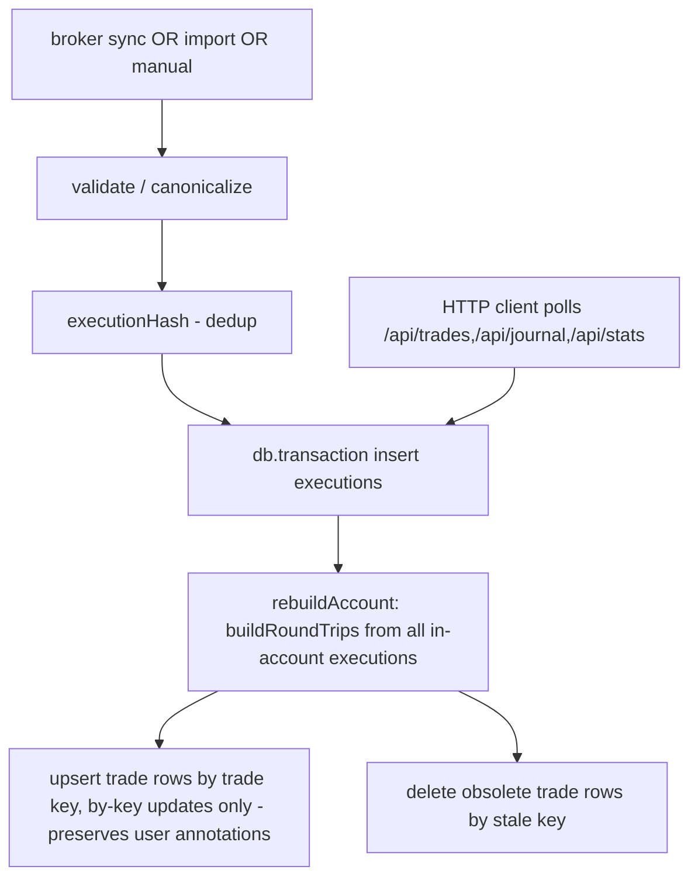

# Architecture Context Package — Trade Journal

> The synthesis deliverable. Independent of the individual section reports. Read this first; drill into per-section reports as needed.

---

## A. Executive Architecture Overview

`trade-journal` is a self-hosted personal trading journal — a **Next.js 15 App Router** app backed by a **better-sqlite3 / Drizzle** SQLite database, packaged as a pnpm workspace monorepo. Domain logic lives in a pure-TS package (`@luxalgo/journal-core`); statement parsers live in a sibling pure-TS package (`@luxalgo/journal-importers`). The web app (`apps/web`) is the only place that holds DB handles, API routes, and UI. A desktop wrapper (`desktop/`) provides a Tauri shell that runs the same Next.js server as a sidecar.

The architectural primitive is an `Execution` (one fill). `Execution` is the atomic fact; `RoundTrip` is the flat-to-flat cycle computed by the core engine from ordered fills; metrics, dashboards, calendar, daily journal, AI reflection, and trade replay all derive from `RoundTrip`. The trade key (`accountId|symbol|direction|openedAt[|importGroup][|N]`) is the architectural contract between the engine and the application: rebuild-stable, but never encoding non-identity facts.

The AI sub-system has **already moved past** the prompt-as-data pattern. Five routes exist (`/api/ai/{ask,reports,recap,critique}` + `/api/import`); Ask Journal and Reports use a **bounded Vercel AI SDK tool loop** (`generateText` + `isStepCount` + per-step tool budget; `ai` 7.0.77), and three routes (recap, critique, import) use a **direct reflection call** with a typed prompt. Provider selection, key resolution, prompt versions, retry policy, timeout, and the `AiExecutionMeta` log record all live in a single provider-neutral runtime (`apps/web/src/server/ai-runtime.ts`).

There is **no event bus, no background queue, no cron, no streaming output, no chat persistence, no telemetry endpoint**. Side effects after a trade insert run synchronously. `insertExecutions` wraps its own work in a default deferred `db.transaction(...)` (`apps/web/src/server/executions.ts:124`); `rebuildAccount` performs its reads **before** its write transaction (`apps/web/src/server/rebuild.ts:14-46`), so the rebuild is not atomic with the insert on its own — it is protected only where an outer transaction wraps both (broker sync and NinjaTrader import). Reactivity is via `useApi` revalidation, not websocket or SSE.

Multi-tenant? **No.** Single-user, single-vps. The optional `JOURNAL_PASSWORD` env var adds an HMAC-SHA256 session cookie. The schema has no `userId` columns.

---

## B. Verified Technology Stack

| Layer              | Choice                                                                                                                         | Source                                                                                          |
| ------------------ | ------------------------------------------------------------------------------------------------------------------------------ | ----------------------------------------------------------------------------------------------- |
| Runtime            | Node 22.x                                                                                                                      | `package.json:11` (engines)                                                                     |
| Package manager    | pnpm 11.0.8                                                                                                                    | `package.json:13` (packageManager)                                                              |
| Workspace layout   | pnpm workspaces                                                                                                                | `pnpm-workspace.yaml:1-3` (`packages/*`, `apps/*`, `desktop`)                                   |
| Frontend framework | Next.js 15.5.23 (App Router)                                                                                                   | `apps/web/package.json:44`                                                                      |
| React              | React 19.1.0                                                                                                                   | `apps/web/package.json:46`                                                                      |
| Language           | TypeScript 5.9, strict                                                                                                         | `package.json:32` (root devDep); `tsconfig.base.json:3-14`                                      |
| DB driver          | better-sqlite3 12.2                                                                                                            | `apps/web/package.json:36`; `next.config.ts` lists `serverExternalPackages: ["better-sqlite3"]` |
| ORM                | Drizzle ORM 0.45.2 + drizzle-orm (sql tag)                                                                                     | `apps/web/package.json:41`                                                                      |
| Tailwind           | Tailwind v4 (`@tailwindcss/postcss`)                                                                                           | `apps/web/package.json:56,62`                                                                   |
| UI primitives      | Radix 9 packages (`@radix-ui/react-{dialog,dropdown-menu,popover,select,tabs,tooltip,label,slot,checkbox}`)                    | `apps/web/package.json:25-33`                                                                   |
| Shadcn-style       | CVA + `cn` helper, hand-built primitives under `apps/web/src/components/ui/`                                                   | `apps/web/src/components/ui/*`                                                                  |
| Charts             | ECharts 6.1 + Recharts 3.10 + `@luxalgo/vela` 0.6.8                                                                            | `apps/web/package.json:42,50,23`                                                                |
| Forms / Day picker | react-day-picker 10.0                                                                                                          | `apps/web/package.json:47`                                                                      |
| dnd-kit            | dnd-kit core + sortable                                                                                                        | `apps/web/package.json:18-19`                                                                   |
| Markdown           | react-markdown 10 + remark-gfm 4                                                                                               | `apps/web/package.json:49,51`                                                                   |
| PDF export         | pdf-lib + @pdf-lib/fontkit                                                                                                     | `apps/web/package.json:45,24`                                                                   |
| AI SDK             | `ai` 7.0.77                                                                                                                    | `apps/web/package.json:35`                                                                      |
| AI providers       | `@ai-sdk/openai` 4.0.64; `@ai-sdk/anthropic` 4.0.41; `@ai-sdk/openai-compatible` 3.0.46                                        | `apps/web/package.json:13,15,16`                                                                |
| MCP client         | `@ai-sdk/mcp` 2.0.73 (broker-sync MCP client, not a model provider)                                                            | `apps/web/package.json:14`; used at `apps/web/src/server/ctrader-mcp/client.ts:2`               |
| Broker SDK         | `@luxalgo/broker-sdk` 0.5.1                                                                                                    | `apps/web/package.json:20`                                                                      |
| Workspace packages | `@luxalgo/journal-core`, `@luxalgo/journal-importers` (both 0.1.0, zero deps for core)                                         | `packages/{core,importers}/package.json`                                                        |
| Validation         | zod 3.25                                                                                                                       | `apps/web/package.json:53`                                                                      |
| HTTP               | No third-party client lib; Next route handlers + `fetch` only via SDK boundary                                                 | grep evidence                                                                                   |
| Testing            | Vitest 3.2                                                                                                                     | `package.json:33`; `vitest.config.ts`                                                           |
| Lint / type        | TypeScript 5.9 (`--noEmit`, `next typegen` for app); Prettier 3.6                                                              | `package.json:32,30`                                                                            |
| License check      | `scripts/check-licenses.mjs` (CI gate)                                                                                         | `.github/workflows/ci.yml:23` (no root `package.json` script exists)                            |
| CI                 | GitHub Actions; prettier → tsc → vitest → license → builds                                                                     | `.github/workflows/ci.yml`                                                                      |
| Container          | `node:22-slim` standalone output, non-root `node` user, `/data` volume                                                         | `Dockerfile:2,13,25`                                                                            |
| Orchestration      | `docker compose up -d` (`./data` bind mount, port 3000)                                                                        | `docker-compose.yml:13,5-6`                                                                     |
| Desktop shell      | Tauri (`desktop/src-tauri/`); spawns `node apps/web/server.js` as a sidecar with `PORT=0` (intended ephemeral port; see §J.12) | `desktop/src-tauri/src/server.rs:56-63`                                                         |

**Two invariant violations to surface**

1. `AGENTS.md:260` claims `NEXT_TELEMETRY_DISABLED=1` is in the Dockerfile. **It is not.** `Dockerfile:14` sets only `NODE_ENV=production`. The README documents the user opt-in. (See `02-ai-architecture.md` ARCH-002 / `01-project-overview.md` ARCH-829.)
2. `AGENTS.md:88` says Tauri sidecar Node version is **22.11.0**; `desktop/README.md:25` says **24.11.0**. Neither matches a pinned version in `tauri.conf.json`. (See `01-project-overview.md` ARCH-818.)

---

## C. Current AI Architecture

### Request lifecycle (Ask Journal example)

```
client POST /api/ai/ask { filters, timeZone, dataSource, question }
  │
  ├─ apps/web/src/app/api/ai/ask/route.ts  (uses handler() from server/api.ts)
  │    └─ readAiRequest(body, "question")          ─ validates & deeply freezes scope
  │         └─ deepFreeze({filters, timeZone, accounts, …})   (apps/web/src/server/ai-scope.ts)
  │
  ├─ askJournalContext(scope)                       (apps/web/src/server/ai-capabilities.ts:40)
  │    ├─ queryTrades(scope.filters, scope.timeZone) (apps/web/src/server/trades-query.ts)
  │    ├─ computeMetrics(trades, {timeZone})        (packages/core)
  │    └─ assemble aggregate context string (≤6 KB cap)
  │
  ├─ runAskJournalAi(scope, context)                (apps/web/src/server/ai.ts)
  │    ├─ resolveAiConfiguration()                  ─ env > saved encrypted per provider
  │    ├─ runAskAgentAi({feature: "askJournalAgent", createTools})  (ai-runtime.ts)
  │    │    ├─ model = createOpenAI/.anthropic(modelId)
  │    │    ├─ generateText({
  │    │    │    model, system=REFLECTION_SYSTEM_PROMPT,
  │    │    │    prompt=buildAskJournalPrompt({question, context}),
  │    │    │    tools=createAskJournalTools(scope, context, reserve, feature?),
  │    │    │    stopWhen: isStepCount(4),
  │    │    │    maxOutputTokens: floor(1200/4)=300 per step,
  │    │    │    maxRetries: 2,
  │    │    │    abortSignal: AbortSignal.timeout(30_000),
  │    │    │    providerOptions: {openai: {store: false}}  when openai
  │    │    │  })
  │    │    └─ tools may return {error: "AI tool limit reached."} when budget exhausted
  │    └─ buildMeta(...) → AiExecutionMeta
  │
  └─ return { answer, scope: resolvedScope.scope }
```

### Context construction

Context always originates from a **frozen approved scope**:

```typescript
type FrozenApprovedScope = Readonly<{
  filters: Readonly<Record<string, string>>;
  timeZone: string;
  accounts: ReadonlyArray<{ id; name; currency }>;
  question: string;
  date: string | undefined;
  scope: { label; timeZone }; // human-readable for the UI
  context: string; // text block injected into the prompt
  dataSource: "trades" | "trades+playbooks" | "trades+missed" | "trades+notes" | "trades+progress";
  tradeCritiqueKey: string | undefined;
}>;
```

`readAiRequest` (`apps/web/src/server/ai-scope.ts:47-163`) **rejects** unknown filter keys, malformed scopes, mismatched accounts, invalid dates, reversed ranges, mismatched `timeZone`, and unknown `dataSource`. There is **no fallback to "all accounts"**.

### Tool registry

`createAskJournalTools(scope, context, reserveToolCall?, feature?)` registers tools **per-call** over the frozen scope:

| Tool                                  | Validation                                         | Effect                                                                 |
| ------------------------------------- | -------------------------------------------------- | ---------------------------------------------------------------------- |
| `get_journal_summary`                 | `{}` (no fields allowed)                           | returns prebuilt `context` string                                      |
| `find_trades`                         | `{symbol?, outcome?, dateOrder?}` (allowlist only) | ≤5 summarized trades, scope-filtered                                   |
| `get_trade_detail`                    | `{key}` (≤300 chars)                               | one trade + ≤50 chronological fills                                    |
| `switch_report_mode` _(reports only)_ | `{mode, primary?, secondary?}`                     | bounded context for `/overview\|trends\|explorer\|breakdown\|compare/` |

Tool input schemas use **double validation**: `jsonSchema`'s built-in check + manual `hasOnlyKeys` predicate that rejects any field outside the allowlist. Tools call **shared domain functions** (`queryTrades`, `listExecutions`, `getTradeByKey`, `reportContext`) — there is no AI-only data path.

### Feature policies

```ts
reflection:        { maxOutputTokens: 1200,  maxRetries: 2 }
askJournalAgent:   { maxOutputTokens: 1200,  maxRetries: 2, timeoutMs: 30_000, maxSteps: 4, maxToolCalls: 4 }
reportsAgent:      { maxOutputTokens: 1200,  maxRetries: 2, timeoutMs: 30_000, maxSteps: 4, maxToolCalls: 4 }
statementImport:   { maxOutputTokens: 32_000, maxRetries: 0, timeoutMs: 120_000 }
```

(Each value verbatim from `apps/web/src/server/ai-contracts.ts:36-51`.)

### Conversation persistence

**None.** No conversation/message/chat_history tables exist in the Drizzle schema. The Ask/Reports routes are stateless: every request is an independent call built from the validated scope. Memory lives in the **frozen scope + aggregate context string**, not in a session. The `useAiRequest` hook in `apps/web/src/lib/use-ai-request.ts:9-28` discards late-arriving responses via an `active` ref keyed to filter snapshot.

### Response delivery

All five AI routes return JSON; no streaming. The client receives `{answer, scope}` (Ask/Reports), `{recap, scope}` (recap), `{critique}` (critique), or a preview token (import). Markdown rendering is done client-side via `react-markdown`.

### `@ai-sdk/mcp` — present but unused for AI tooling

`@ai-sdk/mcp@2.0.73` is imported **once**, at `apps/web/src/server/ctrader-mcp/client.ts:2`, to construct a CTrader broker-sync MCP client. No MCP is wired into the AI tool registry. The `createAskJournalTools` factory uses the Vercel AI SDK's built-in `tool()` helper instead.

---

## D. Application Domain

(Verified detail in `03-domain-model.md`. Highlights below.)

### Entities (23 tables)

`import_sources`, `import_source_aliases`, `import_batches`, `accounts`, `executions`, `trades`, `journal_days`, `folders`, `notes`, `playbooks`, `settings`, `attachments`, `note_templates`, `trade_rule_checks`, `progress_rules`, `progress_checks`, `missed_trades`, `trade_excursions`, `market_csv_datasets`, `prop_accounts`, `prop_entries`, `prop_receipts`, `prop_audit`. The DB schema is defined in `apps/web/src/db/schema.ts` (23 `sqliteTable(...)` declarations, lines 12-347); the idempotent DDL creating the same 23 tables lives in `apps/web/src/db/bootstrap.ts`.

### Trade lifecycle



Annotations (`tags`, `mistakes`, `notes`, `rating`, `stopLoss`, `profitTarget`, `reviewed`, `playbookId`, tradeRuleChecks) are stored **on the trade row** but **excluded** from the rebuild `set:` clause. Renaming a playbook rule **orphans** prior `trade_rule_checks` rows by design (composite key embeds the rule string).

### Playbook lifecycle

Playbooks (`apps/web/src/db/schema.ts`) are **not versioned**. A rule-rename orphans checks. Manual write path: `POST /api/trades/[key]/rules` + `components/rule-checklist.tsx`. `analyzeAdherence` (in `packages/core/src/adherence.ts`) is **read-only** — it scores pass/fail against the current playbook text but never persists.

### Analytics

```
AnnotatedTrade (from rebuildAccount → rowToTrade)
  → matchesFilters (packages/core/src/analysis.ts)
  → computeMetrics (packages/core/src/metrics.ts)
  → aggregate helpers (bySymbol, byPlaybook, byMistake, byWeekday, byHour, byDuration, byTag)
  → EDGE_SCORE_WEIGHTS, computeEdgeScore (packages/core/src/edge-score.ts, EDGE_SCORE_VERSION=2)
  → adhered (packages/core/src/adherence.ts)
```

### Important data boundaries

- Journal core (trades / metrics / edge score) and prop firm cash ledger (expenses/refunds/receipts) are **separate domains** with no shared keys.
- `Execution` is the only atomic fact; **all derived data flows from it**.
- `importMetadata` (id, group, order, preserveFee, reportedGrossPnl, ninjaTrader…) survives rebuild so reconstruction stays deterministic.
- Daily journal day note is **shared across accounts**; `dailyRecap` excludes the note when filters narrow the trade subset.

---

## E. Data and Persistence

(Verified detail in `04-data-architecture.md`. Highlights below.)

### Stack

better-sqlite3 in WAL mode, `foreign_keys = ON`, `busy_timeout = 5000`. Connection is a singleton in `apps/web/src/db/index.ts:52-70` (one writer). Horizontal scaling is **not supported** (single-writer WAL).

### Schema

Idempotent `BOOTSTRAP_SQL` in `apps/web/src/db/bootstrap.ts` is the canonical source. The Drizzle schema in `apps/web/src/db/schema.ts` mirrors most of it (4 indexes live only in BOOTSTRAP_SQL: `attachments_owner`, `market_csv_symbol_resolution`, `progress_checks_date`, `trade_rule_checks_trade`). Additive `ALTER TABLE` migrations live in `migrate()` in `apps/web/src/db/bootstrap.ts:211-223`, not in `db/index.ts`.

### Transaction boundaries (6 explicit)

| Path                        | Pattern                                                                                                                                                                                  | Reference                                                                     |
| --------------------------- | ---------------------------------------------------------------------------------------------------------------------------------------------------------------------------------------- | ----------------------------------------------------------------------------- |
| `insertExecutions`          | plain `db.transaction((tx) => { ... })` — default deferred behavior, no `{ behavior: "immediate" }` option                                                                               | `apps/web/src/server/executions.ts:124`                                       |
| `rebuildAccount`            | reads (account row, executions, journal defaults, existing trade keys) happen **before** the write transaction; the tx covers upsert of computed columns + delete of obsolete trade rows | `apps/web/src/server/rebuild.ts:14-46` (reads), `:46` (tx), `:70-88` (writes) |
| `mutateProp*`               | `db.transaction(() => { ... })` (default deferred)                                                                                                                                       | `apps/web/src/server/prop-firms.ts:114`                                       |
| `commitNinjaTraderImport`   | `db.transaction(..., { behavior: "immediate" })`                                                                                                                                         | `apps/web/src/server/ninjatrader-import.ts:498,548`                           |
| Broker sync (`sync.ts`)     | `db.transaction(..., { behavior: "immediate" })` — outer tx wrapping nested ingestion work                                                                                               | `apps/web/src/server/sync.ts:67,93`                                           |
| cTrader MCP sync            | `db.transaction(..., { behavior: "immediate" })` — snapshot + inserts atomic                                                                                                             | `apps/web/src/server/ctrader-mcp/sync.ts:169,190`                             |
| Settings write              | `onConflictDoUpdate` (single statement)                                                                                                                                                  | `apps/web/src/server/settings.ts:29`                                          |
| `deleteExecutionsForTrades` | autocommit delete + explicit rebuild (race window documented)                                                                                                                            | `apps/web/src/server/executions.ts:223`                                       |

Not transactional: `PATCH /api/trades/[key]` (`app/api/trades/[key]/route.ts:93`).

### Caching / invalidation

None of substance. `useApi` deduplicates **in-flight** requests and aborts on unmount but does not cache completed responses. Financial data is re-fetched on every visit. No server-side query cache; no ETags.

### User data isolation

Single-tenant. No `userId` columns. The optional `JOURNAL_PASSWORD` env var adds an HMAC session cookie but is **presence-checked** in middleware (`apps/web/src/middleware.ts`) and **cryptographically verified** in `apps/web/src/server/auth.ts:23-29` by the `handler()` wrapper. **No server-side session expiry** — the cookie's HMAC stays valid until the `JOURNAL_PASSWORD` changes.

### Audit

- `prop_audit` is the only audit-log table; covers prop entities only; grows indefinitely (`prop_accounts` FK is `SET NULL`).
- Most tables have only `createdAt`; only `journal_days`, `notes`, `prop_accounts`, `prop_entries`, `prop_receipts` carry `updatedAt` or `archivedAt`.
- Soft delete: `folders.deletedAt`, `prop_accounts.archived`.

---

## F. Event and Background Capabilities

(Verified detail in `05-events-and-background-processing.md`.)

**There is none.** Specifically:

- No `EventEmitter`, no domain events, no pub/sub, no message queue (no `bullmq`, `pg-boss`, `inngest`, `trigger.dev`).
- No `worker_threads`, no `node-cron`, no scheduled tasks.
- No `streamText`, no `EventSource`, no `WebSocket` — AI responses are JSON, not streamed.
- All write side effects execute **synchronously** inside transactions.
- `setInterval` exists **only** in `trade-market-data.tsx` for play-head animation (replay is on-demand).
- `setTimeout` exists for: `use-autosave.ts` 500 ms debounce, market-data rate-limit queue (`transport.ts:9,27,34,44,79,82,143-150`), and replay animation.

The application is fundamentally a request/response system. Any future event- or worker-driven capability must be added from scratch.

---

## G. Frontend Capabilities

(Verified detail in `06-frontend-architecture.md`.)

### Stack

Next.js 15.5.23 App Router, React 19, Tailwind v4 + CVA. 9 Radix UI packages wrapped in a hand-built `components/ui/` shadcn-style library. Charts: ECharts (`components/charts/`), Recharts, and `@luxalgo/vela` (trade replay). Forms: react-day-picker.

### State management

- **No global store** (no Redux, no Zustand). State is per-page; data fetching is per-component.
- Server components fetch synchronously and pass to `<Suspense>`; client components use `useApi(url)` (request dedup, abort on unmount) and `useAutosave(url, method)` (coalesce, flush on unmount / `beforeunload`).
- Filter state lives in URL search params (`?query=...&accounts=...`) so a refreshes, back-button, and shareable links all stay coherent.

### AI surfaces (non-streaming)

| Surface          | File                                           | What it sends                                                                                                                        |
| ---------------- | ---------------------------------------------- | ------------------------------------------------------------------------------------------------------------------------------------ |
| Ask Journal      | mounted on `/reports` (`reports/page.tsx:283`) | `{question, filters, timeZone, dataSource}` to `/api/ai/reports` (the ask-agent is also routed via `/api/ai/ask` for the same scope) |
| Reports          | `/reports` page                                | same shape                                                                                                                           |
| Daily Recap      | `components/ai-recap.tsx` on journal day page  | `{date, filters, timeZone}` to `/api/ai/recap`                                                                                       |
| Trade Critique   | trade detail component                         | `{key}` to `/api/ai/critique`                                                                                                        |
| Statement Import | AI used only for preview in `/api/import`      | PDF/text + timeZone                                                                                                                  |

The shared `useAiRequest` hook (`apps/web/src/lib/use-ai-request.ts`) holds the `active` ref that prevents stale answers from replacing fresh ones.

### Notifications

Toasts: in `components/ui` (primitive); usage scattered. **No proactive AI notifications.** Privacy mode is a `PrivacyContext` client-side toggle (`components/privacy.tsx`) that serializes the masked amount into the RSC payload — it is **client-only**; server logs and re-fetched data retain real values.

---

## H. Authentication and Security Boundaries

(Verified detail in `07-authentication-and-security.md`.)

### Boundary diagram

```
Browser ──(HMAC cookie?)──► Next.js middleware (Edge)   ── cookie presence only
                            │
                            └─► Node handler via handler() ── HMAC verify via auth.ts
                                                       │
                                                       └─► request → capability/tool/route logic
```

### What is verified

- `JOURNAL_PASSWORD` env var → HMAC-SHA256 session cookie (30-day `maxAge`, httpOnly, secure-aware) issued in `apps/web/src/app/api/auth/route.ts:12-18`.
- `verifySession` in `apps/web/src/server/auth.ts:23-29` checks HMAC only. **No server-side expiry** — cookie valid until `JOURNAL_PASSWORD` changes.
- AI keys: `OPENAI_API_KEY` / `ANTHROPIC_API_KEY` env > encrypted settings row; AES-256-GCM with `scryptSync(JOURNAL_SECRET, ..., 32)` KDF (`apps/web/src/server/crypto.ts:24-34`). Random `.secret` file fallback under `JOURNAL_DATA_DIR`.
- OpenAI provider options explicitly disable response storage: `providerOptions: { openai: { store: false } }` (`apps/web/src/server/ai-runtime.ts:181,232,292,331`).
- AI tool authorization: tools do **not** re-verify auth. They trust the route-verified `FrozenApprovedScope` and use only the filters/timeZone/accounts inside it.
- Error sanitization: `mapAiRuntimeError` returns one of 7 typed error kinds — **never** raw provider text, key fragments, or stack traces.

### What is NOT covered

- **No CSRF token** for state-changing requests (the cookie is sent on every request including cross-origin POSTs).
- **No login lockout / rate limit** beyond provider-side.
- **No resource-level authorization** (no per-trade owner check) — but the AI scope narrowing in `readAiRequest` is a substitute for trade-level authz.
- `JOURNAL_SECRET` rotation invalidates all stored credentials but is not a defined migration.

---

## I. Existing Architectural Strengths

1. **Pure core package.** `packages/core` has zero imports outside itself; engine is fully unit-tested; this is the clearest boundary in the project.
2. **Trade-key contract.** `packages/core/src/round-trips.ts:95-99` defines the canonical key; the application respects it via a hard block (`protect-trade-key.ts` hook in `.omp/hooks/pre/`).
3. **Provider-neutral AI runtime.** `ai-runtime.ts` is one boundary; provider adapters are constructed there only.
4. **Bounded tool loop.** `4 steps × 4 calls × 30 s × 2 retries × 300 tokens/step` is enforced through the runtime, not the prompt. Tools cannot exceed a budget.
5. **Frozen approved scope.** `deepFreeze` + whitelist validation makes the scope an immutable capability input; tools and routes cannot broaden what the user selected.
6. **AI capabilities pre-built but safe.** The four unregistered capabilities gate on `dataSource`; wiring them as tools is a refactor, not a security review.
7. **Prompt versioning.** Every feature has a `AI_PROMPT_VERSIONS` string. `ai-runtime` includes `promptVersion` in `AiExecutionMeta`.
8. **Encrypted credentials at rest.** AES-256-GCM via `crypto.ts`; transparent resolution at the route boundary.
9. **Idempotent DDL.** `BOOTSTRAP_SQL` + additive `ALTER TABLE` per-app-start. No migration tool to maintain.
10. **Closed provider union.** Three members — Anthropic, OpenAI (Responses API), and OpenAI-compatible (Chat Completions) — built by one `buildModel` factory (`apps/web/src/server/ai-runtime.ts:71-83`). No emergency provider-shape work, fewer model-distinction bugs.

---

## J. Architectural Constraints and Technical Debt

1. **No event bus, no worker, no scheduler.** All "side effects" are synchronous inside transactions. Any proactive AI intelligence must be built from scratch.
2. **No chat persistence.** The Ask agent has no memory of past questions. Cross-session continuity is impossible today.
3. **No streaming.** UI shows a blank page until each AI call returns; ~30 s ceiling for Ask/Reports is a real UX ceiling.
4. **No observability storage.** `AiExecutionMeta` is built and discarded per call. There is no AI usage history across calls.
5. **Single-tenant.** No `userId` columns; sharing/journal handover is not a feature.
6. **No multi-currency aggregation.** `accountContext` warns when accounts use different currencies; sums are unconverted.
7. **No soft delete on most tables.** `trades`, `executions`, `journal_days`, etc. have no `deletedAt`. Deletions are hard.
8. **No generic audit log.** Only `prop_audit`. No "who changed what when" for trades, executions, or playbooks.
9. **No migration tooling.** Schema evolution is the `BOOTSTRAP_SQL` + ad-hoc `ALTER TABLE`. Composable changes need careful sequencing.
10. **No CSRF protection.** Password gate is not a substitute.
11. **No server-side session expiry.** Captured cookies are valid indefinitely.
12. **`PORT=0` Tauri defect.** `desktop/src-tauri/src/server.rs:62` passes `PORT=0` to the node sidecar, but the generated standalone server resolves the port with `parseInt(process.env.PORT, 10) || 3000` (`desktop/src-tauri/target/debug/apps/web/server.js:13`), so `PORT=0` falls back to `3000` instead of an ephemeral port. `server.rs` itself contains no `3000` literal.
13. **`JOURNAL_DATA_DIR` Windows dev defect.** Default of `/data/trade-journal` is a POSIX path; on Windows it resolves to `C:\data\trade-journal` which is wrong.
14. **No Playbook versioning.** Rule renames orphan prior checks by design.
15. **No eviction of `prop_audit` rows.** Grows indefinitely.
16. **`AGENTS.md` invariants that contradict the repo.** `NEXT_TELEMETRY_DISABLED=1` in Dockerfile, Tauri sidecar version.

---

## K. Future Capability Readiness

(Per `11-architectural-readiness.md`.)

| #   | Capability                     | Class                                                                                       | Where it lands                                               |
| --- | ------------------------------ | ------------------------------------------------------------------------------------------- | ------------------------------------------------------------ |
| 1   | AI outside chat                | **Partially supported** (HTTP only)                                                         | A new AI consumer pattern needs to be designed               |
| 2   | Modular AI tools               | **Partially supported** (3 common tools + 1 reports-only tool live; 4 capabilities dormant) | `createAskJournalTools` parameterization                     |
| 3   | Dynamic skill loading          | **Not supported**                                                                           | new                                                          |
| 4   | Event publishing               | **Not supported**                                                                           | new                                                          |
| 5   | Background processing          | **Not supported**                                                                           | new                                                          |
| 6   | Persistent observations        | **Not supported**                                                                           | new schema                                                   |
| 7   | Behavioral pattern tracking    | **Not supported**                                                                           | new schema + worker                                          |
| 8   | Durable workflows              | **Not supported**                                                                           | new                                                          |
| 9   | AI-initiated interactions      | **Not supported**                                                                           | worker + UI channel                                          |
| 10  | Interactive AI outputs         | **Partially supported** (markdown only)                                                     | new tool-call schemas + UI                                   |
| 11  | Strategy rule evaluation       | **Partially supported** (manual UI + read-only `analyzeAdherence`)                          | write path is UI; what is missing is auto-evaluation on save |
| 12  | Cross-domain intelligence      | **Partially supported** (capability exists, not a tool)                                     | wire the 4 dormant capabilities                              |
| 13  | Persistent user context        | **Partially supported** (settings only)                                                     | new observation store                                        |
| 14  | User feedback and corrections  | **Not supported**                                                                           | new                                                          |
| 15  | Observability and auditability | **Partially supported** (`AiExecutionMeta` ephemeral)                                       | new local log table                                          |

---

## L. Critical Code References

| Concern                           | Path                                                                                 |
| --------------------------------- | ------------------------------------------------------------------------------------ |
| Next entry                        | `apps/web/next.config.ts`                                                            |
| Password middleware               | `apps/web/src/middleware.ts`                                                         |
| API handler wrapper               | `apps/web/src/server/api.ts`                                                         |
| Single-instance DB                | `apps/web/src/db/index.ts`                                                           |
| Schema                            | `apps/web/src/db/schema.ts`                                                          |
| Idempotent DDL                    | `apps/web/src/db/bootstrap.ts`                                                       |
| Auth (HMAC verify)                | `apps/web/src/server/auth.ts`                                                        |
| Crypto (AES-256-GCM, KDF)         | `apps/web/src/server/crypto.ts`                                                      |
| Settings (AI key)                 | `apps/web/src/server/settings.ts`                                                    |
| Trade engine (round-trips)        | `packages/core/src/round-trips.ts`                                                   |
| Trade engine (metrics)            | `packages/core/src/metrics.ts`                                                       |
| Trade engine (Edge Score v2)      | `packages/core/src/edge-score.ts`                                                    |
| Trade engine (filters, adherence) | `packages/core/src/analysis.ts`, `packages/core/src/adherence.ts`                    |
| Insert executions                 | `apps/web/src/server/executions.ts`                                                  |
| Rebuild account                   | `apps/web/src/server/rebuild.ts`                                                     |
| Trade query                       | `apps/web/src/server/trades-query.ts`                                                |
| Broker sync                       | `apps/web/src/server/sync.ts`                                                        |
| AI runtime                        | `apps/web/src/server/ai-runtime.ts`                                                  |
| AI feature policies               | `apps/web/src/server/ai-contracts.ts`                                                |
| AI tool factory                   | `apps/web/src/server/ai.ts` (createAskJournalTools)                                  |
| AI capabilities (incl. dormant)   | `apps/web/src/server/ai-capabilities.ts`, `apps/web/src/server/ai-report-context.ts` |
| Prompt builders                   | `apps/web/src/server/ai-prompts.ts`                                                  |
| Scope / frozen                    | `apps/web/src/server/ai-scope.ts`                                                    |
| AI Ask route                      | `apps/web/src/app/api/ai/ask/route.ts`                                               |
| AI Reports route                  | `apps/web/src/app/api/ai/reports/route.ts`                                           |
| AI Recap route                    | `apps/web/src/app/api/ai/recap/route.ts`                                             |
| AI Critique route                 | `apps/web/src/app/api/ai/critique/route.ts`                                          |
| AI Import route                   | `apps/web/src/app/api/import/route.ts`                                               |
| AI Import server                  | `apps/web/src/server/ai-import.ts`                                                   |
| AI client request hook            | `apps/web/src/lib/use-ai-request.ts`                                                 |
| AI client config                  | `apps/web/src/lib/ai-settings.ts`                                                    |
| Chart primitive wrapper           | `apps/web/src/components/charts/tokens.ts`                                           |
| Shell / nav                       | `apps/web/src/components/shell.tsx`                                                  |
| Privacy                           | `apps/web/src/components/privacy.tsx`                                                |
| Tauri server                      | `desktop/src-tauri/src/server.rs`                                                    |
| Importer entry                    | `packages/importers/src/index.ts`; detector at `packages/importers/src/detect.ts`    |

---

## M. Unknowns and Verification Requirements

- **MCP mode behaviour.** Cannot verify behavior of `@ai-sdk/mcp` outside test or runtime usage; only verified by source import.
- **Live provider error messages.** Cannot exercise provider APIs without billable calls; only error category mapping is verified.
- **`AiExecutionMeta` cross-call persistence.** Cannot verify whether anyone reads it outside the runtime — none of the audited code does.
- **Production deployment characteristics.** Cannot verify memory/CPU under real load; only CI verification is documented.
- **Desktop Tauri behaviour on Windows.** Cannot exercise cross-platform paths from this host; the `/data/trade-journal` default is predicted from code, and the `PORT=0` fallback is corroborated by the inspected local generated standalone server (`desktop/src-tauri/target/debug/apps/web/server.js:13`), not by a fresh build.
- **Real telemetry behavior.** Neither Dockerfile nor `docker-compose.yml` set `NEXT_TELEMETRY_DISABLED`; not verified whether Next has its own default.

---

## N. Questions for the Future Architecture Designer

These are decisions the next architect must make; the investigation did not pre-decide them.

1. **What observation schema do we want?** The system currently has hints (tags, mistakes, playbook checks, missed-trades, progress) but no unified "observation" entity that classifies facts / user-reported / derived / AI-interpreted / hypothesis / confirmed. What attributes does it need?
2. **Where should event publication live?** Inside transaction commit? After successful commit? In a separate worker process? Or not at all, with a polling cron?
3. **What should chat persistence look like?** Optional per-session? Stored bound to the same scope mechanism? Indexed for retrieval-augmented generation?
4. **Should we add a worker runtime?** SQLite (single writer) cannot host a long-lived Node process safely. What is the production target — a separate Node process on the same VPS, an external queue (Redis, SQS), or a Postgres migration?
5. **How do we harden auth?** Add CSRF tokens? Rotate on every password change? Add rate limits? Move from HMAC to JWT?
6. **What AI response shape do we want?** Markdown text only, or structured outputs (JSON for tool-call UI), or generative UI (React components returned to the client)?
7. **How do we scale beyond one user?** Multi-tenant means `userId` on every table, RLS at the DB layer, scoped encryption keys. Worth it for self-hosted? Only for hosted?
8. **What is the durable workflow representation?** Steps with checkpoints? A formal state machine? Lightweight action records?
9. **How do we surface AI-initiated interactions?** Toasts, drawer cards, banner alerts, in-app inbox — each has UX and operational implications.
10. **What is the policy on telemetry in production?** Currently `NEXT_TELEMETRY_DISABLED` defaults are off — is the AI-native direction going to make this load-bearing again?

These questions are framed to give the next architect explicit choices; the investigation remains strictly descriptive.

---

## O. Pulled-upstream additions (merge e45707b, October 21 2026)

The merge from `upstream/main` brought in features that the initial investigation did not surface. They are documented here as a delta on top of the sections A–M and `01-..11-..md`. Earlier per-section reports have **not** been re-edited; treat this section as the patch.

### O.1 CTrader MCP sync — full account-type model

The cTrader MCP support is a self-contained subsystem under `apps/web/src/server/ctrader-mcp/` (10 files) wired through two new API routes and one new UI panel. It is the second broker-connect path after `@luxalgo/broker-sdk`.

#### CTrader account model

`CTraderAccountSchema` (`apps/web/src/server/ctrader-mcp/schemas.ts:6-16`):

```ts
{
  id: number,                   // cTrader upstream id
  login?: number | string,      // login account number
  accountName: string,
  brokerTitle: string,          // broker display name (e.g., "Pepperstone", "IC Markets")
  isLive: boolean,              // true = live, false = demo
  balance: number,
  currency: string,             // min 3 chars
  accountType: string,          // broker-defined; typically "HEDGE" or "NET"
  isOnline: boolean,
}
```

Notes:

- `accountType` is **not** a closed enum in this codebase. cTrader brokers usually differentiate hedging-model vs netting-model accounts. The string flows through unchanged.
- `isLive` is the live-vs-demo discriminator and is the only typed `boolean` exposed to the UI (`isLive ? "Live" : "Demo"`, see `app/import/page.tsx:1223`).
- `brokerTitle` is a free-form string per broker (`Pepperstone`, `IC Markets`, etc.).
- Demo entries on the upstream side differ only in `isLive: false`; nothing else.

#### Local journal mapping

The journal has **one** `accounts` row per connected cTrader upstream account. Schema (`apps/web/src/db/schema.ts:55-81`):

| Column             | Type                            | Notes                                                                                                                       |
| ------------------ | ------------------------------- | --------------------------------------------------------------------------------------------------------------------------- |
| `id`               | text PK                         | journal-native                                                                                                              |
| `name`             | text                            | user-supplied display name (brokerTitle is NOT chosen here)                                                                 |
| `broker`           | text                            | `"ctrader-mcp"` for cTrader upstream accounts (id from `/api/brokers`)                                                      |
| `kind`             | enum `sync \| import \| manual` | `sync` for any broker-connected account                                                                                     |
| `currency`         | text                            | seeded from `get_balance.depositAsset`                                                                                      |
| `initialBalance`   | real                            | seeded from `get_balance.balance` if user didn't supply one                                                                 |
| `profitCalcMethod` | enum `fifo \| lifo \| wavg`     | `fifo` default                                                                                                              |
| `credentialsEnc`   | text                            | AES-256-GCM envelope of `{ endpoint, authHeader?, ctraderAccountId }` (encrypted via `encryptJson`)                         |
| `autoSync`         | bool                            | auto-sync on a schedule (UI "auto-sync" toggle)                                                                             |
| `lastSyncAt`       | text                            | ISO timestamp of last successful sync                                                                                       |
| `ibkrSyncTimeZone` | text                            | ibkr-specific provenance (NULL for cTrader)                                                                                 |
| `snapshotJson`     | text                            | JSON of last sync snapshot: `{equity, positions[], openOrders[], balance, freeMargin, depositAsset, brokerName, fetchedAt}` |
| `archivedAt`       | text                            | soft-delete                                                                                                                 |
| `createdAt`        | text                            | ISO timestamp                                                                                                               |

#### Creation flow

`POST /api/accounts` with `{kind: "sync", broker: "ctrader-mcp", credentials: {endpoint, authHeader?, ctraderAccountId}}` (`apps/web/src/app/api/accounts/route.ts:69-110`):

1. Validate `endpoint` matches `^https?://` (returns 400 otherwise).
2. Open a temporary `CTraderMcpClient`; call `initialize()` then `get_accounts_list` then `get_balance`.
3. Seed `initialBalance` and `currency` from the live balance unless the user supplied values.
4. Encrypt credentials; insert the `accounts` row.
5. Trigger first sync via `syncAccount(id)`. **If the first sync fails, the row is deleted** (no stranded half-created accounts).
6. Return `{id, sync}`.

`POST /api/accounts/ctrader-mcp-preview` (`apps/web/src/app/api/accounts/ctrader-mcp-preview/route.ts`):

- Body: `{ endpoint, authHeader? }`.
- Calls `listCTraderAccounts(client)` = `client.callTool("get_accounts_list", {}, cTraderAccountsResponseSchema)`.
- Returns `{ accounts: CTraderAccount[] }`.
- The import page (`app/import/page.tsx:1222-1224`) shows `<SelectItem>{brokerTitle} · {login} ({currency}) · ${balance} · {isLive ? "Live" : "Demo"}` per returned account. **`accountType` itself is not displayed.**
- Error sanitisation: `mapAiRuntimeError`-style — sensitive upstream messages are replaced with the safe equivalent (`CTraderMcpSyncError` kind → sanitised message); verified by `apps/web/tests/ctrader-mcp/ctrader-mcp-preview-route.test.ts`.

#### Sync orchestrator

`apps/web/src/server/ctrader-mcp/sync.ts`:

- Reads `accounts` row; refuses non-`sync` or missing `credentialsEnc`.
- Decrypts credentials, constructs `CTraderMcpClient`.
- `initialize()` → `fetchSymbols` → `getOpenPositions` (open position IDs cached) → `fetchAllDeals` → `fetchOrderHistory({ fromTime, toTime })` with a **5-year lookback** (`ORDER_HISTORY_LOOKBACK_MS`).
- Order-history fetch sits **outside** the transaction so a transport hiccup never rolls back a successful deal write — falls through with empty opening times → closed trades get `durationMs: 0` (preserves prior behaviour).
- Deal grouping:
  - group with ≥ 2 deals: emit each as an execution; latest gets `importMetadata.reportedGrossPnl = deal.grossProfit`.
  - group with 1 deal: emit a **synthetic entry** alongside the real close via `mapClosedPositionToExecutions`, reusing `openingTimes.get(positionId)` from order history.
- `getPendingOrders`, `getAccountBalance` close the call set.
- Inside `db.transaction(..., { behavior: "immediate" })` (`apps/web/src/server/sync.ts:67,93`): `insertExecutions(accountId, rows, "sync")` then `accounts.lastSyncAt = syncedAt` and `snapshotJson` updated.
- Returns `SyncOutcome` (extends `InsertResult`): `accountId, inserted, duplicates, skipped, skippedReasons, equity, positions, syncedAt`.

The `CTraderMcpClient` itself uses the `@ai-sdk/mcp` library (`apps/web/src/server/ctrader-mcp/client.ts:2`), which is the **only** place in the codebase that imports `@ai-sdk/mcp`. Its `callTool` validates the JSON result against the supplied Zod schema.

#### Error taxonomy

`apps/web/src/server/ctrader-mcp/errors.ts` exposes `CTraderMcpSyncError` with five kinds: `unreachable | auth | rate_limited | parse | unknown`. The `classifyMcpError` reducer inspects error message substrings (`ECONNREFUSED|ENOTFOUND|fetch failed|network`, `401|403|unauthor`, `429|rate.?limit`) and emits the appropriate user-facing message. Verified safe by `errors.test.ts`.

#### Boundary rule carved out

`.omp/hooks/pre/block-importer-fetch.ts` explicitly excludes `apps/web/src/server/ctrader-mcp/**` and `apps/web/src/app/api/accounts/ctrader-mcp-preview/route.ts` from the no-raw-HTTP rule. The `@ai-sdk/mcp` transport is the _only_ allowed HTTP path for sync accounts; everything else in the broader codebase must not use raw `fetch`/`axios`.

### O.2 Other features added in the merge

| Feature                                                | Files                                                                                                                                                                                                                                                                                                                                     | Note                                                                                                                                                                                                                                                                                                   |
| ------------------------------------------------------ | ----------------------------------------------------------------------------------------------------------------------------------------------------------------------------------------------------------------------------------------------------------------------------------------------------------------------------------------- | ------------------------------------------------------------------------------------------------------------------------------------------------------------------------------------------------------------------------------------------------------------------------------------------------------ |
| **XTB broker support**                                 | `packages/importers/src/formats/xtb.ts` (351 lines), `packages/importers/src/xlsx.ts` (289 lines), `apps/web/src/server/xtb-import.ts` (91 lines), `packages/importers/tests/xtb.test.ts` (373 lines), `apps/web/tests/xtb-import.test.ts`, `apps/web/tests/xtb-import-ui.test.ts`, `packages/importers/tests/xtb-fixture.ts` (361 lines) | XLSX broker statement format + importer route. No `xlsx` package dependency: `packages/importers/src/xlsx.ts` reads ZIP entries and worksheet XML itself (inflating with `DecompressionStream("deflate-raw")` at `:132`), and `packages/importers/package.json` declares only `@luxalgo/journal-core`. |
| **IBKR Flex XML import**                               | `apps/web/src/server/ibkr-flex-xml-import.ts` (132 lines), `apps/web/tests/ibkr-flex-xml-import.test.ts` (268 lines)                                                                                                                                                                                                                      | Distinct from the existing IBKR Flex CSV path. New XML parser.                                                                                                                                                                                                                                         |
| **Trade ROI endpoint**                                 | `apps/web/src/app/api/trades/route.ts`, `apps/web/tests/trade-roi-api.test.ts`, `apps/web/tests/trade-roi-ui.test.ts`                                                                                                                                                                                                                     | ROI per trade; not yet documented in the canonical section.                                                                                                                                                                                                                                            |
| **Replay chart rewrite**                               | `apps/web/tests/replay-chart.test.ts` (157 lines)                                                                                                                                                                                                                                                                                         | Replay chart component rewritten; user-visible behaviour change.                                                                                                                                                                                                                                       |
| **AI settings UI improvements**                        | `apps/web/src/components/ai-settings.tsx` (rewritten), `apps/web/tests/ai-settings-ui.test.ts` (117 lines), `apps/web/tests/ai-settings.test.ts` (+157 cases)                                                                                                                                                                             | Added after the initial AI reports were generated.                                                                                                                                                                                                                                                     |
| **DB concurrent init safety**                          | `apps/web/tests/db-concurrent-init.test.ts` (88 lines)                                                                                                                                                                                                                                                                                    | Race-condition guard for first-run DB initialisation.                                                                                                                                                                                                                                                  |
| **`packages/core/src/returns.ts` + `returns.test.ts`** | new                                                                                                                                                                                                                                                                                                                                       | A "returns" calculation (R-multiple helper or aggregate return) in core. Not yet in the canonical `packages/core` doc.                                                                                                                                                                                 |
| **`broker-trades.ts` server module**                   | `apps/web/src/server/broker-trades.ts`                                                                                                                                                                                                                                                                                                    | New shared helper for synced trades across brokers.                                                                                                                                                                                                                                                    |
| **`import_batches` table**                             | `apps/web/src/db/schema.ts` + `apps/web/src/db/bootstrap.ts`                                                                                                                                                                                                                                                                              | Tracks import operations by `(accountId, format, fingerprint)` with a unique index. Not yet in `04-data-architecture.md`.                                                                                                                                                                              |
| **Settings encryption flow changes**                   | `apps/web/src/server/settings.ts` (+49/-8), `apps/web/src/app/api/settings/route.ts` (+22/-1)                                                                                                                                                                                                                                             | Encryption-shape changes; new tests.                                                                                                                                                                                                                                                                   |
| **README + CHANGELOG**                                 | README now mentions cTrader and XTB; CHANGELOG adds to the 0.x series.                                                                                                                                                                                                                                                                    |                                                                                                                                                                                                                                                                                                        |

### O.3 Implications for downstream decisions

- **Account-type vocabulary**: a future architect must decide whether `accounts.broker` should remain a free-text string (current behaviour) or be normalised to a closed enum (`"ctrader-mcp" | "xtb" | "import" | ...`). Today the discriminator is `(kind === "sync")` first, then `broker` second.
- **Sync runtime**: cTrader MCP proves that the journal already runs **two** sync paths (`@luxalgo/broker-sdk` and `@ai-sdk/mcp` over cTrader). A future generalised sync orchestrator could host both — the only shared types they expose today are `SyncOutcome` (extending `InsertResult`) and the JSON snapshot envelope on `accounts.snapshotJson`.
- **Snapshot field**: `accounts.snapshotJson` is the conventional shape but is not type-asserted. Worth promoting to a typed column or a structured table once it becomes the basis for "session-end" intelligence.
- **`accountType` is open-ended**: documenting it as a string is honest but means the journal cannot reason about hedging/netting behaviour. If the next phase wants to surface that, the schema or the MCP schema needs an upgrade.
- **Replay chart rewrite**: any prior description of replay behaviour in `08-runtime-and-operations.md` is now stale; the rewrite bundled with this merge changes user-visible chart behaviour.

### O.4 Reconciliation with prior reports

| Report                                   | Impact                                                                                                                                                                                                                                                                                                                                          |
| ---------------------------------------- | ----------------------------------------------------------------------------------------------------------------------------------------------------------------------------------------------------------------------------------------------------------------------------------------------------------------------------------------------- |
| `01-project-overview.md`                 | directory map missing ~5 new files; cTrader MCP directory not enumerated; XTB format not in `packages/importers` listing. Update needed in §4 if precision is required.                                                                                                                                                                         |
| `02-ai-architecture.md`                  | **Major changes — see §O.5 below.** `AI_PROVIDERS` is now **3 members** (was 2); `AiRuntimeConfiguration` now has `apiKey: string \| null` and `baseUrl?: string \| null`; provider adapter construction is a single `buildModel()` helper; a new error class "AI server unreachable" is emitted when a compatible server has no HTTP response. |
| `03-domain-model.md`                     | domain catalog omits cTrader MCP and `import_batches`.                                                                                                                                                                                                                                                                                          |
| `04-data-architecture.md`                | schema catalog omits `import_batches`.                                                                                                                                                                                                                                                                                                          |
| `05-events-and-background-processing.md` | no change — still no event/background infra.                                                                                                                                                                                                                                                                                                    |
| `06-frontend-architecture.md`            | import page renders a `<Select>` of cTrader accounts but the report's surface count did not enumerate it.                                                                                                                                                                                                                                       |
| `07-authentication-and-security.md`      | `crypto.encryptJson` is used for cTrader credentials and for `compatibleKeyEnc`; the report's crypto section already covers the same primitives. No semantic change.                                                                                                                                                                            |
| `08-runtime-and-operations.md`           | replayer rewrite changes memory/CPU profile; **new dependency `@ai-sdk/openai-compatible@3.0.46`** — package list needs update.                                                                                                                                                                                                                 |
| `09-dependencies-and-coupling.md`        | `apps/web/src/server/ctrader-mcp/**` is the carve-out for the no-raw-HTTP rule; report should list it under "boundary exceptions". Compatible AI providers talk to the user's own network — should also note under "outbound network".                                                                                                          |
| `10-testing-and-quality.md`              | add cTrader-MCP test cluster (~9 test files: boundary, client, schemas, errors, sync, deals, order-history, accounts-route, preview-route) + XTB tests + IBKR Flex XML + ROI + replay chart + AI settings UI + AI settings tests (157) + AI settings UI tests (117).                                                                            |
| `11-architectural-readiness.md`          | the eight capabilities remain unchanged. New note: cTrader MCP proves a working broker-connect pattern outside `@luxalgo/broker-sdk` — relevant to capability 4–5 (events / background). Compatible AI is a step toward §1 (AI outside chat) and §13 (Persistent user context).                                                                 |

---

### O.5 OpenAI-compatible AI provider (added in same merge)

The AI provider union widened from `["anthropic", "openai"]` to **`["anthropic", "openai", "compatible"]`** in `apps/web/src/lib/ai-settings.ts:1`. The new `compatible` provider targets any Chat-Completions-compatible server (Ollama, LM Studio, OpenRouter, vLLM, LMDeploy, etc.). The merge landed:

| Surface                                                       | Change                                                                                                                                                                                                                                                                                                                                                                     | File:line                                                    |
| ------------------------------------------------------------- | -------------------------------------------------------------------------------------------------------------------------------------------------------------------------------------------------------------------------------------------------------------------------------------------------------------------------------------------------------------------------- | ------------------------------------------------------------ |
| `AI_PROVIDERS` union                                          | now 3 members; `AiProvider = "anthropic" \| "openai" \| "compatible"`                                                                                                                                                                                                                                                                                                      | `apps/web/src/lib/ai-settings.ts:1-2`                        |
| `AI_DEFAULT_MODELS`                                           | `compatible: ""` (server-defined)                                                                                                                                                                                                                                                                                                                                          | `apps/web/src/lib/ai-settings.ts:5-9`                        |
| `AI_PROVIDER_NAMES`                                           | adds "OpenAI-compatible"                                                                                                                                                                                                                                                                                                                                                   | `apps/web/src/lib/ai-settings.ts:11-15`                      |
| `AI_KEY_VARIABLES`                                            | only the two hosted providers (`ANTHROPIC_API_KEY`, `OPENAI_API_KEY`); compatible **has no env var** — key lives in the encrypted settings store only                                                                                                                                                                                                                      | `apps/web/src/lib/ai-settings.ts:17-20`                      |
| `AiConnection.baseUrl: string \| null`                        | new field; `null` for hosted providers, populated for compatible                                                                                                                                                                                                                                                                                                           | `apps/web/src/lib/ai-settings.ts:23-29`                      |
| New SDK package                                               | `@ai-sdk/openai-compatible@3.0.46` added to dependencies                                                                                                                                                                                                                                                                                                                   | `apps/web/package.json:16`                                   |
| One model factory                                             | `buildModel(configuration)` consolidates Anthropic / OpenAI / OpenAI-compatible adapters                                                                                                                                                                                                                                                                                   | `apps/web/src/server/ai-runtime.ts:71-83`                    |
| `AiRuntimeConfiguration`                                      | `apiKey: string \| null` (was `string`); new `baseUrl?: string \| null`                                                                                                                                                                                                                                                                                                    | `apps/web/src/server/ai-runtime.ts:14-21`                    |
| `TextAiRequest.maxOutputTokens?`                              | optional override of feature policy cap                                                                                                                                                                                                                                                                                                                                    | `apps/web/src/server/ai-runtime.ts:23-30`                    |
| `mapAiRuntimeError(error, provider?)`                         | new `provider` parameter; emits `"AI server unreachable"` when `compatible` and the cause has no `statusCode` (server down or wrong URL)                                                                                                                                                                                                                                   | `apps/web/src/server/ai-runtime.ts:91-147`                   |
| `runTextAi` etc.                                              | all four runners now call `buildModel()` and pass `provider` to `mapAiRuntimeError`                                                                                                                                                                                                                                                                                        | `apps/web/src/server/ai-runtime.ts:169-340`                  |
| `providerOptions: { openai: { store: false } }`               | **only** when `provider === "openai"` (hosted) — compatible servers don't get that option                                                                                                                                                                                                                                                                                  | `apps/web/src/server/ai-runtime.ts:181,232,292,331`          |
| `aiKeyEnvironment`                                            | switched from `provider === "openai" ? ... : ...` ternary to `AI_KEY_VARIABLES[provider]` lookup; `compatible` returns `null`                                                                                                                                                                                                                                              | `apps/web/src/server/settings.ts:61-64`                      |
| `normalizeAiBaseUrl`                                          | new validator: `^https?:` only, no query/fragment, no embedded userinfo, ≤2048 chars; trims trailing slashes                                                                                                                                                                                                                                                               | `apps/web/src/server/settings.ts:89-98`                      |
| `getCompatibleBaseUrl` / `setCompatibleBaseUrl(url, keepKey)` | new setters; **changing URL clears the saved compatible key** (security: a key is tied to its server)                                                                                                                                                                                                                                                                      | `apps/web/src/server/settings.ts:100-107`                    |
| `aiModelSetting(provider)`                                    | dynamic `${provider}Model` for non-Anthropic (legacy `aiModel` key only for Anthropic); for `compatible`, the setting key is `compatibleModel`                                                                                                                                                                                                                             | `apps/web/src/server/settings.ts:116-117`                    |
| `aiProviderConfigured(provider)`                              | new: `compatible` is configured when `compatibleBaseUrl && getAiModel(provider)`; hosted providers require a key                                                                                                                                                                                                                                                           | `apps/web/src/server/settings.ts:123-127`                    |
| `getAiSettings()`                                             | now emits `aiConnections` with three keys (`anthropic`, `openai`, `compatible`) and the matching `baseUrl` field                                                                                                                                                                                                                                                           | `apps/web/src/server/settings.ts:128-146`                    |
| `resolveAiConfiguration()`                                    | adds `baseUrl: string \| null` field; `compatible`'s URL flows through                                                                                                                                                                                                                                                                                                     | `apps/web/src/server/settings.ts:154-167`                    |
| **`resolveAiImportConfiguration()`** _(new)_                  | returns a hosted provider for statement imports — **a compatible server is never used for AI imports** because compatible servers may not accept PDFs or strict structured output. If the user selected `compatible` and a hosted provider has a key, that hosted provider is used; otherwise returns `null` and the import route fails with "Choose OpenAI or Anthropic." | `apps/web/src/server/settings.ts:174-189`                    |
| `parseStatementWithAi`                                        | switched from `resolveAiConfiguration()` to `resolveAiImportConfiguration()`; rejects when null                                                                                                                                                                                                                                                                            | `apps/web/src/server/ai-import.ts:173-179`                   |
| `AiImportProvider` type                                       | `Exclude<AiProvider, "compatible">` — narrows the import-level union                                                                                                                                                                                                                                                                                                       | `apps/web/src/lib/ai-import.ts:10-12`                        |
| Settings route                                                | new `compatibleKey` and `compatibleBaseUrl` fields in the PATCH body                                                                                                                                                                                                                                                                                                       | `apps/web/src/app/api/settings/route.ts:42-44,86-93,154-155` |
| AI settings UI                                                | conditional Server URL field when `provider === "compatible"`; key field renamed to "API key (optional)"                                                                                                                                                                                                                                                                   | `apps/web/src/components/ai-settings.tsx:21-200`             |
| `.env.example`                                                | documents `ANTHROPIC_BASE_URL`, `OPENAI_BASE_URL`, and the Settings route for compatible servers                                                                                                                                                                                                                                                                           | `.env.example:21-23`                                         |
| `aiFeedback`                                                  | new regex match `/AI server unreachable/i` → "Couldn't reach your AI server" → links to `/settings#ai-settings`, `retry: true`                                                                                                                                                                                                                                             | `apps/web/src/lib/ai-feedback.ts:74-83`                      |

#### Why compatible is excluded from statement import

The merge's design is explicit:

```ts
// Statement parsing stays on the hosted providers: they accept PDFs and strict
// structured output. A compatible server is never used for imports; when it is
// the selected provider, a hosted provider with a key is used instead.
```

(`apps/web/src/server/settings.ts:169-172`). The risk surface is that a third-party OpenAI-compatible server might not honour structured-output constraints or PDF inputs; the journal refuses to rely on it for that safety-critical path. **Trade recaps, critique, ask, and reports** all flow through the same `runTextAi` / `runAskAgentAi` / `runReportsAgentAi` path with whatever the resolved provider is — including compatible. **Only imports are exclusive.**

#### Tests added for compatible

| File                                    | Added in the compatible-provider merge | Notes                                                                                                                                                                                |
| --------------------------------------- | -------------------------------------- | ------------------------------------------------------------------------------------------------------------------------------------------------------------------------------------ |
| `apps/web/tests/ai-settings.test.ts`    | +157 lines / 6 `it()` cases            | PATCH settings for compatible, URL normalization, key binding to URL, `Authorization: Bearer …` header in fetch stub, error mapping                                                  |
| `apps/web/tests/ai-settings-ui.test.ts` | +117 lines / 3 `it()` cases            | UI: Server URL field appears for compatible only; "API key (optional)" label; save without a key; "Saving a different server URL removes it."                                        |
| `apps/web/tests/ai-import.test.ts`      | +11 lines / 1 `it()` case              | "keeps statement parsing on hosted providers that accept PDFs and strict schemas" — sets `compatibleBaseUrl` + `aiProvider: "compatible"`, expects 400 "Choose OpenAI or Anthropic." |
| `apps/web/tests/ai-feedback.test.ts`    | +11 lines / 1 `it()` case              | "sends an unreachable OpenAI-compatible server back to its URL setting" — `aiFeedback("AI server unreachable: …")`                                                                   |

#### Implications for the AI architecture reports (re-states ARCH-001 / ARCH-002)

- **ARCH-001 (provider adapter construction is one boundary)** is now corroborated: `buildModel(configuration)` is the **only** call site for `createAnthropic / createOpenAI / createOpenAICompatible`. Provider-bound code outside `ai-runtime.ts` is impossible (verified by grep).
- **ARCH-002 (`store: false` on OpenAI requests)** is now narrower: applies only when `provider === "openai"`. Compatible servers do _not_ get `providerOptions: { openai: { store: false } }` because they are not the hosted OpenAI Responses API and the option is meaningless for them.
- **New ARCH-911 — provider union is no longer closed at 2.** Three members; future-proofing must anticipate N+ providers.
- **New ARCH-912 — compatible is unreachable-bound.** A user-visible error class is dedicated to "AI server unreachable"; nothing in the Ask / Reports / Recap / Critique flow can confuse it with a hosted-provider 5xx.
- **New ARCH-913 — URL change clears compatible key.** `setCompatibleBaseUrl(url, keepKey)` clears a previously saved compatible key when the URL changes, to avoid a key bound to one server being sent to another. Documented behaviour, verified by test.
- **New ARCH-914 — AI import is hosted-only.** Verified by `apps/web/src/server/settings.ts:174-189` and test `apps/web/tests/ai-import.test.ts:160-165`.
- **New ARCH-915 — compatible has no environment override.** `AI_KEY_VARIABLES` deliberately excludes compatible; only the encrypted settings store can hold its key (or none). Aligns with the threat model: a compatible key is for one server; the env is for shared operational keys.

---

## Index of per-section reports

| §   | Report                  | File                                     |
| --- | ----------------------- | ---------------------------------------- |
| 1   | Project overview        | `01-project-overview.md`                 |
| 2   | AI architecture         | `02-ai-architecture.md`                  |
| 3   | Domain model            | `03-domain-model.md`                     |
| 4   | Data architecture       | `04-data-architecture.md`                |
| 5   | Events & background     | `05-events-and-background-processing.md` |
| 6   | Frontend architecture   | `06-frontend-architecture.md`            |
| 7   | Auth & security         | `07-authentication-and-security.md`      |
| 8   | Runtime & operations    | `08-runtime-and-operations.md`           |
| 9   | Dependencies & coupling | `09-dependencies-and-coupling.md`        |
| 10  | Testing & quality       | `10-testing-and-quality.md`              |
| 11  | Architectural readiness | `11-architectural-readiness.md`          |

| Review artifact                            | File                                     |
| ------------------------------------------ | ---------------------------------------- |
| Review: AI architecture                    | `REVIEW-ai.md`                           |
| Review: domain + data                      | `REVIEW-domain-data.md`                  |
| Review: frontend + events + auth + runtime | `REVIEW-frontend-events-auth-runtime.md` |
| Review: project overview                   | `REVIEW-project-overview.md`             |
| Review: dependencies + coupling            | `REVIEW-dependencies-coupling.md`        |
| Review: readiness matrix                   | `REVIEW-readiness.md`                    |
| Review: testing + quality                  | `REVIEW-testing-quality.md`              |

Evidence cross-reference: `EVIDENCE_REGISTER.md`. File map: `CODE_NAVIGATION.md`. Progress: `README.md`.

## P. Update log

| Date                   | Reason                                                                                                                                                                                                                                                           | Author                   |
| ---------------------- | ---------------------------------------------------------------------------------------------------------------------------------------------------------------------------------------------------------------------------------------------------------------- | ------------------------ |
| 2026-10-21 (initial)   | All 11 phase reports + 7 reviews + 4 synthesis docs                                                                                                                                                                                                              | orchestrator + subagents |
| 2026-10-21 (merge)     | Added §O "Pulled-upstream additions" — cTrader MCP account model + 9 other features brought in by `e45707b`. Per-section reports 03/04/08/10 flagged as stale.                                                                                                   | orchestrator             |
| 2026-10-21 (user flag) | Added §O.5 "OpenAI-compatible AI provider" — third AiProvider union member (`compatible`), `@ai-sdk/openai-compatible@3.0.46` SDK, `buildModel()` single-factory, import stays hosted-only by design. Re-states ARCH-001 / ARCH-002 and adds ARCH-911..ARCH-920. | orchestrator             |
