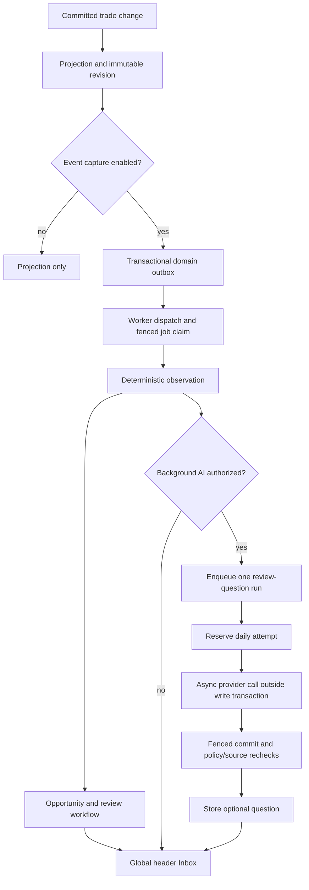

# Intelligence onboarding

Intelligence turns committed trade revisions into deterministic observations and review workflows, with an optional provider-generated review question.

Use this entrypoint to:

- Follow a new trade change from capture to the Inbox.
- Run an isolated local walkthrough without production data.
- Find the owning layer before changing behavior.

For leases, replay, retention, backup, failure codes and recovery, use the [operations runbook](intelligence-operations.md).
For implementation history, use the [run summary](superpowers/reports/ai-native-journal-run-summary.md); it is not operating guidance.

## What runs without AI

An **observation** records deterministic facts derived from an immutable trade projection revision, including P&L, fees, status and timing quality.
Corrections supersede older active observations; removal invalidates them.
An **opportunity** records something the operator may review, with delivery, dismissal and expiry state.
A **workflow** records the review's state, commands and transitions rather than treating a card click as transient UI state.
These paths need no provider key and make no model call.

The global header's **Inbox** opens this experience on every journal page; it is not a separate reports-only feature.
Start a review from its observation, then act on the review card.
The optional **AI question** belongs to that observation and source revision, not to a free-running chat agent.
A generated question may already be stored before a review starts, but is served only on an actionable review waiting for the user.
No question is required to complete the deterministic review flow.



## Capture is not backfill

Manual trade changes use **user / live** provenance; broker synchronization uses **broker_sync / live**.
File imports use **import / historical**; system rebuilds use **system / maintenance**.
Do not describe a newly imported old fill as a live broker event.
Historical seeding is a separate current-state operation, not a replay of past live activity.

`JOURNAL_EVENT_CAPTURE` is off by default.
Only trimmed, case-insensitive `1`, `true` or `on` enable capture.
With capture off, reconciliation still writes trade revisions but does not append their change events or outbox rows.
Enabling capture does **not** manufacture events for revisions already committed.
Create a new change after enabling it; restarting alone does not backfill missing events.

## Optional question contract

Background AI is a separate opt-in, with approved accounts and a pinned provider, model and endpoint configuration.
Configuring an interactive AI provider alone does not grant background consent.
Authorization and source/opportunity liveness are checked before sending and again before storing an answer.

- At most **10 attempts per journal per UTC day** are reserved durably **before** a provider request.
- Failed requests still consume their reservation; retries can consume further attempts.
- One business key identifies the review-insight run for a capability version, account and source revision; duplicate delivery does not create a new run for that key.
- The transport makes one request per invocation, without its own retry loop; durable job retries are separate.
- No write transaction remains open while waiting for the provider.
- Worker/job fences reject stale completion. A returned answer is not permission to commit after ownership or policy changes.
- The stored question is hidden when its observation, account or evidence revision no longer matches the current review.
- Inbox GETs read stored state: they neither call a provider nor reserve/spend an attempt.

Evidence sent for this capability is bounded structured trade data: symbol, direction, status, currency, net P&L, fees, duration and timing quality.
Run diagnostics retain execution metadata, not prompts, answer text or credentials; the question itself is stored separately as an insight.
The card masks the question in privacy mode. Masking is display behavior, not a revocation of earlier provider disclosure.
Output validation accepts a trimmed nonempty string of at most 2,000 characters.
That does **not** prove factual accuracy, relevance, or even that the text is phrased as a question; review generated text critically.

## Isolated local walkthrough

Run from the workspace root with installed dependencies and the repository's supported Node/pnpm versions.
Use synthetic trades only. Do not point this walkthrough at an existing journal directory or broker account.
The root build delegates to `web`; its build packages the worker and standalone supervisor.
The direct packaged command below avoids ambiguity about forwarding arguments through nested pnpm scripts.

```powershell
$env:JOURNAL_DATA_DIR = Join-Path $env:TEMP ('journal-onboarding-' + [guid]::NewGuid())
$env:JOURNAL_EVENT_CAPTURE = '1'
pnpm build
node apps/web/.next/standalone/apps/web/scripts/run-journal.mjs --mode production --host 127.0.0.1 --port 3007 --worker enabled
```

1. Open `http://127.0.0.1:3007` and create/select a synthetic account.
2. In Settings, configure your real supported provider and credentials through the AI settings UI. Never invent a provider or paste a fake generated answer into storage.
3. In **Background AI**, explicitly enable background use, opt in the synthetic account, review the declared capabilities/context limit, and save.
4. Create a **new manual trade** through the journal UI (or its supported manual-entry API). Use a synthetic symbol/fills, not a file import or live broker sync.
5. Open the global header **Inbox**, wait for the deterministic observation, and start its review.
6. If the provider call succeeds and the evidence remains current, the waiting review card displays **AI question**. Otherwise the deterministic review remains usable.

To try the provider-free path, skip steps 2–3. Expect observations and reviews, not an AI question.
Reloading the Inbox is safe; it does not trigger generation.
Stop the supervisor with Ctrl+C when finished; retain the isolated directory only if needed for inspection.

## Worker switches and shared storage

The supervisor's `--worker enabled|disabled` controls whether it forks a worker and overwrites the child's `JOURNAL_WORKER_ENABLED` with `1` or `0`.
Its default is **enabled in production**, **disabled in dev**; an inherited worker environment value does not override that CLI/default decision.
The standalone worker entrypoint behaves differently: only `JOURNAL_WORKER_ENABLED=0` disables it; unset means enabled.
`pnpm dev` starts Next directly, not the supervisor; do not assume it starts a worker.

HTTP and worker must use the **same absolute `JOURNAL_DATA_DIR`**.
The supervisor passes one explicit directory to both children; the worker refuses a relative path.
This directory owns the SQLite journal and related local state, not merely a cache.
Use the runbook before operating on an existing journal, launching workers separately, or moving storage.

## First diagnosis

- **No events:** check capture in the HTTP process, then make a new manual change. Capture enabled after the change is too late for that revision.
- **Outbox/backlog not moving:** confirm a worker was launched against the same directory; inspect supervisor/worker output and lease state using the runbook.
- **No AI question:** check saved Background AI consent/account opt-in, configured provider, pinned configuration and daily reservations. Provider errors need not remove the observation.
- **Question stored but hidden:** start the observation review; confirm it is waiting for the user and still references the current revision. Check privacy mode before diagnosing missing text.
- **Worker status unclear:** the web status route returns `worker: null`; that is not proof the standalone worker is stopped. Read its process health output.

Do not replay events, delete rows or reset knowledge merely to make a card appear. Use the runbook's scoped diagnosis and recovery procedures.

## Source map by responsibility

Links below are the current implementation entrypoints, not the historical architecture audit.

- **Contracts:** [observations](../apps/web/src/server/intelligence/contracts/observations.ts), [insights](../apps/web/src/server/intelligence/contracts/insights.ts), [policy](../apps/web/src/server/intelligence/contracts/policy.ts), [jobs](../apps/web/src/server/intelligence/contracts/jobs.ts), [experience](../apps/web/src/server/intelligence/contracts/experience.ts).
- **Infrastructure:** [worker](../apps/web/src/server/intelligence/infrastructure/worker.ts), [outbox](../apps/web/src/server/intelligence/infrastructure/outbox.ts), [jobs/fences](../apps/web/src/server/intelligence/infrastructure/jobs.ts), [knowledge store](../apps/web/src/server/intelligence/infrastructure/knowledge-store.ts), [insight store](../apps/web/src/server/intelligence/infrastructure/insight-store.ts), [provider transport](../apps/web/src/server/intelligence/infrastructure/review-transport.ts).
- **Runtime:** [review enqueue](../apps/web/src/server/intelligence/runtime/review-enqueue.ts), [prepare/commit capability job](../apps/web/src/server/intelligence/runtime/capability-job.ts), [model authorization](../apps/web/src/server/intelligence/runtime/model-policy.ts), [review capability](../apps/web/src/server/intelligence/runtime/review-insight.ts).
- **Experience:** [opportunity producer](../apps/web/src/server/intelligence/experience/producer.ts), [engagement policy](../apps/web/src/server/intelligence/experience/engagement.ts), [commands](../apps/web/src/server/intelligence/experience/commands.ts), [workflows](../apps/web/src/server/intelligence/experience/workflows.ts).
- **Composition/processes:** [single wiring point](../apps/web/src/server/intelligence/composition.ts), [worker entry](../apps/web/src/server/intelligence/worker-entry.ts), [supervisor](../apps/web/scripts/run-journal.mjs), [web scripts](../apps/web/package.json).
- **API/read model:** [observation GET/review POST](../apps/web/src/app/api/intelligence/observations/route.ts), [queries](../apps/web/src/app/api/intelligence/queries.ts), [intelligence routes](../apps/web/src/app/api/intelligence/).
- **UI:** [global shell/Inbox mount](../apps/web/src/components/shell.tsx), [Inbox](../apps/web/src/components/intelligence/inbox.tsx), [review card/privacy](../apps/web/src/components/intelligence/interaction-card.tsx), [controls](../apps/web/src/components/intelligence/controls.tsx).
- **Trading/events:** [command provenance](../apps/web/src/server/trading/commands.ts), [reconciliation/capture](../apps/web/src/server/trading/reconcile.ts), [event schema](../apps/web/src/server/domain-events.ts), [transactional event store](../apps/web/src/server/domain-event-store.ts).
- **DB:** [schema](../apps/web/src/db/schema.ts), [migrations](../apps/web/src/db/migrations/), [connection/data directory](../apps/web/src/db/connection.ts).

Sibling intelligence domains exchange contracts; composition wires concrete adapters.
Keep trading's event append path independent of intelligence orchestration.
The [boundary tests](../apps/web/tests/intelligence-boundaries.test.ts) enforce import direction rather than relying on these notes alone.

## Focused checks when changing this path

These are developer references, not prerequisites for every onboarding session.
Run only the checks relevant to your change, from the workspace root:

```powershell
pnpm exec vitest run apps/web/tests/intelligence-boundaries.test.ts
pnpm exec vitest run apps/web/tests/intelligence-observations.test.ts
pnpm exec vitest run apps/web/tests/intelligence-review-insight.test.ts
pnpm exec vitest run apps/web/tests/intelligence-insight-card.test.ts
```

For packaged-process behavior, see [supervisor tests](../apps/web/tests/intelligence-supervisor.test.ts) and [packaging tests](../apps/web/tests/intelligence-packaging.test.ts).
For operational procedures and exact refusal-code locations, return to the [runbook](intelligence-operations.md).

Contract guide v1.
