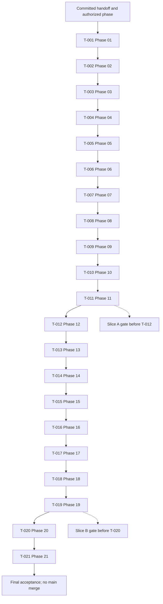

# Dependency graph and execution waves

The 21 ownership units match the existing phase boundaries after checking coupling: each owns a coherent storage, mutation, lifecycle, policy or presentation contract. Splitting every file would duplicate schema/composition ownership. Combining phases would violate bounded review stops. Although original detailed Task 4 permits independent review of Task 3, the later normative phase guide serializes migrations and reviewed integrations; this package does not override that decision for speculative speed.

Critical path is T-001 through T-021, including every phase integration gate. No duration estimates are invented. Each W-NN contains T-NNN and exits only after review, local merge and post-merge verification. Waves are eligibility boundaries, not permission to automatically execute the next phase.

| Wave | Task                    | Required predecessor | Conditional parallel work                                                                                                                                  |
| ---- | ----------------------- | -------------------- | ---------------------------------------------------------------------------------------------------------------------------------------------------------- |
| W-01 | [T-001](tasks/T-001.md) | G-BOOTSTRAP          | After connection/error exports are settled, import-graph guards and lifecycle tests may run in separate task worktrees.                                    |
| W-02 | [T-002](tasks/T-002.md) | T-001                | One owner for registry/schema/checksum changes; documentation can run independently after the migration contract is fixed.                                 |
| W-03 | [T-003](tasks/T-003.md) | T-002                | Pure canonicalization and identity fixtures can split after types are committed; only one schema/migration owner.                                          |
| W-04 | [T-004](tasks/T-004.md) | T-003                | Outbox and job adapters may split only after common schemas/claim contracts land; worker integration is dependent.                                         |
| W-05 | [T-005](tasks/T-005.md) | T-004                | Keep shared ingestion/rebuild ownership serial; independent test fixtures may run separately.                                                              |
| W-06 | [T-006](tasks/T-006.md) | T-005                | SDK/IBKR, cTrader, and NinjaTrader adapters can use independent worktrees with exclusive files; one controller owns shared import route edits.             |
| W-07 | [T-007](tasks/T-007.md) | T-006                | Route families can split after command interfaces land; one owner for shared commands and purge implementation.                                            |
| W-08 | [T-008](tasks/T-008.md) | T-007                | Pure evaluator and cTrader quality adapter may split after shared evidence contracts are fixed; persistence owns schema.                                   |
| W-09 | [T-009](tasks/T-009.md) | T-008                | Replay and seed tests can split after checkpoint/handler interfaces land.                                                                                  |
| W-10 | [T-010](tasks/T-010.md) | T-009                | Supervisor lifecycle and bundling/Docker work can split with an agreed artifact/IPC contract; shared package scripts have one owner.                       |
| W-11 | [T-011](tasks/T-011.md) | T-010                | Rust lifecycle and packaging smoke fixtures can split once IPC/artifact contract is stable; do not duplicate native builds concurrently.                   |
| W-12 | [T-012](tasks/T-012.md) | T-011                | Registry and tool gateway can split after shared context/types land; no duplicated edits to ai.ts.                                                         |
| W-13 | [T-013](tasks/T-013.md) | T-012                | Policy storage and runtime cancellation adapter may split after interfaces land; settings route/UI remain under one task owner.                            |
| W-14 | [T-014](tasks/T-014.md) | T-013                | Source route families can split after union/store contracts land; one domain-event/schema owner.                                                           |
| W-15 | [T-015](tasks/T-015.md) | T-014                | Time-trigger and condition-trigger fixtures may split against a fixed schedule API; one scheduler implementation owner.                                    |
| W-16 | [T-016](tasks/T-016.md) | T-015                | Pure transition reducer and repository tests can split after workflow state contracts land; schema/command store has one owner.                            |
| W-17 | [T-017](tasks/T-017.md) | T-016                | Pure policy and persistence tests may split after inputs/decisions are fixed.                                                                              |
| W-18 | [T-018](tasks/T-018.md) | T-017                | Read endpoints and command endpoints may split after common DTO/auth helpers land; one owner for shared composition and origin policy.                     |
| W-19 | [T-019](tasks/T-019.md) | T-018                | Inbox and settings controls can split with distinct files; one integration owner for shell/settings page and end-to-end flow.                              |
| W-20 | [T-020](tasks/T-020.md) | T-019                | Backup tooling/docs and retention logic may split after deletion/backup contracts land; never share a database fixture.                                    |
| W-21 | [T-021](tasks/T-021.md) | T-020                | Read-only artifact audit, benchmarks and target-specific smoke may run separately with isolated builds/data/ports; feature integration remains serialized. |

Recommended initial concurrency: one implementation OMP. A read-only reviewer may inspect a pinned commit independently. Later allow at most two disjoint writers within a phase after a committed ownership split. These are conditional child work units, not initially dispatchable tasks; coordinator must register their native dependencies before dispatch. Schema/registry/composition integration stays serial. Do not run a reviewer against a moving working tree or let parallel tests share DB files/build output.
