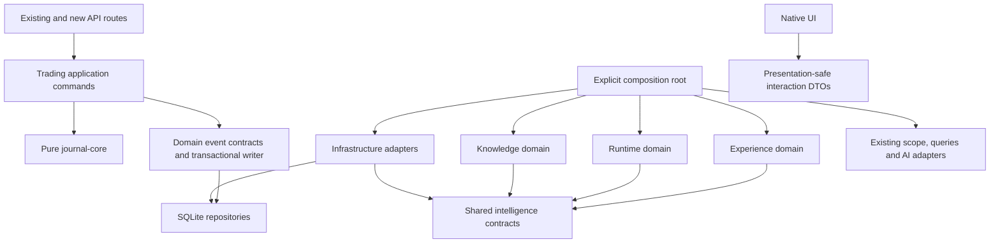

# AI-Native Journal — Architecture Contract Review

**Date:** 2026-10-22  
**Status:** Proposed; source validation complete, production approval pending.  
**Baseline:** `e45707b158d21f2e63439c20f25c550f51079b17`, including the existing working-tree discovery inputs.  
**Target:** [Architecture design](2026-10-22-ai-native-journal-architecture-design.md).  
**Execution:** [Milestone plan](../plans/2026-10-22-ai-native-journal-modernization.md).

**2026-10-23 handoff amendment:** The [phase guide](../plans/2026-10-23-ai-native-journal-phases.md)
subdivides execution for another agent. Its phase stops and migration sequence are normative.
Phase 02 delivers the versioned runner and legacy baseline without intelligence tables;
later schema migrations accompany their owning phases. Future schema changes use that same
runner. No implementation is performed as part of this handoff revision.

## 1. Recommendation and verified module mapping

Keep a modular monolith, the current calculation engine, SQLite, and existing AI adapters.
Introduce transaction-aware reconciliation and durable processing before generalizing AI.
The first released capability records a factual trade projection observation, without calling
a provider. This proves recovery and invalidation without introducing a coaching methodology.

Source citations below are repository-relative and identify symbols rather than fragile line
numbers. Verified means source-inspected; runtime verification is reported separately in §9.
The eleven numbered discovery reports, context synthesis, navigation map, and evidence register
were consulted for the relevant boundaries. They remain historical inputs, not executable contracts.

| Current source / symbol                                                                        | Verified behavior                                                                                                                                                   | Target / ownership                                                                                                                  |
| ---------------------------------------------------------------------------------------------- | ------------------------------------------------------------------------------------------------------------------------------------------------------------------- | ----------------------------------------------------------------------------------------------------------------------------------- |
| `packages/core/src/round-trips.ts`, `buildRoundTrips`                                          | Pure reconstruction; derived key; crossing-flat fills may belong to two cycles                                                                                      | Reuse unchanged; trading owns calculations and identity inputs                                                                      |
| `server/executions.ts`, `insertExecutions`                                                     | Synchronous transaction; validates, deduplicates, rebuilds, attaches notes; default deferred transaction                                                            | Keep public signature and `InsertResult`; add transaction-taking internal variant                                                   |
| `server/rebuild.ts`, `rebuildAccount`                                                          | Reads account, fills, settings, obsolete keys before its own write transaction; upserts computed columns only                                                       | Wrapper around `trading/reconcile.ts`; read, compare, persist, emit inside caller's immediate transaction                           |
| `server/sync.ts`                                                                               | Broker SDK fetch outside immediate transaction; IBKR guards inside; credential rotation separately persists                                                         | Preserve transport and output; call transaction-aware ingestion within existing outer transaction                                   |
| `server/ctrader-mcp/{sync,deals,order-history}.ts`                                             | Local MCP; latest 200 deals; synthetic entry fallback; nonfatal order history; snapshot and inserts atomic                                                          | Preserve ADR 0002; attach source-quality sidecar evidence; never expose MCP as model tools                                          |
| `api/import/route.ts`, `ninjatrader-import.ts`, `xtb-import.ts`, `ibkr-flex-xml-import.ts`     | Generic/AI-reviewed/IBKR/XTB commits converge on ingestion; NinjaTrader directly inserts and corrects fees under immediate tx; XTB preview reads persisted holdings | Revalidate storage-dependent checks during commit; preserve preview tokens, counts, warnings, source aliases and batch fingerprints |
| `api/accounts/[id]/{route,actions/route}.ts`, `api/settings/route.ts`                          | Method/multiplier changes rebuild; clear/delete bypass rebuild; transfer commits move before rebuild/annotation copy                                                | Explicit command boundary for all projection-affecting mutations, including both transfer accounts                                  |
| `db/{index,bootstrap,schema}.ts`                                                               | Singleton connection; shared bootstrap retries busy initialization and migrates under immediate lock                                                                | Retain bootstrap; add checksummed ordered migrations and a separate connection factory for worker                                   |
| `server/{ai,ai-scope,ai-capabilities,ai-report-context,ai-runtime,ai-contracts,ai-prompts}.ts` | Frozen request scopes, bounded read tools, provider-neutral nonstreaming runtime                                                                                    | Adapter migration; runtime domain receives scope/query/model ports from composition                                                 |
| `components/{ask-journal,ai-recap}.tsx`, `lib/use-ai-request.ts`                               | Existing JSON responses and stale-response protection                                                                                                               | Preserve; new interaction contracts render through native UI                                                                        |
| `apps/web/scripts/copy-static-build.js`, `Dockerfile`, `desktop/src-tauri/src/{server,lib}.rs` | Next standalone output copied into desktop; no durable worker; Rust process state ownership gap                                                                     | Explicit supervisor launches HTTP and worker children; copied runtime assets tested independently of checkout                       |
| `.github/workflows/release.yml`                                                                | Publishes recursively under `./packages/*`                                                                                                                          | Intelligence stays inside private `apps/web`; no new public package                                                                 |

All `server/`, `db/`, `api/`, `components/`, and `lib/` paths in this review refer to
`apps/web/src/` unless otherwise qualified.

### Reconciliation of stale or questionable claims

- `ARCHITECTURE_CONTEXT` §E incorrectly says ingestion is immediate and rebuild reads are
  inside its own transaction. Report 04 §6.4 is more accurate. Existing outer sync/NinjaTrader
  transactions do protect nested work; do not describe current insertion as universally non-atomic.
- The context's two-provider statements and report 02 adapter description are obsolete.
  `ai-runtime.ts:buildModel` supports Anthropic, OpenAI Responses, and compatible Chat Completions.
  There are three common tools plus the Reports-only fourth, not four plus one.
- `runTextAi` currently has no timeout/caller abort parameter. Ask/Reports have bounded loops;
  statement import accepts cancellation. Background work must add cancellation to the adapter,
  rather than assume every existing invocation is cancellable.
- Hosted statement-import fallback when compatible is selected already exists in
  `settings.ts:resolveAiImportConfiguration`. Preserve this explicit product policy; prohibit
  using it as a generic background fallback. Retain provider disclosure on import review.
- Migrations moved to `bootstrap.ts`; concurrent initialization already has regression coverage.
  Extend this mechanism instead of adding a competing migration runner.
- The synthesis says XTB requires an `xlsx` dependency. `packages/importers/src/xlsx.ts`
  implements ZIP/XML reading without that dependency; package manifests confirm it.
- `import_batches` is not a universal event ledger: NinjaTrader writes it. Do not use its
  fingerprint as ingestion idempotency for every broker or import type.
- Tauri passes `PORT=0`; the inspected local generated standalone server uses
  `parseInt(PORT, 10) || 3000`. This artifact corroborates the risk, not a fresh build result.
  `start_server` also allocates a new state instead of filling the app-managed state.
- The target's generic `status: closed` must map to persisted `win|loss|breakeven` versus `open`;
  closure detection uses `openQuantity`/`closedAt`, not a nonexistent stored `closed` enum.
- Readiness-report suggestions for an in-memory event emitter, raw prompt logs, and mandatory
  streaming are rejected: none satisfies the target's durability/privacy/presentation contracts.

## 2. Dependency contract

Arrows mean permitted imports, not event flow. New domains must not import sibling private
repositories. Shared contracts contain typed data/ports, no DB singleton, Next, React, or AI SDK.



Use `server/intelligence/{contracts,infrastructure,knowledge,runtime,experience}` plus
`server/intelligence/composition.ts`. Trading remains at `server/trading/`; event types belong
to `server/domain-events.ts`, and persistence to `server/domain-event-store.ts`, so trading
does not depend on intelligence runtime. Knowledge's pure evaluator receives a versioned
projection snapshot; infrastructure owns SQLite adapters for every domain's storage port.
`lib/intelligence-interactions.ts` contains only public DTOs; clients never import server contracts.

Extract `RequestError`/`requireValue` into `server/request-error.ts` and re-export from `api.ts`
before bundling worker adapters. Current domain helpers import Next transitively via `api.ts`.
This is a compatibility-preserving dependency correction, not a new HTTP abstraction.

## 3. Minimum interfaces

These are target contracts, not claims that these APIs exist today. Concrete payloads use strict
Zod schemas with discriminated unions; `unknown` appears only at parsing boundaries. Synchronous
transaction callbacks must reject Promise-returning work by both types and a runtime guard.

```ts
// db/transaction.ts; derives the real Drizzle transaction type, not JournalDb.
type JournalTx = Parameters<Parameters<JournalDb["transaction"]>[0]>[0];
type ChangeContext = Readonly<{
  operationId: string;
  origin: "user" | "broker_sync" | "import" | "system" | "workflow";
  mode: "live" | "historical" | "maintenance";
  recordedAt: string; // commit-operation time, never broker close time
}>;
type ReconcileResult = Readonly<{
  discovered: number;
  opened: number;
  closed: number;
  revised: number;
  removed: number;
  unchanged: number;
  ambiguous: number;
}>;
// Trading composition functions; implementations receive the event store by composition.
declare function reconcileAccountInTx(
  tx: JournalTx,
  accountId: string,
  context: ChangeContext,
): ReconcileResult;
declare function insertExecutionsInTx(
  tx: JournalTx,
  accountId: string,
  rows: ImportedExecution[],
  source: ExecutionSource,
  context: ChangeContext,
  manualNotes?: string,
  options?: { preserveFees?: boolean },
): InsertResult;

type TradeChanged = Readonly<{
  id: string;
  type: "trade.projection_changed";
  schemaVersion: 1;
  aggregate: { type: "trade"; id: string; revision: number };
  correlationId: string;
  causationId?: string;
  origin: ChangeContext["origin"];
  recordedAt: string;
  occurredAt?: string;
  payload: {
    accountId: string;
    tradeKey: string;
    kind: "discovered" | "opened" | "closed" | "revised" | "removed";
    mode: ChangeContext["mode"];
    projectionRevisionId: string;
  };
}>;
type TimingQuality = "source_reported" | "reconstructed" | "unknown";
type TradeProjectionEvidence = Readonly<{
  revisionId: string;
  tradeId: string;
  revision: number;
  accountId: string;
  tradeKey: string;
  currency: string;
  status: "open" | "win" | "loss" | "breakeven";
  netPnl: number;
  fees: number;
  openQuantity: number;
  openedAt: string;
  closedAt: string | null;
  timingQuality: TimingQuality;
  durationMs: number | null;
  identityResolution: "exact_key" | "explicit_transfer" | "new" | "ambiguous";
}>;
type ObservationResult =
  | { kind: "trade_projection"; evidence: TradeProjectionEvidence }
  | { kind: "insufficient_evidence"; reason: "ambiguous_identity" | "source_removed" };
declare function evaluateTradeProjection(source: TradeProjectionEvidence): ObservationResult;

type JobClaim = Readonly<{ jobId: string; owner: string; fence: number; leaseUntil: number }>;
interface WorkerHandle {
  stop(): Promise<void>;
}
// Infra supplies clock, repositories and registered handlers at composition time.
interface WorkerService {
  start(signal: AbortSignal): Promise<WorkerHandle>;
}
```

Runtime's `ExecutionContext` contains an execution ID, correlation ID, trusted principal
(`interactive` or `system`), validated account IDs/filter snapshot, timezone, data-source
allowlist, allowed capability/tool IDs, time/token/tool-call budgets, and AbortSignal.
Only composition can construct it. Background scope is reconstructed from persisted policy
and reauthorized at execution; event JSON never grants permission. Missing/deleted accounts
cancel work rather than widening scope. Interactive legacy `{filters:{}}` remains an explicit
all-account request; a background job always stores concrete account IDs.

`CapabilityRegistry` maps `(id, version)` to input/output schemas, deterministic eligibility,
mode, required model features, tool IDs, instruction loader, and `execute(input, context)`.
Eligibility is `eligible | defer(until) | ineligible(reason)`; outcomes are
`completed | insufficient_evidence | unavailable | cancelled | failed` with validated payloads.
`ToolGateway.execute(id, input, context)` checks strict input/output schemas, scope, access
category, budget, cancellation, and permitted tool IDs before invoking a supplied domain port.
The AI SDK adapter exposes only that approved registry subset. No SQL, credentials, arbitrary
HTTP, or cTrader tools are registered. No new authoritative trading-write tool is in scope.

## 4. Transaction, identity, and event consistency

### Mutation boundary

Fetch/parse externally first. Then enter one `BEGIN IMMEDIATE` transaction: revalidate account
and storage-dependent preconditions; mutate executions/settings; read prior projections;
reconstruct through core; compare; write projections, identity revisions, outbox events; apply
existing note rules and sync/import bookkeeping; commit. No network, Promise, worker invocation,
or provider call inside this callback. Internal helpers use `tx` for every read and write.

Public wrappers keep their old signatures/results. Known outer-transaction callers migrate
to `*InTx` functions. A direct `rebuildAccount` wrapper opens the full transaction before reads.
Nested transactions currently roll back successfully; the refactor must preserve that behavior,
not pretend existing savepoints are separate commits.

The exhaustive integration set is ingestion, NinjaTrader corrections, single/bulk execution
deletion, account clear/delete/transfer, profit-method and multiplier rebuilds, and demo loading.
Annotation/rule/journal/playbook writes receive their own versioned source-change events later,
before any capability depends on them. Do not masquerade annotation changes as financial changes.
Account transfer moves, reconciles both sides, and copies only unambiguous annotations atomically.
Account clear emits removal tombstones; account deletion cancels/purges account intelligence in
the deleting transaction so queued work cannot resurrect private records.

Fingerprint every computed field currently persisted by rebuild, including normalized exit
attribution and execution membership; include evidence quality/currency where intelligence
semantics change. Exclude labels, balance, notes, formatting, fetch timestamps, and sync snapshots.
Canonicalize JSON ordering. Same fingerprint means no revision/event. Price/fee/method changes
can revise a projection even when trade key and total P&L are unchanged. Broker fee correction
support does not magically appear: existing hash dedup omits fee, and only existing authorized
correction paths (notably NinjaTrader) mutate fills.

### Identity decision

Keep `trades.key` and all current URLs unchanged. A separate immutable `tradeId` has monotonic
revisions and a current key mapping. Same active key retains its ID. Removal ends that mapping;
if the same key reappears later, allocate a new ID so old conclusions do not revive silently.
Explicit account transfer may retain identity only when a unique full execution-membership match
is established within that transaction. No fuzzy matching by symbol/time/P&L or shared execution
overlap: crossing-flat fills make that unsound. Other rekeys allocate new IDs, tombstone old IDs,
and store an ambiguity/supersession link. Preserve candidate evidence, not inferred continuity.

Annotations survive unchanged keys. On ambiguous transfer, reject the transfer before any
write with an actionable conflict; do not silently drop or overwrite annotations. Ordinary
historical reconstruction retains current behavior for obsolete keys; broader annotation
recovery is a separate product change, with ambiguity visible in intelligence diagnostics.

### Classification and evidence

New closed projection = `discovered`, even during live sync. New open projection in live mode
= `opened`; historical/baseline open projection = `discovered`. A known open cycle becoming
closed = `closed`, with `mode: historical` suppressing live engagement for a historical upload.
Other changes, including reopening, = `revised`; disappearance = `removed`.

Snapshot a bounded factual projection in a revision record within the mutation transaction.
Keep execution membership in normalized rows (not an unbounded event array). Outbox payloads
hold revision references, not raw broker data. Consumers read that immutable revision, never
reinterpret an old event using whatever trade happens to exist now.

cTrader `synthetic:open:` IDs prove reconstruction, not reliable timing. Introduce
`execution_evidence` sidecar rows without changing hashes or import metadata. New mapping can
label order-history-derived opening times as reconstructed and missing opening times unknown.
Legacy synthetic entries remain unknown; no heuristic upgrade from nonzero duration. A quality
upgrade can create a revision without modifying financial facts. The first observation stores
duration only for source-reported timing; otherwise null with an explicit quality reason.

### Durable storage and uniqueness

All new operational timestamps are UTC epoch milliseconds; event/source ISO dates retain their
existing representation. UUIDs identify new durable entities. JSON payloads are schema-versioned,
strict, and capped at 16 KiB per event/job; larger membership is normalized. No raw prompts.

| Table                        | Key constraints / indexes                                                                                                      | Responsibility                                                            |
| ---------------------------- | ------------------------------------------------------------------------------------------------------------------------------ | ------------------------------------------------------------------------- |
| `journal_migrations`         | PK version, name, checksum, applied_at                                                                                         | Ordered app-owned migrations; mismatch/future version fails before writes |
| `trade_identities`           | PK id, account_id, current_key nullable, revision, state; unique current_key where nonnull                                     | Active mapping and tombstone; no FK to ephemeral trade key                |
| `trade_projection_revisions` | PK id; unique(trade_id, revision); account_id index; fingerprint, bounded snapshot, resolution                                 | Immutable factual evidence                                                |
| `trade_revision_executions`  | PK(revision_id, execution_id)                                                                                                  | Membership survives source deletion until explicit purge                  |
| `trade_identity_links`       | PK(old_id, new_id, operation_id), reason                                                                                       | Explicit transfer/rekey ambiguity provenance                              |
| `execution_evidence`         | PK execution_id, timing quality, source kind, evidence version                                                                 | Separate source quality; does not alter ingestion dedup                   |
| `domain_outbox`              | PK id; unique(aggregate_type, aggregate_id, aggregate_revision, type); dispatch index(dispatched_at, recorded_at, id)          | Committed changes; dispatched_at marks durable fanout only                |
| `event_deliveries`           | PK(event_id, handler_id, handler_version); state/job_id                                                                        | Per-handler delivery, terminal diagnostics                                |
| `intelligence_jobs`          | PK id; unique idempotency_key; indexes(status, available_at, id), (status, lease_until); owner/fence/attempts/cancel_requested | Atomic claims and retry state                                             |
| `intelligence_observations`  | PK id; unique(subject_id, source_revision, evaluator_id, evaluator_version, type); index(subject_id, status)                   | Active/superseded/invalidated derived results                             |
| `observation_evidence`       | PK(observation_id, revision_id)                                                                                                | Source links; referenced evidence cannot be pruned                        |
| `intelligence_worker_lease`  | PK name; owner/fence/lease_until/heartbeat_at                                                                                  | One active worker per DB even after accidental double launch              |

Dispatch creates delivery rows and jobs and marks the outbox dispatched in one immediate
transaction. Handler registry is explicit; incompatible schema is terminal and inspectable.
New handler versions need explicit replay/backfill, not automatic replay of all history.
Use job key `eventId:handlerId:handlerVersion`. A crash before commit repeats fanout safely;
after commit the job exists. Job claim and completion are separate short transactions.

For deterministic processing, observation insert, revision-order invalidation, delivery success,
and job completion commit together, guarded by owner/fence and an unexpired lease. A stale worker
cannot commit. Older revisions processed late remain superseded; removal cannot be undone by a
delayed earlier job. A latest-revision check happens in the effect transaction, not before it.
AI may run more than once after crashes; only the persisted application effect is deduplicated.

## 5. Worker lifecycle and scheduling

Use an explicit Node supervisor (`apps/web/scripts/run-journal.mjs`) with an HTTP child and
a separately bundled worker child. This isolates synchronous SQLite/evaluator work from HTTP,
uses the same local DB, and avoids routes or Next build workers starting consumers. This is
process supervision, not a service requiring extra infrastructure. Initial concurrency is one.

Both children have IPC parent-liveness handling. On parent disconnect they abort and exit;
this prevents orphan workers/servers after Tauri kills the supervisor on Windows. The supervisor
handles SIGINT/SIGTERM, sends shutdown over IPC, stops claims, waits at most 10 seconds, then
terminates children. Every child closes its own DB handle; do not unlink WAL/SHM files. Startup
migration completes before claims. Worker faults degrade intelligence, not trading; restart with
bounded exponential delay, at most five crashes per ten minutes, then expose unhealthy status.
HTTP failure stops the worker and exits the supervisor. No infinite restart loop.

One worker lease: 30 seconds, renewal every 10 seconds. Job leases: 60 seconds with renewal
every 15 seconds for cancellable asynchronous work. Deterministic work is bounded and chunked
between jobs; completion checks expiry. Reclaim expired claims with an incremented fencing token.
Poll every 1 second when idle; claim one job; dispatch up to 100 events per transaction. Default
five attempts, backoff 1/5/30/120 seconds; validation/schema errors fail immediately. These are
initial engineering defaults, subject to measured tuning rather than claims of existing capacity.

Time schedules persist `next_due_at` and version; unique `(scheduleId, dueAt, version)` jobs make
restart safe. Condition schedules consume durable source changes and a persisted checkpoint.
Missed intervals coalesce to one catch-up job; historical replay cannot flood engagement.
Waiting for a person releases the worker and persists workflow state. Persist UTC instants;
user-local scheduling must use existing timezone helpers with explicit DST tests.

Deployments:

- Standalone/Docker: supervisor is entry point; worker bundle and native dependency are copied
  explicitly because Next tracing cannot discover an independently executed file. Docker keeps
  one container/volume/nonroot user. Both processes resolve the identical absolute data directory.
- Tauri: retain one managed supervisor handle in `SharedServerState` across start/restart/quit.
  Bind HTTP to `127.0.0.1`; pass an explicit nonzero allocated port with bounded collision retry
  (three attempts), since generated Next startup does not honor zero. Supervisor emits a single
  structured ready message only after HTTP readiness. Handle the reserve/release port race.
  The bundle must run with no checkout/node_modules access and with paths containing spaces.
- Development: explicit `dev:journal` supervisor command; ordinary `pnpm dev` may remain web-only
  with an observable worker-disabled state. Hot reload never starts extra workers. Build and
  typecheck never start workers. Node minimum stays 22; verify the actual bundled sidecar ABI.

The worker bundle must not import `next/headers`, routes, or React. Runtime adapters that
currently reach DB/settings globals are gradually injected; initial factual evaluation needs
only its independent connection, strict contracts, and pure evaluator.

## 6. Migration, rollback, deletion, and budgets

Keep existing bootstrap/legacy repairs; add a version table and ordered migrations inside its
existing immediate transaction, with an initial baseline marker after legacy convergence.
Check for unsupported future versions before running legacy/schema writes. Mirror final DDL
in `schema.ts`/`BOOTSTRAP_SQL`; test fresh and upgrade databases for equivalent tables/indexes.
Migration SQL runs synchronously; failures roll back version advancement. No rewrite of keys,
execution hashes, credentials, or imported financial data.

Back up before rollout: stop HTTP/worker writers and copy the complete data directory, including
encryption material and attachments; alternatively use SQLite's backup API and separately copy
key/files under a coordinated quiescence window. Never copy only a live WAL database file.
Verify restore in scratch storage with integrity and foreign-key checks and credential decryption
using synthetic credentials. No experiment reads or mutates live trader data.

Seed existing trades as historical baseline observations in bounded account batches, with a
durable account cursor and current-revision check. Never mark baseline as a new live closure.
If a real mutation arrives first, seed skips already mapped identities. Large-account rebuilding
remains synchronous for correctness; benchmark 1k/10k/100k synthetic fills before release.
If lock time is unacceptable, defer rollout and design snapshot-plus-CAS reconstruction; do not
move reads outside the transaction without a revision guard.

Feature controls: worker enabled separately from event recording; background AI defaults off;
proactive delivery defaults off. Once event recording starts, disabling a worker preserves the
backlog. Disabling capture or running an older binary requires a subsequent baseline reconcile;
do not resume an apparently continuous event stream across an unrecorded interval.

Rollback means stop worker and deploy the prior application with additive tables retained, or
restore the verified full backup if incompatible source changes occurred. An older binary lacks
new version guards, so operator instructions must prevent it from writing concurrently. Do not
drop tables as an automatic downgrade. Record and reconcile any writes made during rollback.

Default retention: keep active observations and referenced evidence; prune unreferenced terminal
jobs/deliveries/outbox after 30 days, diagnostics after 30 days, superseded/invalidated unreferenced
knowledge after 90 days. Keep unresolved failures until acknowledged. Preserve compact effect
dedup keys while any replay source remains. Account deletion purges its payloads, knowledge,
conversations and opportunities, cancelling leased work under the same fence. Clear-history
invalidates evidence; explicit intelligence reset purges it and suppresses automatic reseeding
until the user requests rebuild. No deletion resurrected by retry/backfill.

Background AI has opt-in policy per account and pinned provider/model/endpoint fingerprint;
reauthorize settings on every attempt. Configuration change yields unavailable/cancelled until
explicitly rescheduled, never silent rerouting. Initial caps: 30 seconds, four steps/tools,
1,200 output tokens and zero automatic provider retries, maximum 10 background attempts/day
per journal. Reserve the daily allowance transactionally before network use; crashes consume
the reservation conservatively. A fresh queue retry consumes another allowance. Record minimal
metadata, not prompts/responses/keys. Input context must be bounded and model feature requirements
explicitly configured; unsupported tools/structured outputs return unavailable. Existing
interactive policy constants and import behavior remain compatible.

## 7. Risk register and remaining uncertainties

| Risk                                               | Severity               | Mitigation / release evidence                                                                                                          |
| -------------------------------------------------- | ---------------------- | -------------------------------------------------------------------------------------------------------------------------------------- |
| Missed mutation paths or partial transfer          | High                   | Enumerated caller matrix; failure injection in every command; compare before/after financial rows                                      |
| Wrong identity after split/merge/rekey             | High                   | Exact key or proven explicit transfer only; ambiguity test with crossing-flat membership                                               |
| False duration/closure claims from cTrader         | High                   | Separate quality rows, null unsupported duration, historical suppression; fake-MCP regression                                          |
| Stale worker after lease takeover                  | High                   | Fenced completion/renewal and current-revision checks with two real SQLite connections                                                 |
| Background data leaves local provider              | High                   | Endpoint-bound configuration, opt-in, no generic fallback, routing/cancellation tests                                                  |
| Worker imports Next or bundle misses native module | High                   | Independent bundle and clean-directory smoke on Node 22 and shipped Windows sidecar                                                    |
| Desktop orphan or wrong port                       | High                   | Shared child ownership, IPC disconnect handling, repeated restart/quit and collision tests                                             |
| SQLite write contention                            | High                   | Bounded work and benchmark gate; no measured performance claim yet                                                                     |
| Account purge races with AI completion             | High                   | Scope recheck plus tombstone/purge fencing at completion; no late resurrection                                                         |
| Database initializer removes WAL sidecars          | High                   | Worker never imports hot-reload singleton; remove manual unlink behavior before multi-process release                                  |
| Raw errors leak through `api.ts`                   | Medium                 | New routes sanitize unexpected exceptions; preserve legacy success contracts; security gate for automation                             |
| CSRF/user endpoint misuse                          | High before automation | Same-origin checks on new interaction/settings writes, loopback binding, endpoint credentials never in payloads; test malicious origin |
| Public package leakage                             | Medium                 | No new package; dependency/import and release-target checks                                                                            |

Unverified here: real Pepperstone network behavior, live model capability support, Docker build,
fresh Tauri build/ABI, 100k-fill contention and forced process-kill recovery. These are explicit
milestone gates, not reasons to claim the architecture is production-proven. Source inspection
and mocked tests do not establish them.

## 8. Required ADRs and finalized milestone order

Existing ADRs 0001/0002 retain broker boundaries; 0003–0005 retain native UI conventions.
New records are **Proposed**, with decisions awaiting this review's approval:

- [0006](../../decisions/0006-transactional-trade-events-and-identity.md): transaction ownership,
  meaningful events, immutable intelligence identity and ambiguity.
- [0007](../../decisions/0007-durable-sqlite-worker-and-migrations.md): SQLite outbox/jobs,
  fenced worker, explicit supervision, ordered additive migrations.
- [0008](../../decisions/0008-scoped-intelligence-and-provider-compatibility.md): internal modules,
  evidence lifecycle, scope gateway, provider routing, workflows and presentation boundaries.

| Milestone | Independently reviewable result                                                 | Depends on                   |
| --------- | ------------------------------------------------------------------------------- | ---------------------------- |
| M0        | Baseline, import guards, transaction/DB seams and migration tests               | Approved design/plan         |
| M1        | Durable outbox/jobs and supervised worker                                       | M0                           |
| M2        | Every projection mutation participates in reconciliation                        | M1                           |
| M3        | Persistent factual observations, invalidation, historical seed; Slice A passes  | M2; no AI prerequisite       |
| M4        | Scoped capability/tool gateway around existing AI                               | Slice A approved as verified |
| M5        | Durable workflows, controlled opportunities, correction/interaction UI; Slice B | M4                           |
| M6        | Packaging, privacy/deletion, recovery, performance and operations gates         | M5                           |

Do packaging feasibility in M1, not only M6. M6 repeats it against the complete artifact.
Book content, live trading, generic third-party plugins, distributed queues, vector storage,
multi-tenancy and generative component execution remain excluded.

## 9. Validation performed

2026-10-22: existing targeted suite **18 files / 220 tests passed** (25.76 s, Node 24.20.0).
Covered execution storage/rollback, concurrent bootstrap, all cTrader-MCP tests, AI runtime/scope/
settings, NinjaTrader, XTB, IBKR Flex XML and sync resilience. No application code changed.
Tests use temporary directories and mocked transports (the MCP client test uses loopback).

`pnpm` initially could not bootstrap pinned 11.0.8 because registry DNS was unavailable.
The installed Vitest CLI was used directly. Sandbox realpath restrictions prevented its first
run from collecting tests; the same command outside the sandbox passed:

```text
node node_modules/vitest/vitest.mjs run apps/web/tests/execution-storage.test.ts apps/web/tests/db-concurrent-init.test.ts apps/web/tests/ctrader-mcp apps/web/tests/ai-runtime.test.ts apps/web/tests/ai-scope.test.ts apps/web/tests/ai-settings.test.ts apps/web/tests/ninjatrader-import.test.ts apps/web/tests/xtb-import.test.ts apps/web/tests/ibkr-flex-xml-import.test.ts apps/web/tests/sync-resilience.test.ts
```

Full CI/builds were not run for this documentation deliverable. The milestone plan requires
them before shipping; historical discovery-suite counts are not reused as current evidence.
